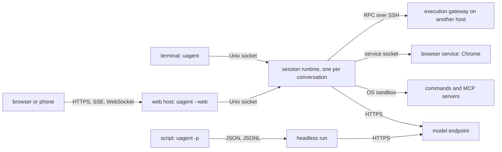
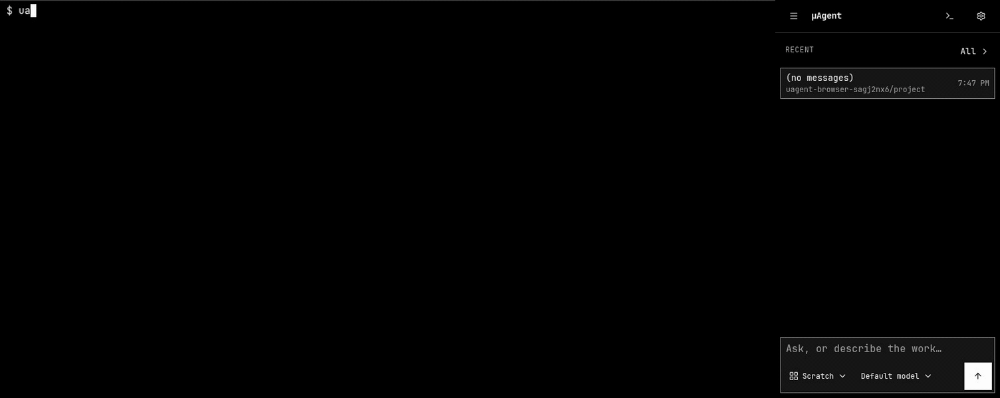

# µAgent

[](https://github.com/timongentzsch/uAgent/actions/workflows/ci.yml)
[](LICENSE)

A coding agent you can account for. One native C++20 executable is the agent
runtime, the web host its browser and phone clients connect to, and the
execution gateway it starts on other machines over SSH. By default it
contacts the model endpoint you configure and nothing else: conversations,
settings and credentials stay on one machine you own, and there is no µAgent
account, relay or telemetry. [Every other contact is
listed](SECURITY.md#what-leaves-the-machine), and a test holds the source to
that list.

## Process model



A conversation is one runtime process, whichever client started it; the
terminal and paired browsers attach to it and detach without stopping it. The
gateway executes file, Git, command and terminal operations and holds no
settings, history or provider keys.
[Architecture](docs/architecture/overview.md) has each process and channel.

## Properties

| | |
| --- | --- |
| Code | about 74k lines of C++20; the web client, about 43k lines of TypeScript and CSS, is embedded in the binary |
| Size | binary 6.6–10.8 MB; complete installation 19–23 MB with the web client, skills and three gateway payloads |
| Footprint | 27.1 MiB idle, 29 ms CPU per headless turn ([measured 2026-11-18](benchmarks/README.md#footprint-comparison)) |
| First request | 14 tools and their instructions in 3,305 tokens ([measured 2026-11-18](benchmarks/README.md#outside-contacts-and-first-request)) |
| Outside contacts | the configured model endpoint; updates, push and Auto review at another provider only when turned on ([recorded 2026-11-18](benchmarks/README.md#outside-contacts-and-first-request)) |
| Model APIs | OpenAI Chat Completions, OpenAI Responses, Anthropic Messages |
| Sandbox | Seatbelt on macOS, Landlock on Linux, on in every approval mode |
| Runtime dependencies | libcurl, zlib, the C++ runtime and, on Linux, OpenSSL 3; no language runtime, no plugin loader |
| Platforms | Linux x86_64 and ARM64 (glibc 2.38 or newer), macOS 15 or newer on Apple silicon |
| Tests | native unit and integration suites against mock providers, Chromium and WebKit, sanitizers, fuzzers, clang-tidy |


Sizes are of the 1.9.0 archives.
[Versions, raw results and method](benchmarks/README.md).

## Compared with Claude Code and OpenCode

Measured on 2026-11-18 with µAgent 1.10.1, Claude Code 2.1.327 and OpenCode
1.19.6, except the two rows from each project's own documentation.

| | µAgent | Claude Code | OpenCode |
| --- | --- | --- | --- |
| Hosts asked for during one headless turn, besides the model endpoint | none | `api.anthropic.com` | `models.opencode.ai`, `registry.npmjs.org` |
| A phone or second device attaches to | your own web host, after pairing | Anthropic's API, which stores the transcript while connected (its docs) | your own server |
| OS sandbox for the agent's commands | on in every approval mode | off by default (its docs) | none (its SECURITY.md) |
| First request, tools and instructions | 3,305 tokens | 11,509 | 6,904 |
| Idle memory | 27 MiB | 161 MiB | 585 MiB |

Both do things µAgent does not: Claude Code has cloud sessions, IDE and
desktop apps and a plugin ecosystem; OpenCode has more providers built in,
LSP integration and desktop and IDE clients. On five small fix tasks with a
small GPT model, OpenCode needed fewer model calls than µAgent.
[Method and raw results](benchmarks/README.md#outside-contacts-and-first-request).

## Design decisions

- **The main owns everything.** Provider requests, keys, settings, history and
  the agent loop run on one machine. A remote host receives execution requests,
  an authentication token and a sandbox preset, nothing else.
  [Execution gateway](docs/architecture/execution-gateway.md)
- **One binary, three roles.** No server-side language runtime and no
  dynamically loaded plugins; the web client ships inside the executable.
  [Overview](docs/architecture/overview.md)
- **The OS confines commands.** The approval mode decides who is asked; the
  sandbox decides what a command can reach, and no mode turns it off.
  [Sandbox](docs/architecture/sandbox.md) · [Security](SECURITY.md)
- **Configuration is described once.** One registry yields the flags,
  `/config`, the web's settings and the
  [generated reference](docs/interfaces/settings.md).
- **Pages cannot reach the app.** Decks, documents, sheets and designs the
  agent writes render in opaque-origin frames from a capability address; a
  sheet calculates in a worker of its own page.
  [Artifacts](docs/architecture/artifacts.md)
- **A turn survives its client.** A conversation's runtime is a process of
  its own: a closed tab, a detached terminal or a restarted web host does not
  end the turn. [Sessions](docs/architecture/sessions.md)

## Interfaces

| Contract | Specification |
| --- | --- |
| Flags and slash commands | [interfaces/cli.md](docs/interfaces/cli.md) |
| Settings, defaults, scopes | [interfaces/settings.md](docs/interfaces/settings.md) |
| Headless runs: `-p`, `--json`, `--json-stream`, `--control` | [interfaces/headless.md](docs/interfaces/headless.md) |
| HTTP API, event stream, terminal and viewer sockets | [interfaces/http-api.md](docs/interfaces/http-api.md) |
| Tool schemas as a model is sent them | [interfaces/tool-schemas.md](docs/interfaces/tool-schemas.md) |
| Files under `~/.uagent` | [interfaces/on-disk.md](docs/interfaces/on-disk.md) |
| Artifact formats | [interfaces/artifact-formats.md](docs/interfaces/artifact-formats.md) |
| Fixed limits | [interfaces/limits.md](docs/interfaces/limits.md) |

## Build and verify

```sh
(cd web && npm ci && npm run build)
cmake --preset debug
cmake --build --preset debug --parallel
ctest --preset debug --output-on-failure
```

The suite needs no API key or network. [Testing](docs/testing.md) covers the
browser tests, sanitizers and the behavioural evaluation;
[Contributing](CONTRIBUTING.md) the conventions and the release.

## Install

```sh
curl -fsSL https://raw.githubusercontent.com/timongentzsch/uAgent/master/install.sh | sh
```

The installer offers a local install or a container, then asks for a provider.
`uagent` starts a conversation in the current folder; `uagent --web` prints a
pairing link for a browser or phone.
[Install and update](docs/operations/install.md) ·
[Container](docs/operations/container.md) ·
[Remote access](docs/operations/remote-access.md)

## In use




Recorded from the running client with a scripted model. The
[manual](docs/manual.md) covers what each control does.

## Documentation

| Section | Holds |
| --- | --- |
| [Architecture](docs/architecture/overview.md) | one page per subsystem: turn loop, providers, tools, sandbox, sessions, web host, web client, execution gateway, browser, artifacts, memory and schedules |
| [Interfaces](docs/README.md#interfaces) | the contracts above |
| [Operations](docs/README.md#operations) | install, container, remote access, budgets and recovery |
| [Manual](docs/manual.md) | the terminal and web clients |
| [Security](SECURITY.md) | threat model and boundaries |
| [Changelog](CHANGELOG.md) | what changed, by release |
