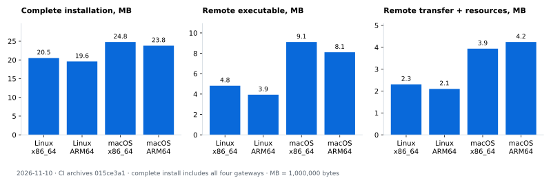
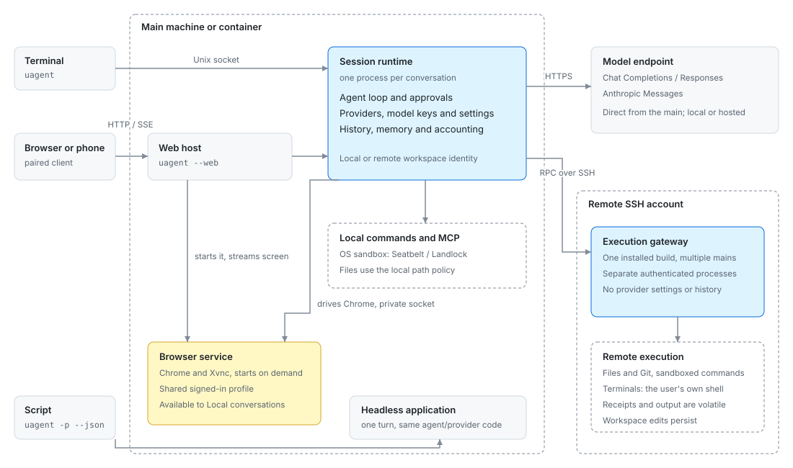
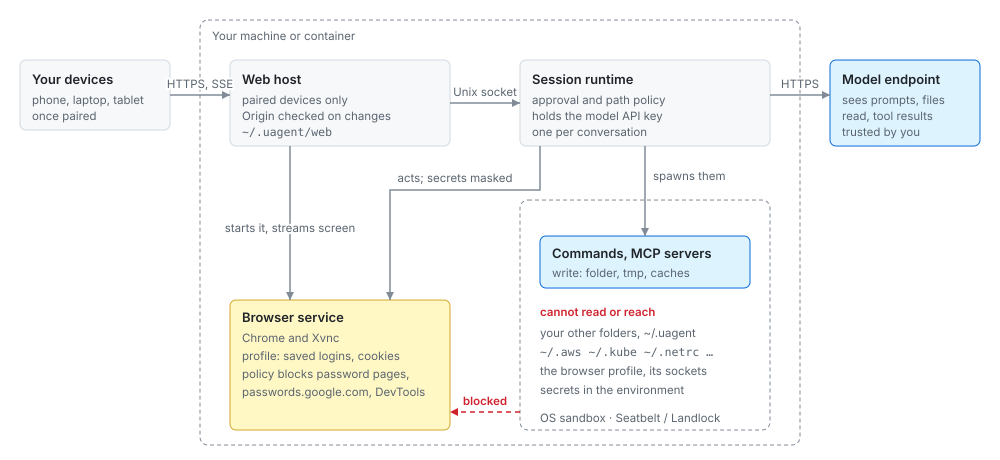
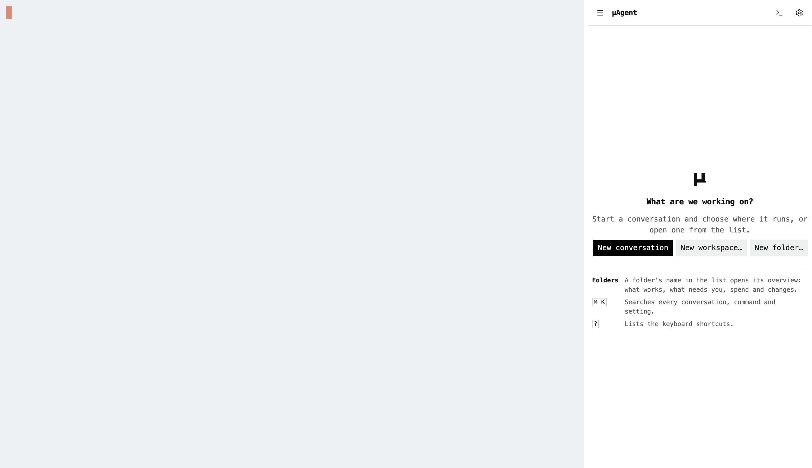
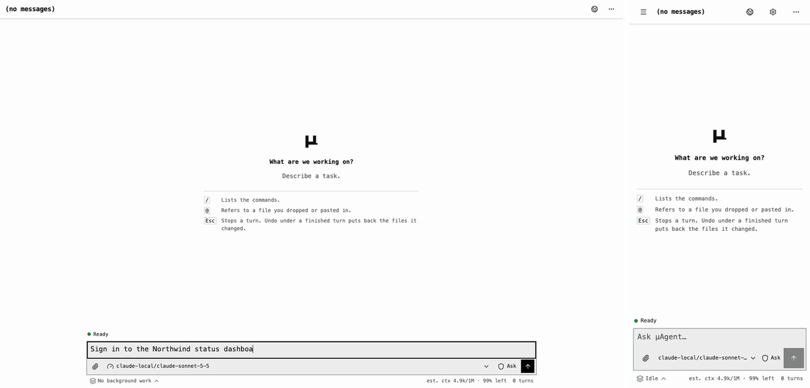

# µAgent

[](https://github.com/timongentzsch/uAgent/actions/workflows/ci.yml)
[](LICENSE)

µAgent is a native coding agent sandboxed to your project folder. It
keeps one conversation across terminal, script and phone, and drives a real
Chrome that you can watch and take over.



Complete installations are 19.6–24.8 MB; a remote gateway executable is
3.9–9.1 MB, transferred with its resources in 2.1–4.2 MB. Measured from the
four-platform CI archives on 2026-11-10; MB means 1,000,000 bytes.
[Benchmarks](benchmarks/README.md#current-measurements) records the build,
raw measurements and local performance results. The older competitor comparison
is retained there as a dated historical measurement.

## Built to be light

- **One C++20 binary,** no runtime to install. Each conversation is one
  process; the terminal and the web host attach to it over a Unix socket.
  Complete installations also carry four compressed native gateways, so a
  remote host needs no compiler or download.
- **The web interface is embedded,** with optional renderers loaded on demand,
  compressed API responses and resumable event streams. `npm run size` in
  `web/` reports the current bundle and first-load sizes.
- **Chrome starts only when the agent first uses it,** and stops on request.
- **Fewer tokens:** the prompt cache serves 77–94% of input on both OpenAI and
  Anthropic routes, compaction reads the cached conversation instead of
  resending it, and a browser result for the page just seen carries only what
  changed.



## What it does

- **Drives a real browser, without seeing your passwords.** A persistent
  Chrome profile that you watch and take over from any paired device. Sign-ins
  come from Chrome's password manager: the agent asks Chrome to fill the saved
  login and learns only whether the field was filled. It cannot type into a
  password field or read what one holds, screenshots draw passwords as dots,
  Chrome's password pages are blocked, and sandboxed commands cannot open the
  profile. Codes, captchas and payments are handed to you. See
  [the agent's browser](docs/BROWSER.md#isolation).
- **Stays in its folder.** Commands run under the OS sandbox (Seatbelt on
  macOS, Landlock on Linux): they write only inside the folder, your other
  folders stay closed, cloud and git credential stores (`~/.aws`, `~/.kube`,
  `~/.netrc`, …) stay hidden, and the agent asks before it changes a file,
  runs a command or uses the network. In yolo, commands may also read
  anywhere and write your home folder, never `~/.uagent` or the credential
  stores. `/undo` restores what the last turn changed. See
  [Security](SECURITY.md).
- **One conversation, every device.** Start in the terminal, continue on your
  phone (an installable web app with notifications), or run a turn from a
  script with `uagent -p "..." --json`.
- **Local or remote files.** Add an SSH host, then choose it when creating a
  conversation or opening a folder. The main keeps providers, keys, settings
  and history; a shared remote gateway runs files, Git, commands and terminals.
  See [remote hosts](docs/REMOTE_HOSTS.md) for setup and current limits.
- **Works in parallel.** A conversation starts agents, conversations of
  their own that research or change code and report back, listed beneath it;
  a folder's overview shows what works, what needs you, spend and changes.
- **Remembers and repeats.** Memory, skills, scheduled tasks and MCP servers,
  managed from the terminal or the web.
- **Any endpoint.** Chat Completions, OpenAI Responses and Anthropic Messages,
  local or hosted.







## Install

Linux and macOS, in one line:

```sh
curl -fsSL https://raw.githubusercontent.com/timongentzsch/uAgent/master/install.sh | sh
```

It asks where µAgent should run, then for your OpenRouter, OpenAI and
Anthropic keys (any of them) and a default model:

- **In a container** (recommended where Docker runs): the published image
  with the web interface, the agent's browser and the terminal, isolated from
  this machine's files and logins. It sees only the folder you give it
  (`~/uagent-workspaces`), keeps its keys on its own volume and starts with
  Docker.
- **Here:** the release for Linux x86_64 or arm64 with glibc 2.38 or newer
  (Ubuntu 24.04, Debian 13, Fedora 39, Arch and later) or macOS 15 or newer on
  Apple silicon or Intel, checked against its checksum and that it starts, and
  installed under `~/.local` with its skills; it
  offers to put `~/.local/bin` on your `PATH` and to keep the web interface
  running as a service that starts when you log in (systemd or launchd). On
  Linux it can include the agent's browser; on macOS that runs only in the
  container. Older systems (Ubuntu 22.04, Debian 12, RHEL 9), musl
  distributions and other machines build from source instead, or
  run the container.

Run the same line again to update. `UAGENT_INSTALL=container|here` chooses
without asking, `UAGENT_VERSION=1.6.0` installs that release,
`UAGENT_PREFIX` installs elsewhere than `~/.local`, and without a terminal (or
with `UAGENT_NONINTERACTIVE=1`) it asks nothing. To remove the service:
`systemctl --user disable --now uagent-web` (Linux) or `launchctl bootout
gui/$(id -u)/com.github.timongentzsch.uagent.web` (macOS), then delete its
unit or plist.

From a checkout, `./install.sh` does the same with that checkout: it builds
the image or the binary itself. Releases ship archives (`bin/uagent`; keep
`bin` and `share` together) with Sigstore-signed checksums, and the image as
`ghcr.io/timongentzsch/uagent`.

Building needs CMake 3.21+, a C++20 compiler, libcurl 7.66+, zlib and
Node.js for the web interface. `-DUAGENT_WEB_PUSH=ON` adds Web Push (needs
OpenSSL 3). A source installation also needs the matching four-platform remote
bundle; [remote installation](docs/REMOTE_HOSTS.md#installers-and-containers)
explains supplying it or explicitly choosing a local-only developer install.

## Quick start

```sh
uagent setup    # API keys and a default model; the installer runs it once
cd my-project
uagent          # Enter sends, Esc stops, / lists commands
```

A start with no provider asks to run setup. `UAGENT_PROVIDERS` and
`UAGENT_MODEL` work without saving anything.

- **Approvals:** answer `y` (once), `s` (this conversation), `a` (always in
  this repository) or `n`.
- **Models:** `/model QUERY` searches what your key offers; add `--default`
  to keep it.
- **Come back:** `/quit` leaves it running; `uagent -c` continues the latest.
- **Phone:** `uagent --web` prints a pairing link.
- **The folder at a glance:** `/overview`, or the folder's name in the web.

The [guide](docs/GUIDE.md) covers the rest in order; `uagent --help` lists
every flag.

## Documentation

[Guide](docs/GUIDE.md) ·
[Web interface](docs/WEB.md) ·
[The agent's browser](docs/BROWSER.md) ·
[Tools](docs/TOOLS.md) ·
[Memory, skills and schedules](docs/MANAGEMENT.md) ·
[Skills](skills/README.md) ·
[Operations](docs/OPERATIONS.md) ·
[Remote hosts](docs/REMOTE_HOSTS.md) ·
[Persistence](docs/PERSISTENCE.md) ·
[Accessibility](docs/ACCESSIBILITY.md) ·
[Security](SECURITY.md) ·
[Architecture](docs/ARCHITECTURE.md) ·
[Prompt caching](docs/CACHING.md) ·
[Changelog](CHANGELOG.md)

## Development

The tests need no API key or network: C++ unit tests, Python integration
tests against a mock provider and Playwright browser tests, run in CI on
Linux and macOS on x86_64 and arm64 with sanitizers and clang-tidy.
[Contributing](CONTRIBUTING.md) covers building and checks;
[Testing](docs/TESTING.md) covers running one test.
