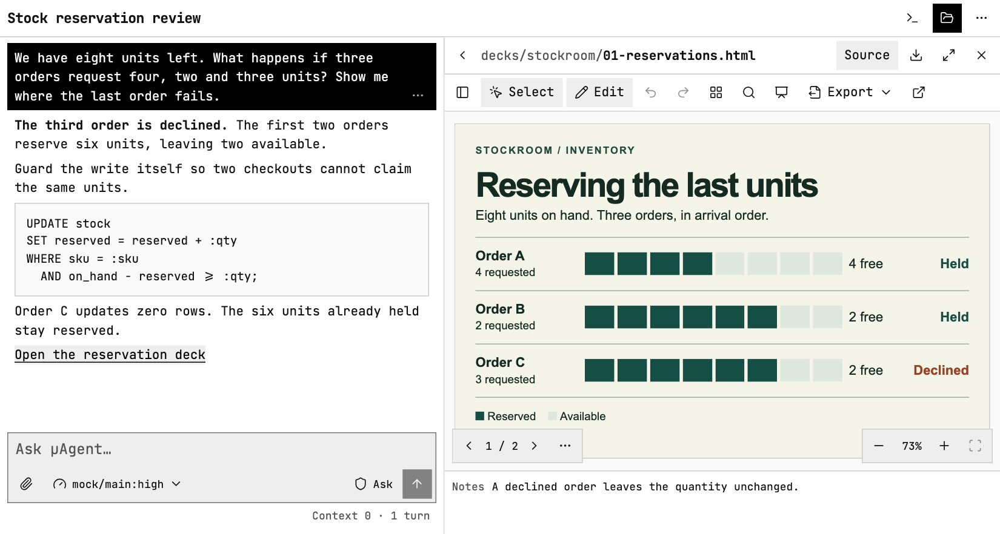

# µAgent

[](https://github.com/timongentzsch/uAgent/actions/workflows/ci.yml)
[](LICENSE)

µAgent is a native C++20 coding agent you run on your own host with the model provider you choose. Start a task in the terminal, follow it on your phone, and open the files it produces beside the conversation.



*A sample inventory review in the v1.12 web client. The two-slide deck is an editable workspace file.*

## What you can do

- **Pick your model.** Connect OpenAI, Anthropic, OpenRouter or a compatible local endpoint. Switch models per conversation. The runtime speaks OpenAI Responses, Chat Completions and Anthropic Messages. [Provider setup](docs/manual.md#models-and-providers)
- **Follow a turn across devices in real time.** Replies, tool calls and approval requests update in the terminal and on paired browsers. Start work at your desk, approve a tool call from your phone and reconnect later. An always-on host keeps the turn running when you close a client. [Pair a device](docs/operations/remote-access.md#pair-a-device)
- **Work over SSH with your API keys on one host.** The host keeps the transcript, chooses the model and evaluates tool approvals. The remote worker receives the file, Git, shell or terminal operations it needs to execute. Their results return to the host and can become context for the model. [Remote workspaces](docs/architecture/execution-gateway.md) · [What leaves the machine](SECURITY.md#what-leaves-the-machine)
- **Use a signed-in Chrome browser.** On a Linux web host, watch the agent work in a persistent Chrome profile or give it a disposable browser for research. Chrome can fill a saved login while keeping the password out of the tool response. Take over from a paired device for sign-in or MFA, then hand the browser back. [Browser controls](docs/manual.md#the-agents-browser)
- **Edit artifacts beside the chat.** Open a slide deck, document, spreadsheet, design or whiteboard as a workspace file. Select a passage or slide element to ask for a change, edit it in place, or export the result. Documents support Markdown export, decks support PDF and sheets support Excel and CSV. [Artifact workflow](docs/manual.md#artifacts)

## Get started

```sh
curl -fsSL https://raw.githubusercontent.com/timongentzsch/uAgent/master/install.sh | sh
```

Run `uagent` in a project folder to open the terminal client, or `uagent --web` to pair a browser. Release packages support Linux (x86-64 and ARM64) and macOS on Apple silicon. The managed Chrome service is included in the Linux container. [Install and verify](docs/operations/install.md) · [Container setup](docs/operations/container.md) · [Release downloads](https://github.com/timongentzsch/uAgent/releases/latest)

## Footprint

One native executable contains the agent, terminal client and web UI. The v1.12 packages include the executable, resources and workers for all three SSH targets. In a five-run Linux ARM64 test, µAgent used 26.6 MiB of idle process-tree memory and 15.3 ms of local CPU per scripted one-word reply.

[Five-agent comparison and raw samples](benchmarks/README.md#footprint-comparison) · [Package sizes and method](benchmarks/README.md#current-measurements)

## Inside the project

[Process architecture](docs/architecture/overview.md) · [Security model](SECURITY.md) · [Build, test and contribute](CONTRIBUTING.md) · [Documentation](docs/README.md) · [Changelog](CHANGELOG.md)
