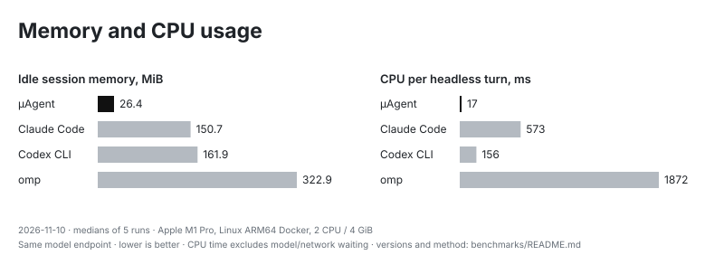

# µAgent

[](https://github.com/timongentzsch/uAgent/actions/workflows/ci.yml)
[](LICENSE)

A native coding agent with terminal and web interfaces.

Conversations can be accessed from the terminal, a desktop browser or a phone.
µAgent supports local and remote projects, multiple model providers, and
browser automation with manual takeover.

## Features

- **Shared conversations.** Continue in the terminal or web app;
  approve a step from your phone without starting over.
- **Browser automation.** Watch Chrome, take over when needed,
  and let its password manager fill saved logins without exposing their values
  to the agent.
- **Local and remote projects.** Choose an SSH host when starting work.
  Your main keeps conversations, settings and provider keys; the remote runs
  files, Git, commands and terminals.
- **Model providers.** Local or hosted endpoints using Chat Completions,
  OpenAI Responses or Anthropic Messages.
- **Parallel tasks.** Delegate tasks, review agent reports, and
  see progress, spend and changes in the folder overview.
- **Control over execution.** Project sandboxing, approval modes and undo.
  Skills, memory, MCP and schedules support recurring work.

## Resource use

A C++20 executable with its web interface embedded. No JavaScript runtime is
required to run µAgent. Chrome starts when browser work needs it.



The same small task, model endpoint and container limits. Five-run medians,
measured 2026-11-10: **26.4 MiB idle memory** and **17 ms CPU per headless turn**
for µAgent. This measures agent overhead, not model quality or response speed.
The Linux ARM64 complete installation is **19.6 MB**, including remote gateways.
[Versions, raw results and method](benchmarks/README.md#footprint-comparison).

## Get started

```sh
curl -fsSL https://raw.githubusercontent.com/timongentzsch/uAgent/master/install.sh | sh
```

Choose a local or container install, connect a provider, and open a project:

```sh
cd my-project
uagent
```

Use `uagent --web` to pair your browser or phone. Add an SSH host under
**Remote hosts**, then choose it when starting a conversation or opening a folder.

Linux and macOS, x86_64 and ARM64.
[Setup and platform requirements](docs/GUIDE.md) ·
[Remote hosts](docs/REMOTE_HOSTS.md)

## How it works

The main owns conversations and model access. Remote gateways provide execution.
Each conversation has its own process, and commands run within the configured
OS sandbox. Shared remote accounts retain their normal filesystem permissions.

[Architecture](docs/ARCHITECTURE.md) · [Security](SECURITY.md) ·
[Browser isolation](docs/BROWSER.md#isolation)

## Explore

[Guide](docs/GUIDE.md) · [Web interface](docs/WEB.md) ·
[Memory, skills and schedules](docs/MANAGEMENT.md) ·
[Operations](docs/OPERATIONS.md) · [Changelog](CHANGELOG.md)

## Development

C++20 and a Preact web interface, with native unit/integration tests and
Chromium/WebKit coverage. Tests use mock providers and need no API key.

[Contributing](CONTRIBUTING.md) · [Testing](docs/TESTING.md)
