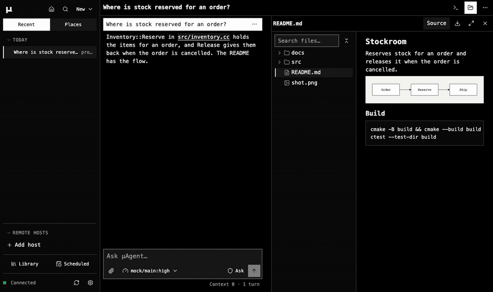
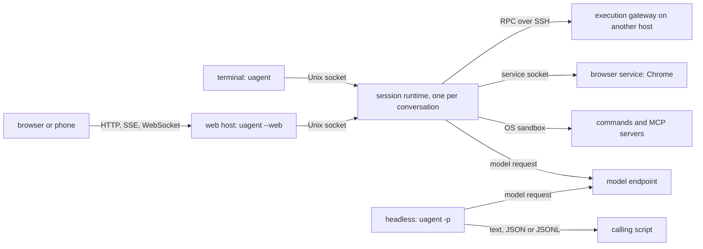

# µAgent

[](https://github.com/timongentzsch/uAgent/actions/workflows/ci.yml)
[](LICENSE)

µAgent is a self-hosted coding agent written in C++20. Start a conversation in
a terminal, follow the same turn from a browser or phone, and inspect the
files it produces beside the chat. The host can also run tools in a remote
workspace over SSH.

The host stores your transcript, settings and provider credentials. Each turn
sends conversation context to the model endpoint you configure. µAgent operates
without its own account or relay service. Network-capable tools and optional
services can contact other destinations.
[What leaves the machine](SECURITY.md#what-leaves-the-machine)

## Install

```sh
curl -fsSL https://raw.githubusercontent.com/timongentzsch/uAgent/master/install.sh | sh
```

The installer offers provider setup and, when Docker is available, a container
installation. Run `uagent` in a project folder to start a terminal session.
Run `uagent --web` for a local browser pairing link. For a phone, configure
a reachable origin using the remote-access guide.
[Release downloads](https://github.com/timongentzsch/uAgent/releases/latest) ·
[Verify a download](docs/operations/install.md#verify-a-release) ·
[Install and update](docs/operations/install.md) ·
[Container](docs/operations/container.md) ·
[Remote access](docs/operations/remote-access.md)

## In use



Both demos were recorded on v1.12 using a scripted model and a sample project.
The second shows a terminal and phone sharing one conversation. [Terminal and phone recording](docs/images/terminal.gif) ·
[User manual](docs/manual.md)

## Process model



An active interactive conversation has a runtime process that terminal and
paired browser clients can attach to. A turn continues after a client disconnects. The
web host serves HTTP directly and can sit behind an HTTPS reverse proxy. The
gateway executes file, Git, command and terminal operations and holds no
settings, history or provider keys.
[Architecture](docs/architecture/overview.md) has each process and channel.

## Properties

| Property | Details |
| --- | --- |
| Release size | 6.6–10.9 MB executable, 19.4–23.7 MB unpacked installation across the three 1.11.0 release targets. [Archive measurements](benchmarks/results/packages-2026-11-24.json) |
| Footprint | µAgent 1.11.0 used 27.3 MiB idle and 20.6 ms local CPU per one-word headless turn in the Linux ARM64 comparison. [Measurement, 2026-11-24](benchmarks/README.md#footprint-comparison) |
| First request | 13 tools in the fresh 1.11.0 release profile. Compact schemas plus system instructions count to 3,023 tokens with o200k_base. The historical benchmark serialization gives 3,479. [Measurement, 2026-11-24](benchmarks/README.md#current-measurements) |
| Outside contacts | The v1.11.0 default headless DNS probe observed only the configured endpoint hostname. Tools, SSH and optional services have their own network behavior. [Recorded scenarios](benchmarks/README.md#outside-contacts-and-first-request) |
| Model APIs | OpenAI Chat Completions, OpenAI Responses, Anthropic Messages |
| Command sandbox | Seatbelt on macOS and Landlock on Linux. Enabled by default independently of approval mode. [Platform limits and exceptions](SECURITY.md#sandboxing) |
| Runtime dependencies | libcurl, zlib, the C++ runtime and, on Linux, OpenSSL 3; no language runtime, no plugin loader |
| Platforms | Linux x86_64 and ARM64 (glibc 2.38 or newer), macOS 15 or newer on Apple silicon |
| Tests | native unit and integration suites against mock providers, Chromium and WebKit, sanitizers, fuzzers, clang-tidy |

## Compared with other coding agents


On 2026-11-24, five CLI releases ran against a loopback provider returning
the same one-word reply, with external networking disabled. All 25 headless
turns returned that reply. Claude Code 2.1.331 exited each interactive start
before the idle sample, so its idle memory is unavailable. The chart measures
local process work. Model inference and response quality require a different
workload. [Versions, raw samples and method](benchmarks/README.md#footprint-comparison)

| Documented behavior, reviewed 2026-11-24 | µAgent | Claude Code | OpenCode |
| --- | --- | --- | --- |
| A phone or second device connects to | a paired, self-hosted web server | Anthropic Remote Control, which stores the transcript while connected | a self-hosted server |
| OS sandbox for agent commands | enabled by default where supported | off by default | no built-in agent sandbox |

Claude Code also provides cloud sessions, IDE and desktop clients, and
plugins. OpenCode provides built-in LSP integration and desktop and IDE
clients. The benchmark report also includes DNS and tool-schema captures for
the specific versions measured.
[Method and raw results](benchmarks/README.md#outside-contacts-and-first-request) ·
[Claude Remote Control](https://code.claude.com/docs/en/remote-control#connection-and-security) ·
[Claude sandbox defaults](https://code.claude.com/docs/en/sandboxing#what-the-sandbox-restricts) ·
[OpenCode server](https://opencode.ai/docs/api) ·
[OpenCode security model](https://github.com/anomalyco/opencode/security/policy)

## Design decisions

- **Provider access stays on the host.** Provider requests, keys, settings, history and
  the agent loop run on one machine. An SSH target receives a matching gateway
  bundle, its authentication token and sandbox preset, then the data required
  for its execution requests.
  [Execution gateway](docs/architecture/execution-gateway.md)
- **The web client ships inside the executable.** The terminal, session runtime
  and web host share the native code. Optional tools run in separate processes.
  [Overview](docs/architecture/overview.md)
- **Approvals and sandboxing are separate.** The approval mode determines
  when a person is asked. The sandbox limits filesystem and network access.
  Explicit unsandboxed and root commands require approval.
  [Sandbox](docs/architecture/sandbox.md) · [Security](SECURITY.md)
- **Settings share one registry.** The same definitions power `/config`,
  the web settings and the
  [generated reference](docs/interfaces/settings.md).
- **Artifact previews run in isolated frames.** Decks, documents, sheets and designs the
  agent writes render in opaque-origin frames from a capability address; a
  sheet calculates in a worker of its own page.
  [Artifacts](docs/architecture/artifacts.md)
- **A turn survives its client.** A conversation's runtime is a process of
  its own: a closed tab, a detached terminal or a restarted web host does not
  end the turn. [Sessions](docs/architecture/sessions.md)

## Interfaces

| Contract | Specification |
| --- | --- |
| Flags and slash commands | [interfaces/cli.md](docs/interfaces/cli.md) |
| Settings, defaults, scopes | [interfaces/settings.md](docs/interfaces/settings.md) |
| Headless runs: `-p`, `--json`, `--json-stream`, `--control` | [interfaces/headless.md](docs/interfaces/headless.md) |
| HTTP API, event stream, terminal and viewer sockets | [interfaces/http-api.md](docs/interfaces/http-api.md) |
| Tool schemas as a model is sent them | [interfaces/tool-schemas.md](docs/interfaces/tool-schemas.md) |
| Files under `~/.uagent` | [interfaces/on-disk.md](docs/interfaces/on-disk.md) |
| Artifact formats | [interfaces/artifact-formats.md](docs/interfaces/artifact-formats.md) |
| Fixed limits | [interfaces/limits.md](docs/interfaces/limits.md) |

## Build and verify

A source build needs a C++20 compiler, CMake 3.21+, libcurl, zlib and OpenSSL 3.
CI builds the web client with Node.js 24 and npm. Install Python 3 to run the
native test suite. [Build prerequisites](docs/operations/install.md#platforms-and-the-loader-check)

```sh
(cd web && npm ci && npm run build)
cmake --preset debug
cmake --build --preset debug --parallel
ctest --preset debug --output-on-failure
```

With build dependencies installed, the default native suite uses local fixtures
and loopback connections. It needs no provider API key. [Testing](docs/testing.md) covers the
browser tests, sanitizers and the behavioural evaluation;
[Contributing](CONTRIBUTING.md) the conventions and the release.

## Documentation

| Section | Holds |
| --- | --- |
| [Architecture](docs/architecture/overview.md) | one page per subsystem: turn loop, providers, tools, sandbox, sessions, web host, web client, execution gateway, browser, artifacts, memory and schedules |
| [Interfaces](docs/README.md#interfaces) | the contracts above |
| [Operations](docs/README.md#operations) | install, container, remote access, budgets and recovery |
| [Manual](docs/manual.md) | the terminal and web clients |
| [Security](SECURITY.md) | threat model and boundaries |
| [Changelog](CHANGELOG.md) | what changed, by release |
