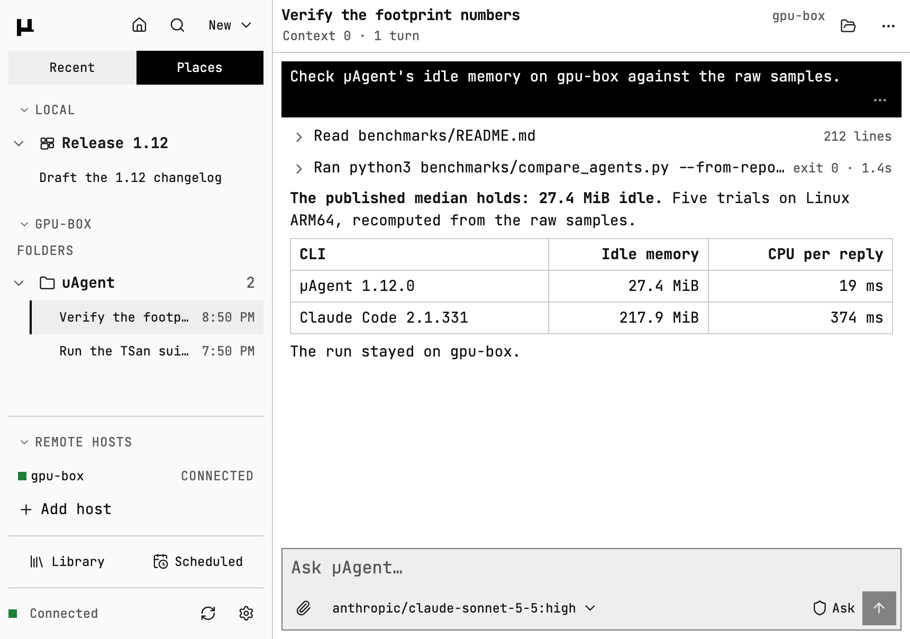
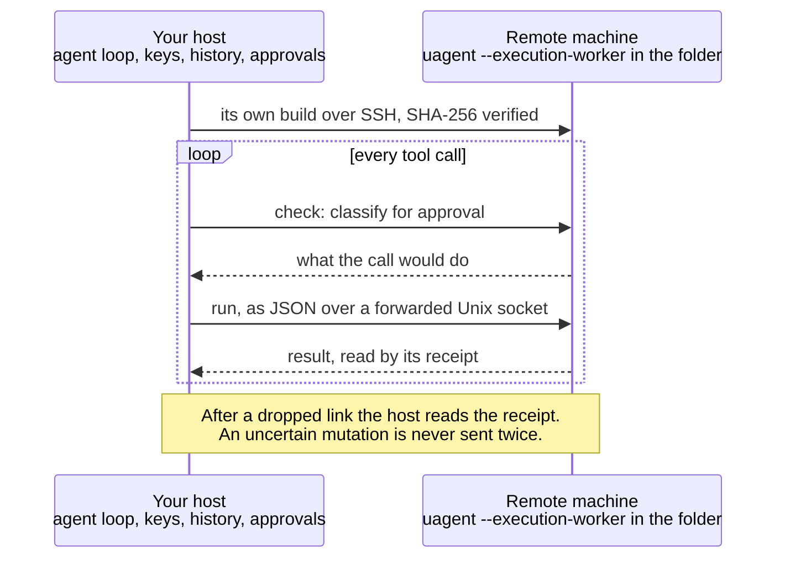
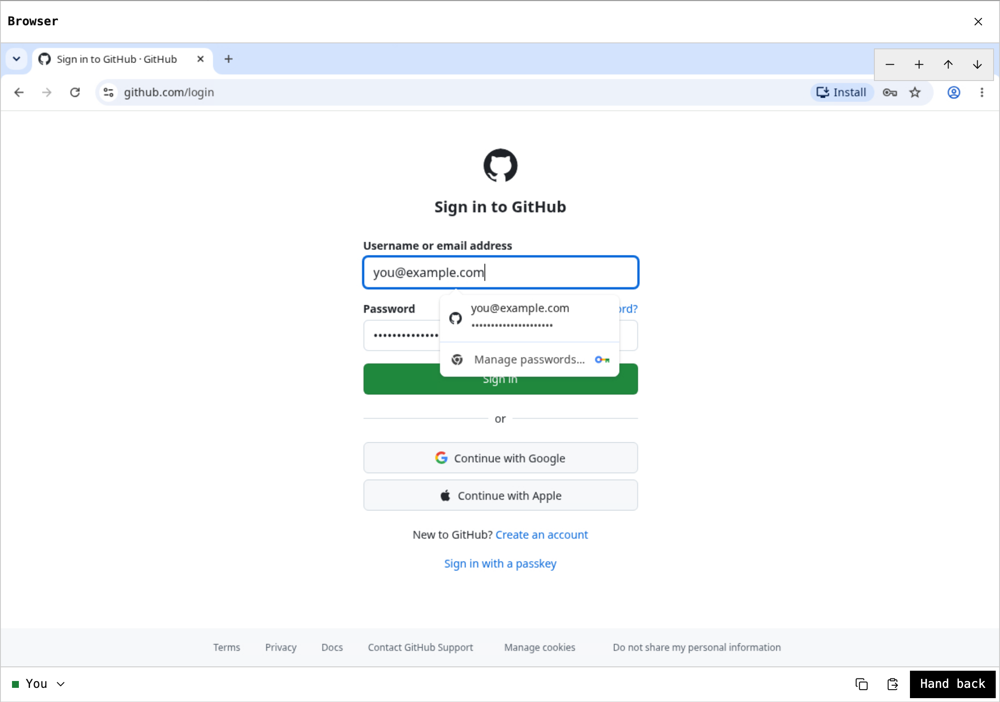
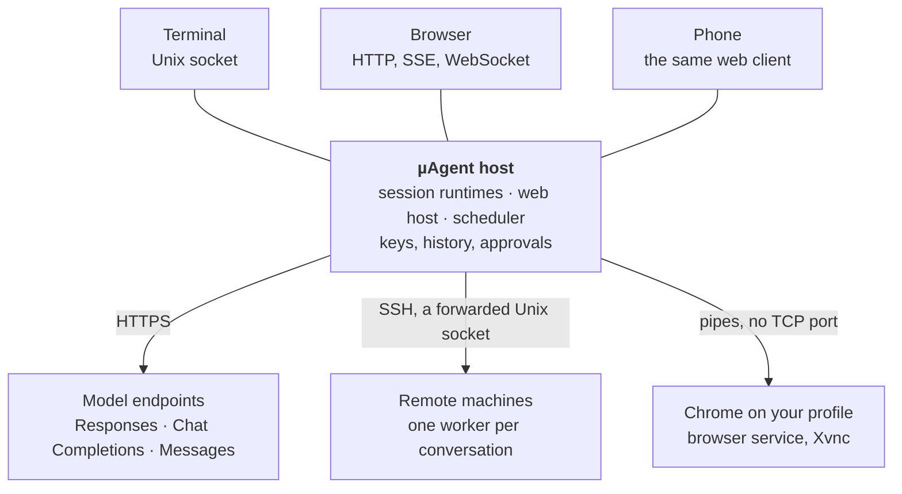
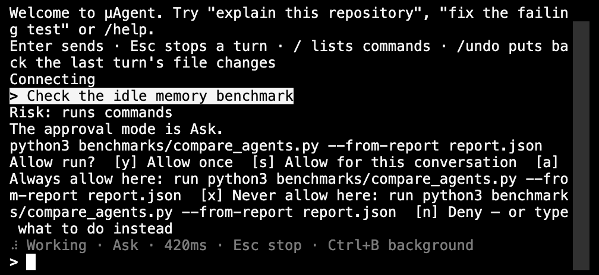
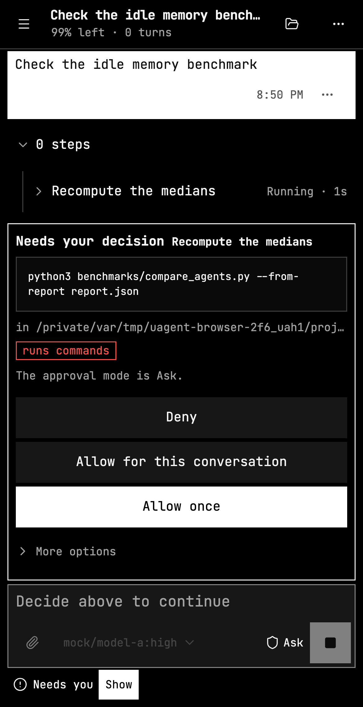

# µAgent

[](https://github.com/timongentzsch/uAgent/actions/workflows/ci.yml)
[](LICENSE)

µAgent is a coding agent built as one native C++20 executable. A long-lived host process on a machine you control runs every turn. It calls the model endpoint you configure, executes tools on any machine you reach over SSH and in a Chrome that carries your profile, and streams the same session to a terminal, a browser and a phone.

## Native remote

A conversation's execution host is fixed when it starts: Local, or a machine added by its SSH name. The agent loop stays on your host and its tools run on the remote.



The stills on this page are the v1.12 clients against a scripted provider; the Chrome one is the container's browser with one placeholder login saved in its profile. [How they are produced](docs/testing.md#web-tests)

- **One worker per conversation.** The host keeps one `ssh -M` master per machine and starts a `uagent --execution-worker` for each conversation, agent and terminal, in the remote folder and under that conversation's sandbox preset.
- **The same tools.** The built-in read, search, edit, patch, exec and terminal tools keep their schemas. The worker classifies each call for approval and executes it in the remote folder. Nothing is mounted or synced, and the Files pane and terminals of the web client work on the remote folder too.
- **Secrets stay on the host.** Provider requests, API keys, settings, history, memory and approval decisions never cross. The remote holds its changed files and the installed build.
- **No setup on the remote.** The host sends the payload of its own build over SSH and the remote verifies its SHA-256. It needs Linux with glibc 2.38 on x86-64 or ARM64, or macOS 15 on ARM64, and no compiler, root or download.
- **A dropped link is recoverable.** Commands and terminals keep running. After a reconnect the host reads each result by its receipt, and an uncertain mutation is never sent twice.



A remote conversation has no browser tool and no project MCP servers. [Connect a host](docs/operations/remote-access.md#connect-an-ssh-execution-host) · [Execution gateway: protocol, limits and failure modes](docs/architecture/execution-gateway.md) · [What a remote account may do](SECURITY.md)

## Chrome with your profile

On a Linux host the agent drives a real Chrome whose profile persists and can be signed in as you, so it works in your accounts without holding their passwords.



- **A real, persistent profile.** `uagent --browser-service` owns Chrome and its virtual display. The profile keeps cookies and saved logins across restarts. **Sign in to profile** restarts Chrome without the agent's control channel, so you can sign Chrome in to your Google account and turn on sync.
- **Logins are used, not read.** `fill_saved` has Chrome fill the focused field and returns only its length. `type` refuses password fields. Page text shows `(filled)` or `(empty)` for password, one-time-code and card fields, and a screenshot is taken only once password fields are drawn as dots.
- **No debugging port.** Chrome is driven over CDP on a pipe and the display is a Unix socket. No CDP or VNC TCP port exists. A managed policy blocks Chrome's password and autofill pages, `view-source:` and DevTools.
- **You connect over VNC.** The display is a VNC server on a Unix socket. The host relays it to the viewer built into the web app, so every paired device can watch the live screen with no VNC port and no VNC client. **Take over** gives that device the input and pauses the agent until **Done**. For a sign-in, MFA, captcha or payment the agent asks, and only the device that opened the request can finish it.
- **Disposable browsers for research.** Browser scheduling can give conversations 1, 2 or 4 research browsers whose profiles are reset between conversations.

[Browser controls](docs/manual.md#the-agents-browser) · [Browser service: processes, protocol and limits](docs/architecture/browser.md) · [What the profile exposes](SECURITY.md#browser-automation)

## One host, every client



<p>
  
  
</p>

- **Sessions outlive clients.** Each conversation is a session runtime that calls `setsid()` and keeps running after the client that started it exits, until `runtime.idleMinutes` pass with no turn, queued message, command or attached terminal.
- **Every client sees the same turn.** The terminal client attaches over a Unix socket; browsers and phones attach through the web host over HTTP, SSE and WebSocket. Replies, tool calls and approval requests stream to all of them, and any of them can answer an approval.
- **Pairing is explicit.** `uagent --web` prints a link whose code works once, for five minutes. [Pair a device](docs/operations/remote-access.md#pair-a-device) · [Process model](docs/architecture/overview.md)

## Any model

A provider is a base URL with a key. The runtime speaks OpenAI Responses, Chat Completions and Anthropic Messages, so OpenAI, Anthropic, OpenRouter and compatible local endpoints are reached directly. A model is selected per conversation as `[provider/]model[:effort]`; titles, memory extraction, image reading, web search and approval review have their own optional routes. [Models and providers](docs/manual.md#models-and-providers) · [Provider adapters](docs/architecture/providers.md) · [What leaves the machine](SECURITY.md#what-leaves-the-machine)

## Also on board

| Feature | Reference |
| --- | --- |
| Workspaces and folders, filed per host | [Conversations](docs/manual.md#conversations) |
| Approvals, rules, Auto review and the sandbox | [Approvals and plan mode](docs/manual.md#approvals-and-plan-mode) · [Sandbox](docs/architecture/sandbox.md) |
| Memory, skills and scheduled tasks | [Memory, skills and schedules](docs/manual.md#memory-skills-and-schedules) |
| Artifacts: documents, decks, sheets, designs and whiteboards, edited beside the conversation | [Artifacts](docs/manual.md#artifacts) |
| Sub-agents and the to-do list | [Agents and the to-do list](docs/manual.md#agents-and-the-to-do-list) |
| MCP servers over stdio | [Tools and approvals](docs/architecture/tools.md) |
| Headless runs with JSON output | [Headless JSON and streaming](docs/interfaces/headless.md) |

## Get started

```sh
curl -fsSL https://raw.githubusercontent.com/timongentzsch/uAgent/master/install.sh | sh
```

Run `uagent` in a project folder to open the terminal client, or `uagent --web` to pair a browser. Release packages support Linux (x86-64 and ARM64) and macOS on Apple silicon. The Chrome service is included in the Linux container. [Install and verify](docs/operations/install.md) · [Container setup](docs/operations/container.md) · [Release downloads](https://github.com/timongentzsch/uAgent/releases/latest)

## Footprint

The v1.12 executable includes the agent, terminal client and web UI in **6.8–11.0 MB**. The installation with resources and all SSH workers occupies **19.8–24.0 MB**, depending on platform.

Median results from five trials per CLI on Linux ARM64, using a scripted provider that returned a one-word reply.

| CLI | Idle memory | Local CPU per reply |
| --- | ---: | ---: |
| µAgent 1.12.0 | 27.4 MiB | 19 ms |
| Claude Code 2.1.331 | 217.9 MiB | 374 ms |

## Documentation

[Documentation index](docs/README.md) · [Process architecture](docs/architecture/overview.md) · [Security model](SECURITY.md) · [Build, test and contribute](CONTRIBUTING.md) · [Changelog](CHANGELOG.md)
