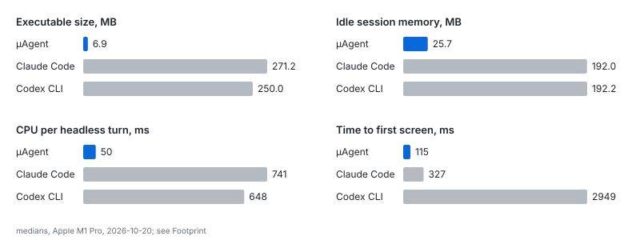
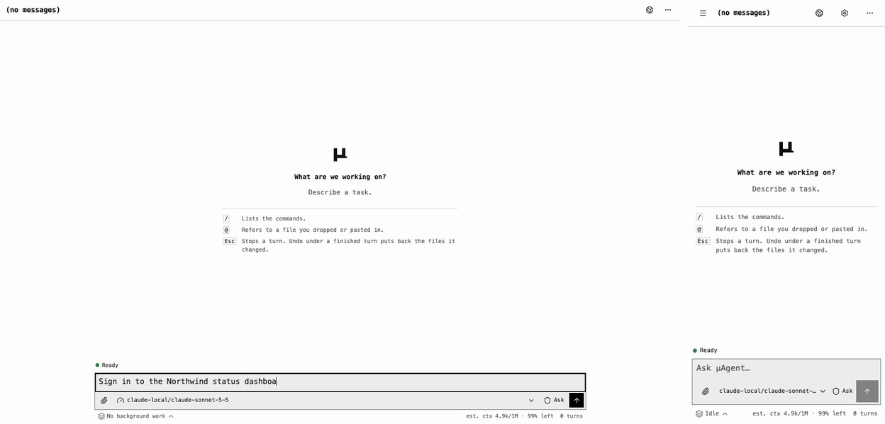

# µAgent

[](https://github.com/timongentzsch/uAgent/actions/workflows/ci.yml)
[](LICENSE)

µAgent is a coding agent in a 6 MB binary. A conversation idles in about
30 MB and spends about 12 ms of CPU on a turn, a small fraction of what
Claude Code, Codex CLI or omp need. It is sandboxed to your project folder,
keeps one conversation across terminal, script and phone, and drives a real
Chrome that you can watch and take over.



Medians of five runs in a 2-CPU, 4 GB Docker container on 2026-10-28, all four
answering through the same Claude Haiku 5.5 endpoint;
[the method](benchmarks/README.md#footprint-comparison) has the versions and
every metric.

## Built to be light

- **One C++20 binary,** no runtime to install. Each conversation is one
  process; the terminal and the web host attach to it over a Unix socket.
- **The web interface is embedded:** 1.5 MB gzipped in total, about 120 KB on
  first load, with compressed API responses and resumable event streams.
- **Chrome starts only when the agent first uses it,** and stops on request.
- **Fewer tokens:** the prompt cache serves 77–94% of input on both OpenAI and
  Anthropic routes, compaction reads the cached conversation instead of
  resending it, and a browser result for the page just seen carries only what
  changed.

![The terminal and the web host attach over a Unix socket to one session runtime process per conversation; a browser or phone reaches the web host over HTTP and SSE; the web host starts the agent's browser, Chrome and Xvnc with one signed-in profile, on first use and streams its live screen to paired devices; the runtime's browser tool drives Chrome over a private socket; a script runs one turn in its own headless process; the agent loop runs tools in a sandbox and calls Chat Completions, OpenAI Responses or Anthropic Messages endpoints over HTTPS](docs/images/architecture.svg)

## What it does

- **Drives a real browser.** A persistent Chrome profile that you watch and
  take over from any paired device. It signs in through Chrome's password
  manager without ever reading or typing a password, and hands codes,
  captchas and payments to you. See [the agent's browser](docs/BROWSER.md).
- **Stays in its folder.** Commands run under the OS sandbox (Seatbelt on
  macOS, Landlock on Linux): they write only inside the folder, your other
  folders stay closed, cloud and git credential stores (`~/.aws`, `~/.kube`,
  `~/.netrc`, …) stay hidden, and the agent asks before it changes a file,
  runs a command or uses the network. `/undo` restores what the last turn
  changed. See [Security](SECURITY.md).
- **One conversation, every device.** Start in the terminal, continue on your
  phone (an installable web app with notifications), or run a turn from a
  script with `uagent -p "..." --json`.
- **Works in parallel.** A folder's lead agent keeps a plan, fans questions
  out to read-only subagents and starts background agents that change code
  and report back.
- **Remembers and repeats.** Memory, skills, scheduled tasks and MCP servers,
  managed from the terminal or the web.
- **Any endpoint.** Chat Completions, OpenAI Responses and Anthropic Messages,
  local or hosted.




## Install

Linux and macOS. From a checkout, `./install.sh` asks where µAgent should run:

- **In a container** (recommended where Docker runs): the web interface, the
  agent's browser and the terminal, isolated from this machine's files and
  logins.
- **Here:** a Release build installed under `~/.local` with its skills; put
  `~/.local/bin` on your `PATH`. On Linux it can include the agent's browser;
  on macOS that runs only in the container.

Tagged releases ship archives for Linux x86_64 and arm64 and macOS arm64
(`bin/uagent`; keep `bin` and `share` together) with Sigstore-signed
checksums.

Building needs CMake 3.21+, a C++20 compiler, libcurl 7.66+ and zlib, plus
Node.js for the web interface. `-DUAGENT_WEB=OFF` builds a terminal-only
binary, `-DUAGENT_BROWSER=OFF` leaves out the agent's browser and
`-DUAGENT_WEB_PUSH=ON` adds Web Push (needs OpenSSL 3).

## Quick start

```sh
export OPENROUTER_API_KEY=replace-me   # or UAGENT_BASE_URL + UAGENT_MODEL
cd my-project
uagent                                 # Enter sends, Esc stops, / lists commands
```

- **Approvals:** answer `y` (once), `s` (this conversation), `a` (always in
  this repository) or `n`.
- **Models:** `/model QUERY` searches what your key offers; add `--default`
  to keep it.
- **Come back:** `/quit` leaves it running; `uagent -c` continues the latest.
- **Phone:** `uagent --web` prints a pairing link.
- **Parallel work:** `uagent panel` opens the folder's lead agent.

The [guide](docs/GUIDE.md) covers the rest in order; `uagent --help` lists
every flag.

## Documentation

[Guide](docs/GUIDE.md) ·
[Web interface](docs/WEB.md) ·
[The agent's browser](docs/BROWSER.md) ·
[Tools](docs/TOOLS.md) ·
[Memory, skills and schedules](docs/MANAGEMENT.md) ·
[Skills](skills/README.md) ·
[Operations](docs/OPERATIONS.md) ·
[Persistence](docs/PERSISTENCE.md) ·
[Accessibility](docs/ACCESSIBILITY.md) ·
[Security](SECURITY.md) ·
[Architecture](docs/ARCHITECTURE.md) ·
[Prompt caching](docs/CACHING.md) ·
[Changelog](CHANGELOG.md)

## Development

The tests need no API key or network: C++ unit tests, Python integration
tests against a mock provider and Playwright browser tests, run in CI on
Linux x86_64 and arm64 and macOS arm64 with sanitizers and clang-tidy.
[Contributing](CONTRIBUTING.md) covers building and checks;
[Testing](docs/TESTING.md) covers running one test.
