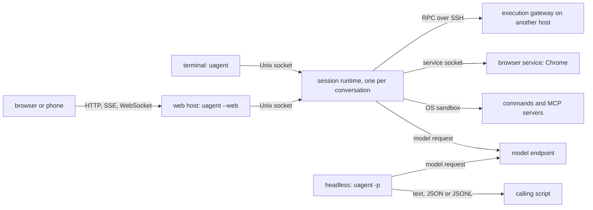

# µAgent

[](https://github.com/timongentzsch/uAgent/actions/workflows/ci.yml)
[](LICENSE)

µAgent runs coding conversations in a native C++20 executable. The same
program hosts the web and phone interface and starts execution gateways
over SSH. Your host stores the transcript, settings and provider credentials.
Each turn sends conversation context to the configured model endpoint.
µAgent has no account service, telemetry or relay. Network-capable tools
and optional services can reach additional destinations.
[What leaves the machine](SECURITY.md#what-leaves-the-machine)

## Process model



An active interactive conversation has a runtime process that terminal and
paired browser clients can attach to. A client can disconnect while a turn runs. The web host
serves HTTP directly and can sit behind an HTTPS reverse proxy. The
gateway executes file, Git, command and terminal operations and holds no
settings, history or provider keys.
[Architecture](docs/architecture/overview.md) has each process and channel.

## Properties

| | |
| --- | --- |
| Code | About 77k physical lines in the native source and headers (`src/` and `include/`), and 50k in the TypeScript and CSS web client (`web/src/`), as of 2026-11-24 |
| Release size | 6.6–10.9 MB executable, 19.4–23.7 MB unpacked installation across the three 1.11.0 release targets. [Archive measurements](benchmarks/results/packages-2026-11-24.json) |
| Footprint | 27.3 MiB idle and 20.6 ms local CPU per one-word headless turn in the interleaved Linux ARM64 comparison. [Measurement, 2026-11-24](benchmarks/README.md#footprint-comparison) |
| First request | 13 tools in the fresh 1.11.0 release profile. Compact schemas plus system instructions count to 3,023 tokens with o200k_base. The historical benchmark serialization gives 3,479. [Measurement, 2026-11-24](benchmarks/README.md#current-measurements) |
| Outside contacts | The scripted default headless probe requested only the model endpoint. Tools, SSH and optional services have their own network behavior. [Recorded scenarios](benchmarks/README.md#outside-contacts-and-first-request) |
| Model APIs | OpenAI Chat Completions, OpenAI Responses, Anthropic Messages |
| Command sandbox | Seatbelt on macOS and Landlock on Linux. Enabled by default independently of approval mode. [Platform limits and exceptions](SECURITY.md#sandboxing) |
| Runtime dependencies | libcurl, zlib, the C++ runtime and, on Linux, OpenSSL 3; no language runtime, no plugin loader |
| Platforms | Linux x86_64 and ARM64 (glibc 2.38 or newer), macOS 15 or newer on Apple silicon |
| Tests | native unit and integration suites against mock providers, Chromium and WebKit, sanitizers, fuzzers, clang-tidy |

## Compared with other coding agents


On 2026-11-24, five CLI releases ran against a loopback provider returning
the same one-word reply, with external networking disabled. All 25 headless
turns returned that reply. Claude Code 2.1.331 exited each interactive start
before the idle sample, so its idle memory is unavailable. The chart measures
local process work. Model inference and response quality require a different
workload. [Versions, raw samples and method](benchmarks/README.md#footprint-comparison)

| Documented behavior, reviewed 2026-11-24 | µAgent | Claude Code | OpenCode |
| --- | --- | --- | --- |
| A phone or second device connects to | a paired, self-hosted web server | Anthropic Remote Control, which stores the transcript while connected | a self-hosted server |
| OS sandbox for agent commands | enabled by default where supported | off by default | no built-in agent sandbox |

Claude Code also provides cloud sessions, IDE and desktop clients, and
plugins. OpenCode provides built-in LSP integration and desktop and IDE
clients. The benchmark report also includes DNS and tool-schema captures for
the specific versions measured.
[Method and raw results](benchmarks/README.md#outside-contacts-and-first-request) ·
[Claude Remote Control](https://code.claude.com/docs/en/remote-control#connection-and-security) ·
[Claude sandbox defaults](https://code.claude.com/docs/en/sandboxing#what-the-sandbox-restricts) ·
[OpenCode server](https://opencode.ai/docs/api) ·
[OpenCode security model](https://github.com/anomalyco/opencode/security/policy)

## Design decisions

- **The main owns everything.** Provider requests, keys, settings, history and
  the agent loop run on one machine. An SSH target receives a matching gateway
  bundle, its authentication token and sandbox preset, then the data required
  for its execution requests.
  [Execution gateway](docs/architecture/execution-gateway.md)
- **One binary, three roles.** No server-side language runtime and no
  dynamically loaded plugins; the web client ships inside the executable.
  [Overview](docs/architecture/overview.md)
- **Approvals and sandboxing are separate.** The approval mode determines
  when a person is asked. The sandbox limits filesystem and network access.
  Explicit unsandboxed and root commands require approval.
  [Sandbox](docs/architecture/sandbox.md) · [Security](SECURITY.md)
- **Settings share one registry.** The same definitions power `/config`,
  the web settings and the
  [generated reference](docs/interfaces/settings.md).
- **Pages cannot reach the app.** Decks, documents, sheets and designs the
  agent writes render in opaque-origin frames from a capability address; a
  sheet calculates in a worker of its own page.
  [Artifacts](docs/architecture/artifacts.md)
- **A turn survives its client.** A conversation's runtime is a process of
  its own: a closed tab, a detached terminal or a restarted web host does not
  end the turn. [Sessions](docs/architecture/sessions.md)

## Interfaces

| Contract | Specification |
| --- | --- |
| Flags and slash commands | [interfaces/cli.md](docs/interfaces/cli.md) |
| Settings, defaults, scopes | [interfaces/settings.md](docs/interfaces/settings.md) |
| Headless runs: `-p`, `--json`, `--json-stream`, `--control` | [interfaces/headless.md](docs/interfaces/headless.md) |
| HTTP API, event stream, terminal and viewer sockets | [interfaces/http-api.md](docs/interfaces/http-api.md) |
| Tool schemas as a model is sent them | [interfaces/tool-schemas.md](docs/interfaces/tool-schemas.md) |
| Files under `~/.uagent` | [interfaces/on-disk.md](docs/interfaces/on-disk.md) |
| Artifact formats | [interfaces/artifact-formats.md](docs/interfaces/artifact-formats.md) |
| Fixed limits | [interfaces/limits.md](docs/interfaces/limits.md) |

## Build and verify

```sh
(cd web && npm ci && npm run build)
cmake --preset debug
cmake --build --preset debug --parallel
ctest --preset debug --output-on-failure
```

With build dependencies installed, the default native suite uses local fixtures
and loopback connections. It needs no provider API key. [Testing](docs/testing.md) covers the
browser tests, sanitizers and the behavioural evaluation;
[Contributing](CONTRIBUTING.md) the conventions and the release.

## Install

```sh
curl -fsSL https://raw.githubusercontent.com/timongentzsch/uAgent/master/install.sh | sh
```

The interactive installer configures the provider and offers a container
when Docker is available.
`uagent` starts a conversation in the current folder; `uagent --web` prints a
pairing link for a browser or phone.
[Install and update](docs/operations/install.md) ·
[Container](docs/operations/container.md) ·
[Remote access](docs/operations/remote-access.md)

## In use


Recorded from the running client with a scripted model. The
[manual](docs/manual.md) covers what each control does.

## Documentation

| Section | Holds |
| --- | --- |
| [Architecture](docs/architecture/overview.md) | one page per subsystem: turn loop, providers, tools, sandbox, sessions, web host, web client, execution gateway, browser, artifacts, memory and schedules |
| [Interfaces](docs/README.md#interfaces) | the contracts above |
| [Operations](docs/README.md#operations) | install, container, remote access, budgets and recovery |
| [Manual](docs/manual.md) | the terminal and web clients |
| [Security](SECURITY.md) | threat model and boundaries |
| [Changelog](CHANGELOG.md) | what changed, by release |
