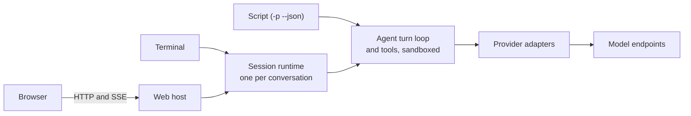

# µAgent

[](https://github.com/timongentzsch/uAgent/actions/workflows/ci.yml)
[](LICENSE)

µAgent is a local coding agent that fits in one native binary: a C++20
program with the web interface built in, which works in a terminal, from a
script or in the browser on the same conversations, and runs its commands in a
sandbox limited to your folder.


## Highlights

- **Terminal, script and browser share conversations.** `uagent` is the
  terminal, `uagent -p "..." --json` runs one turn from a script, `uagent --web`
  serves the browser; leave one and pick the conversation up in another.
- **Any endpoint.** It talks to Chat Completions, OpenAI Responses and
  Anthropic Messages APIs, local or hosted.
- **Sandboxed, with approvals and `/undo`.** Commands can write only inside the
  folder; it asks before it changes a file, runs a command or uses the
  network, and `/undo` puts back what the last turn changed.
- **A panel for several agents.** A folder's panel hosts a chat with a
  moderator and members you add, and starts threads that do the work in
  parallel and report back.


## How it's built

C++20 with libcurl, cpp-httplib and nlohmann/json; the web interface is
Preact, TypeScript and Vite; the tests are C++, Python and Playwright.

Every conversation runs in its own session runtime process. The terminal and
the browser's web host attach to it over a private Unix socket, so neither has
authority the other lacks and neither runs a second agent. A script
(`-p --json`) runs its turn in its own process.



[Architecture](docs/ARCHITECTURE.md) covers the layers, the runtime and its
wire format.

## Engineering

- **Tests run without a key or network.** 133 C++ unit cases, 287 Python
  integration tests against a mock provider (real binary, real PTY), 154
  Playwright browser tests (Chromium; a subset also runs in WebKit) and 68 Node unit tests.
- **Fuzzing.** Two libFuzzer targets, the SSE stream decoder and the terminal
  input decoder, replay their corpus on every CI run and search for five minutes each, weekly.
- **Static analysis.** clang-format, cpplint, clang-tidy with warnings as
  errors, and CodeQL.
- **Sanitizers.** The suite also runs under ASan and UBSan, and under TSan.
- **CI on three platforms.** Linux x86_64, Linux arm64 and macOS arm64, plus
  terminal-only and no-browser build variants.
- **Layers enforced by a test.** `tests/boundary_test.py` fails a translation
  unit that includes a higher layer.
- **Releases are verifiable.** Archives ship with `SHA256SUMS`, signed with
  Sigstore, and build attestations.

See [Contributing](CONTRIBUTING.md) and [Testing](docs/TESTING.md).

## Footprint

| | µAgent | Claude Code | Codex CLI |
|---|---|---|---|
| Executable alone | 6.5 MB | 247.9 MB | 246.6 MB |
| Install on disk | 7.0 MB, 33 files | 247.9 MB, 1 file | 338.1 MB, 42 files |
| Download (macOS arm64, tar.gz) | 4.4 MB | not measured | not measured |
| Non-system shared libraries | 0 | 0 | 0 |
| `--version`, wall (median / p90) | 10 / 13 ms | 15 / 19 ms | 15 / 19 ms |
| `--version`, CPU (median / p90) | 6 / 8 ms | 11 / 13 ms | 12 / 14 ms |
| Idle session, resident memory | 25.1 MB (2 processes) | 188.5 MB (1) | 182.2 MB (1)\* |
| Idle session, CPU over 10 s | 0 ms | 40 ms | 10 ms\* |
| Time to first screen | 102 ms | 344 ms | 3284 ms |
| One headless turn, CPU | 65 ms | 790 ms | 639 ms |
| One headless turn, peak resident memory | 12.5 MB | 257.2 MB | 191.5 MB |
| One headless turn, wall time (model and network bound) | 1522 ms | 2974 ms | 4332 ms |

Medians of 30 `--version` runs (3 warm-ups) and of 5 idle and 5 headless runs.
No MCP servers, plugins or extensions are loaded: Claude Code runs with
`--strict-mcp-config`, an empty MCP config and only project settings, Codex
CLI's headless turn with `exec --ignore-user-config`, and µAgent has none
configured. Each tool uses its own default login and model (µAgent:
`claude-haiku-5-5` through a local proxy), so headless wall time depends on the
model and is not comparable. The idle session is measured for 10 s in a 120×40
pseudo-terminal after the screen settles, with the provider's model list
cached (µAgent fetches it once a day), at each tool's folder-trust prompt
where it asks; resident memory is summed over the tool's own processes,
including helpers it starts. µAgent's two are the client and its session
runtime. \*Codex CLI's interactive UI cannot skip the user config, so its idle
row counts only Codex's own executables and leaves out the MCP servers it
started from this machine's configuration. Runs alternate between the tools to
share any background load, and idle memory varied between runs (Codex CLI 91 to
189 MB, Claude Code 188 to 194 MB, µAgent 15 to 25 MB). Install size counts
the executable plus what ships with it: `bin/` and `share/uagent/` for µAgent
(from `cmake --install --strip`), the single versioned file for Claude Code,
the cask directory for Codex CLI. Measured on an Apple M1 Pro with 16 GB,
macOS 27.0.1, on 2026-10-14 with µAgent 1.3.1 built from master (`77816d72`),
Claude Code 2.1.299 and Codex CLI 0.162.1. The download size is the installed
tree compressed with `tar czf`. Reproduce with
`python3 benchmarks/compare_agents.py --help`.

The browser interface is served by the same binary: the idle web host uses
9.5 MB of resident memory, and 38.0 MB with two open conversations (the host
at 11.6 MB plus a session runtime of about 13 MB each). The page itself runs in
your browser. Measured with `benchmarks/web.py` against a mock provider.

## Install

Linux and macOS. From a checkout:

```sh
./install.sh
```

This builds a Release binary in `build/release` (reusing a build already
there) and installs `uagent` and the bundled skills under `~/.local`; put
`~/.local/bin` on your `PATH`. `UAGENT_PREFIX` and `UAGENT_BUILD_DIR` change
the two locations.

Each tagged release also ships built archives
(`uagent-<version>-linux-x86_64`, `-linux-arm64`, `-macos-arm64`, each
`.tar.gz`). Unpack one and run `bin/uagent`; keep `bin` and `share` together,
since the skills are found relative to the binary. `SHA256SUMS`, signed
with Sigstore (`SHA256SUMS.sigstore.json`), lists every archive's checksum.

### Requirements

- CMake 3.21+, a C++20 compiler, libcurl 7.66+ and zlib.
- Node.js, to build the browser interface from `web/`. Without it the build
  is terminal-only. Each release also ships the built interface as
  `uagent-web-dist-<version>.tar.gz`; unpack it into `web/dist` before
  building.
- Optional at run time: [uv](https://docs.astral.sh/uv/) for Python `scratch`
  scripts with dependencies; `npm install -g @playwright/cli@latest` for the
  `browser-use` skill.

| CMake option | Effect |
| --- | --- |
| `-DUAGENT_WEB=OFF` | Terminal-only binary, no browser interface |
| `-DUAGENT_BROWSER=OFF` | Leave out the agent's browser |
| `-DUAGENT_WEB_PUSH=ON` | Web Push notifications; needs OpenSSL 3 libcrypto. Release archives and the Docker image include it |

## Quick start

1. **Give it a key.** With an [OpenRouter](https://openrouter.ai) key and
   nothing else it picks a default model:

   ```sh
   export OPENROUTER_API_KEY=replace-me
   ```

   For a local or other OpenAI-compatible endpoint set `UAGENT_BASE_URL` and
   `UAGENT_MODEL` instead (and `UAGENT_API_KEY` if it wants one). Responses
   and Anthropic Messages endpoints are set up as
   [named providers](docs/GUIDE.md#models-and-providers).

2. **Start it in a project folder** and say what you want:

   ```sh
   cd my-project
   uagent
   ```

   Enter sends, Esc stops a turn, `/` lists the commands.

3. **When it asks before acting**, answer `y` (once), `s` (for this
   conversation), `a` (always in this repository) or `n`. It asks before it
   changes a file, runs a command or uses the network. Commands run in a
   sandbox that can write only inside the folder. `/undo` puts back the files
   the last turn changed.

4. **Pick a model.** `/models` searches what your key offers;
   `/model NAME --default` also keeps the choice for new conversations.

5. **Leave and come back.** `/quit` leaves the conversation running;
   `uagent -c` continues the latest and `uagent --resume` lets you pick.

6. **In the browser or on a phone.** `uagent --web` prints a link that pairs
   the browser; one host serves every folder's conversations. See the
   [web guide](docs/WEB.md).

7. **Several at once.** `uagent panel` opens the folder's panel. Ask it
   for work and it starts threads that do it; ask it for another voice and it
   adds a member to the chat. Start a message with a name ("Ada, …") to ask
   that one alone.

8. **From a script.** `uagent -p "inspect this repository" --json` runs one
   turn and prints one JSON envelope.

The [guide](docs/GUIDE.md) tells the rest in order: keys, models and
providers, settings, approvals, coming back to a conversation, the
panel and its chat, and scripting. `uagent --help` lists every flag.

## Documentation

- [Guide](docs/GUIDE.md): the whole story, in order
- [Web interface](docs/WEB.md) and the [browser the agent drives](docs/BROWSER.md)
- [Tools](docs/TOOLS.md)
- [Memory, skills and scheduled tasks](docs/MANAGEMENT.md)
- [Bundled skills](skills/README.md)
- [Operations and limits](docs/OPERATIONS.md)
- [Persistence](docs/PERSISTENCE.md)
- [Accessibility](docs/ACCESSIBILITY.md)
- [Security](SECURITY.md)
- Reference, generated from the binary:
  [flags](skills/uagent-config/references/cli.md),
  [slash commands](skills/uagent-config/references/slash-commands.md),
  [settings](skills/uagent-config/references/configuration.md)
- Internals: [Architecture](docs/ARCHITECTURE.md),
  [Instructions](docs/INSTRUCTIONS.md),
  [Prompt caching](docs/CACHING.md)
- [Changelog](CHANGELOG.md)

## Development

See [Contributing](CONTRIBUTING.md) for building, the checks CI runs and
[Testing](docs/TESTING.md) for running one test.
