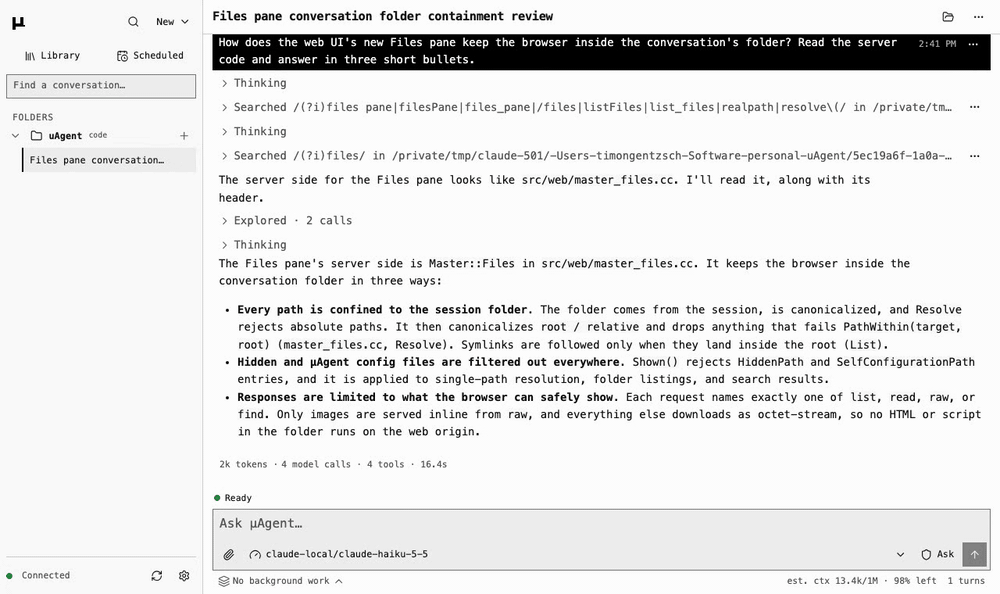

# µAgent

[](https://github.com/timongentzsch/uAgent/actions/workflows/ci.yml)
[](LICENSE)

µAgent is a coding agent in a 7 MB binary. It is sandboxed to your folder
folder, keeps one conversation you can continue from the terminal, a script or
your phone, and drives a real Chrome that you can watch and take over.


## Features

- **Terminal, script and browser.** `uagent` opens the terminal,
  `uagent -p "..." --json` runs one turn from a script and `uagent --web`
  serves the browser. A conversation continues in any of them.
- **Endpoints.** Chat Completions, OpenAI Responses and Anthropic Messages
  APIs, local or hosted.
- **Sandbox and approvals.** Commands write only inside the folder. The agent
  asks before it changes a file, runs a command or uses the network, and
  `/undo` restores what the last turn changed.
- **Lead agent.** A folder's lead agent keeps a plan, has read-only subagents
  answer its questions in parallel and checks their findings, and starts
  background agents that change code and report back.
- **Browser automation.** The agent drives a persistent Chrome that you can
  watch and take over from any device. It signs in with Chrome's saved
  passwords without reading them and hands codes, captchas and payments to
  you. See [the agent's browser](docs/BROWSER.md).
- **Files.** The browser shows the conversation's folder beside the chat, read
  only, with search, highlighted code and rendered markdown.




## How it's built

C++20 with libcurl, cpp-httplib and nlohmann/json; the web interface is
Preact, TypeScript and Vite; the tests are C++, Python and Playwright.

Every conversation runs in its own session runtime process. The terminal and
the web host attach to it over a private Unix socket, so neither has authority
the other lacks and neither runs a second agent. A script (`-p --json`) runs
its turn in its own process.


[Architecture](docs/ARCHITECTURE.md) covers the layers, the runtime and its
wire format.

## Footprint


Medians of five runs on an Apple M1 Pro on 2026-10-21, with µAgent 1.5.0,
Claude Code 2.1.306, Codex CLI 0.163.0 and omp 18.12.5. Each headless turn
answers a one-word prompt; µAgent and omp used Claude Haiku 5.5 through the
same endpoint, Claude Code and Codex CLI their own. omp's install includes its
`node_modules` and the Bun runtime it needs.
[The method](benchmarks/README.md#footprint-comparison) has every metric.

## Install

Linux and macOS. From a checkout:

```sh
./install.sh
```

It says what it found and asks where µAgent should run:

- **In a container** (recommended where Docker runs): the web interface, the
  agent's browser and the terminal, isolated from this machine's files and
  logins. See [The agent's browser](docs/BROWSER.md).
- **Here:** a Release binary built in `build/release` (an existing build is
  reused) and installed with the bundled skills under `~/.local`; put
  `~/.local/bin` on your `PATH`. It includes the web interface when Node.js
  is present, and with it on Linux the agent's browser, offering to install
  Chrome and TigerVNC with `sudo` when they are missing. On macOS the agent's
  browser runs only in the container.

`UAGENT_INSTALL=container` or `here` chooses without asking; a run without a
terminal installs here. `UAGENT_PREFIX` and `UAGENT_BUILD_DIR` change the two
locations.

Each tagged release also ships built archives:
`uagent-<version>-linux-x86_64.tar.gz`, `-linux-arm64.tar.gz` and
`-macos-arm64.tar.gz`. Unpack one and run `bin/uagent`. Keep `bin` and `share`
together, since the skills are found relative to the binary. `SHA256SUMS`,
signed with Sigstore (`SHA256SUMS.sigstore.json`), lists every archive's
checksum.

### Requirements

- CMake 3.21+, a C++20 compiler, libcurl 7.66+ and zlib.
- Node.js, to build the browser interface from `web/`. Without it the build
  is terminal-only, unless you unpack the release's
  `uagent-web-dist-<version>.tar.gz` into `web/dist` before building.
- Optional at run time: [uv](https://docs.astral.sh/uv/) for Python `scratch`
  scripts with dependencies; `npm install -g @playwright/cli@latest` for the
  `browser-use` skill.

| CMake option | Effect |
| --- | --- |
| `-DUAGENT_WEB=OFF` | Terminal-only binary, no browser interface |
| `-DUAGENT_BROWSER=OFF` | Leave out the agent's browser |
| `-DUAGENT_WEB_PUSH=ON` | Web Push notifications; needs OpenSSL 3 libcrypto. Release archives and the Docker image include it |

## Quick start

1. **Give it a key.** With only an [OpenRouter](https://openrouter.ai) key
   set, the first start opens the model picker:

   ```sh
   export OPENROUTER_API_KEY=replace-me
   ```

   For a local or other Chat Completions endpoint, set `UAGENT_BASE_URL` and
   `UAGENT_MODEL` instead, plus `UAGENT_API_KEY` if it needs one. Responses
   and Anthropic Messages endpoints are
   [named providers](docs/GUIDE.md#models-and-providers).

2. **Start it in a folder** and say what you want:

   ```sh
   cd my-project
   uagent
   ```

   Enter sends, Esc stops a turn, `/` lists the commands.

3. **Answer approvals.** Before it changes a file, runs a command or uses
   the network, it asks: answer `y` (once), `s` (for this conversation), `a`
   (always in this repository) or `n`. `/undo` puts back the files the last
   turn changed.

4. **Pick a model.** `/model QUERY` searches what your key offers.
   `/model NAME --default` also keeps the choice for new conversations.

5. **Leave and come back.** `/quit` leaves the conversation running.
   `uagent -c` continues the latest and `uagent --resume` lets you pick.

6. **Open it in a browser or on a phone.** `uagent --web` prints a link that
   pairs the browser. One host serves every folder's conversations; see the
   [web guide](docs/WEB.md).

7. **Run several at once.** `uagent panel` opens the folder's lead agent.
   Ask it for work and it starts background agents; ask it a question and it
   fans out
   subagents and reports what held up.

8. **Script it.** `uagent -p "inspect this repository" --json` runs one turn
   and prints one JSON envelope.

The [guide](docs/GUIDE.md) covers the rest in order: keys, models and
providers, settings, approvals, returning to a conversation, the lead agent and
scripting. `uagent --help` lists every flag.

## Documentation

- [Guide](docs/GUIDE.md): everything in order, from the first conversation
- [Web interface](docs/WEB.md) and the [browser the agent drives](docs/BROWSER.md)
- [Tools](docs/TOOLS.md)
- [Memory, skills and scheduled tasks](docs/MANAGEMENT.md)
- [Bundled skills](skills/README.md)
- [Operations and limits](docs/OPERATIONS.md)
- [Persistence](docs/PERSISTENCE.md)
- [Accessibility](docs/ACCESSIBILITY.md)
- [Security](SECURITY.md)
- Reference, read from the binary: `uagent --help` (flags), `/help` (slash
  commands), `/config` (settings), `uagent inspect` through the agent
- Internals: [Architecture](docs/ARCHITECTURE.md),
  [Instructions](docs/INSTRUCTIONS.md),
  [Prompt caching](docs/CACHING.md)
- [Changelog](CHANGELOG.md)

## Development

The tests need no API key or network: C++ unit tests, Python integration
tests against a mock provider, and Playwright browser tests. CI runs them on
Linux x86_64, Linux arm64 and macOS arm64, with sanitizers, clang-tidy and
fuzzing. Release archives come with signed checksums and build attestations.

[Contributing](CONTRIBUTING.md) covers building and the checks CI runs;
[Testing](docs/TESTING.md) covers running a single test.
