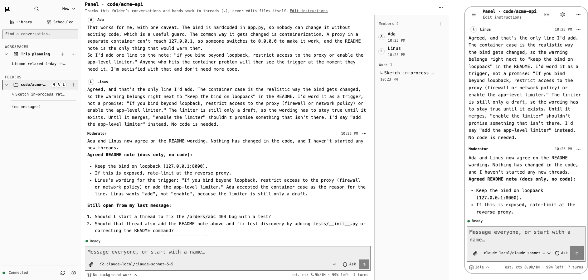
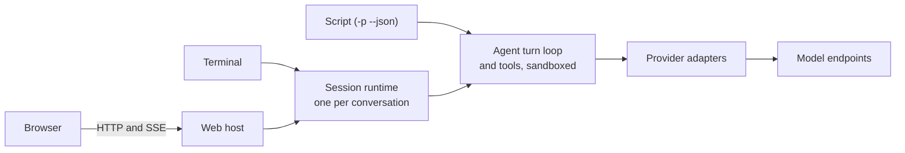

# µAgent

[](https://github.com/timongentzsch/uAgent/actions/workflows/ci.yml)
[](LICENSE)

µAgent is a coding agent that runs on your machine. It is a single C++20
binary that serves the same conversations to a terminal, a script and a
browser, and runs commands in a sandbox limited to the project folder.



## Features

- **Terminal, script and browser.** `uagent` opens the terminal,
  `uagent -p "..." --json` runs one turn from a script and `uagent --web`
  serves the browser. A conversation started in one can be continued in
  another.
- **Endpoints.** Chat Completions, OpenAI Responses and Anthropic Messages
  APIs, local or hosted.
- **Sandbox and approvals.** Commands can write only inside the folder. The
  agent asks before it changes a file, runs a command or uses the network, and
  `/undo` restores what the last turn changed.
- **Panels.** A folder's panel is a chat with a moderator and the members you
  add. It starts threads that work in parallel and report back.
- **Browser automation.** The agent drives a persistent Chrome that you can
  watch and take over from any device. It signs in with Chrome's saved
  passwords without reading them and hands codes, captchas and payments to
  you. See [the agent's browser](docs/BROWSER.md).
- **Files.** In the browser, the conversation's folder can be shown beside the
  chat, read only, with search, highlighted code and rendered markdown.


## How it's built

C++20 with libcurl, cpp-httplib and nlohmann/json; the web interface is
Preact, TypeScript and Vite; the tests are C++, Python and Playwright.

Every conversation runs in its own session runtime process. The terminal and
the web host attach to it over a private Unix socket, so neither has authority
the other lacks and neither runs a second agent. A script (`-p --json`) runs
its turn in its own process.



[Architecture](docs/ARCHITECTURE.md) covers the layers, the runtime and its
wire format.

## Install

Linux and macOS. From a checkout:

```sh
./install.sh
```

This builds a Release binary in `build/release`, reusing a build already
there, and installs `uagent` and the bundled skills under `~/.local`. Put
`~/.local/bin` on your `PATH`. `UAGENT_PREFIX` and `UAGENT_BUILD_DIR` change
the two locations.

Each tagged release also ships built archives:
`uagent-<version>-linux-x86_64.tar.gz`, `-linux-arm64.tar.gz` and
`-macos-arm64.tar.gz`. Unpack one and run `bin/uagent`. Keep `bin` and `share`
together, since the skills are found relative to the binary. `SHA256SUMS`,
signed with Sigstore (`SHA256SUMS.sigstore.json`), lists every archive's
checksum.

### Requirements

- CMake 3.21+, a C++20 compiler, libcurl 7.66+ and zlib.
- Node.js, to build the browser interface from `web/`. Without it the build
  is terminal-only, unless you unpack the release's
  `uagent-web-dist-<version>.tar.gz` into `web/dist` before building.
- Optional at run time: [uv](https://docs.astral.sh/uv/) for Python `scratch`
  scripts with dependencies; `npm install -g @playwright/cli@latest` for the
  `browser-use` skill.

| CMake option | Effect |
| --- | --- |
| `-DUAGENT_WEB=OFF` | Terminal-only binary, no browser interface |
| `-DUAGENT_BROWSER=OFF` | Leave out the agent's browser |
| `-DUAGENT_WEB_PUSH=ON` | Web Push notifications; needs OpenSSL 3 libcrypto. Release archives and the Docker image include it |

## Quick start

1. **Give it a key.** With only an [OpenRouter](https://openrouter.ai) key
   set, the first start opens the model picker:

   ```sh
   export OPENROUTER_API_KEY=replace-me
   ```

   For a local or other Chat Completions endpoint, set `UAGENT_BASE_URL` and
   `UAGENT_MODEL` instead, plus `UAGENT_API_KEY` if it needs one. Responses
   and Anthropic Messages endpoints are
   [named providers](docs/GUIDE.md#models-and-providers).

2. **Start it in a project folder** and say what you want:

   ```sh
   cd my-project
   uagent
   ```

   Enter sends, Esc stops a turn, `/` lists the commands.

3. **Answer approvals.** Before it changes a file, runs a command or uses
   the network, it asks: answer `y` (once), `s` (for this conversation), `a`
   (always in this repository) or `n`. `/undo` puts back the files the last
   turn changed.

4. **Pick a model.** `/models` searches what your key offers.
   `/model NAME --default` also keeps the choice for new conversations.

5. **Leave and come back.** `/quit` leaves the conversation running.
   `uagent -c` continues the latest and `uagent --resume` lets you pick.

6. **Open it in a browser or on a phone.** `uagent --web` prints a link that
   pairs the browser. One host serves every folder's conversations; see the
   [web guide](docs/WEB.md).

7. **Run several at once.** `uagent panel` opens the folder's panel. Ask it
   for work and it starts threads; ask for another voice and it adds a member
   to the chat. Start a message with a name ("Ada, …") to ask that member
   alone.

8. **Script it.** `uagent -p "inspect this repository" --json` runs one turn
   and prints one JSON envelope.

The [guide](docs/GUIDE.md) covers the rest in order: keys, models and
providers, settings, approvals, returning to a conversation, the panel and
scripting. `uagent --help` lists every flag.

## Documentation

- [Guide](docs/GUIDE.md): everything in order, from the first conversation
- [Web interface](docs/WEB.md) and the [browser the agent drives](docs/BROWSER.md)
- [Tools](docs/TOOLS.md)
- [Memory, skills and scheduled tasks](docs/MANAGEMENT.md)
- [Bundled skills](skills/README.md)
- [Operations and limits](docs/OPERATIONS.md)
- [Persistence](docs/PERSISTENCE.md)
- [Accessibility](docs/ACCESSIBILITY.md)
- [Security](SECURITY.md)
- Reference, generated from the binary:
  [flags](skills/uagent-config/references/cli.md),
  [slash commands](skills/uagent-config/references/slash-commands.md),
  [settings](skills/uagent-config/references/configuration.md)
- Internals: [Architecture](docs/ARCHITECTURE.md),
  [Instructions](docs/INSTRUCTIONS.md),
  [Prompt caching](docs/CACHING.md)
- [Changelog](CHANGELOG.md)

## Development

The tests need no API key or network: C++ unit tests, Python integration
tests against a mock provider, and Playwright browser tests. CI runs them on
Linux x86_64, Linux arm64 and macOS arm64, with sanitizers, clang-tidy and
fuzzing. Release archives come with signed checksums and build attestations.

[Contributing](CONTRIBUTING.md) covers building and the checks CI runs;
[Testing](docs/TESTING.md) covers running a single test.
