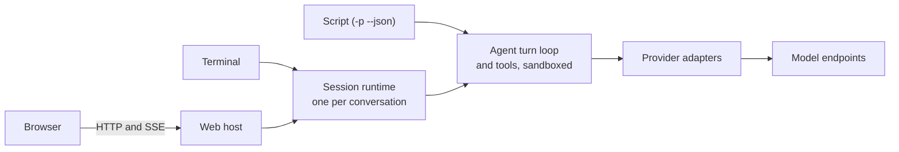

# µAgent

[](https://github.com/timongentzsch/uAgent/actions/workflows/ci.yml)
[](LICENSE)

µAgent is a local coding agent in one native binary. The C++20 program has
the web interface built in, serves the same conversations to a terminal, a
script and a browser, and runs its commands in a sandbox limited to your
folder.


## Highlights

- **Terminal, script and browser share conversations.** `uagent` opens the
  terminal, `uagent -p "..." --json` runs one turn from a script and
  `uagent --web` serves the browser. Leave one and continue in another.
- **Any endpoint.** It talks to Chat Completions, OpenAI Responses and
  Anthropic Messages APIs, local or hosted.
- **Sandboxed, with approvals and `/undo`.** Commands can write only inside
  the folder. The agent asks before it changes a file, runs a command or uses
  the network, and `/undo` puts back what the last turn changed.
- **A panel for several agents.** A folder's panel is a chat with a
  moderator and the members you add. It starts threads that work in parallel
  and report back.
- **Your browser, your logins, never the password.** The agent drives a
  persistent Chrome that you can watch and take over from any device. It signs
  in with Chrome's saved passwords without reading them and hands you codes,
  captchas and payments. See [the agent's browser](docs/BROWSER.md) for the
  setup.
- **The folder beside the chat.** In the browser, Files lists the
  conversation's folder next to the conversation, read only: search by name,
  code with line numbers, rendered markdown with its images. Every pane can be
  resized.


## How it's built

C++20 with libcurl, cpp-httplib and nlohmann/json; the web interface is
Preact, TypeScript and Vite; the tests are C++, Python and Playwright.

Every conversation runs in its own session runtime process. The terminal and
the web host attach to it over a private Unix socket, so neither has authority
the other lacks and neither runs a second agent. A script (`-p --json`) runs
its turn in its own process.



[Architecture](docs/ARCHITECTURE.md) covers the layers, the runtime and its
wire format.

## Engineering

- **Tests run without a key or network.** 155 C++ unit cases, 336 Python
  integration tests against a mock provider (real binary, real PTY), 199
  Playwright browser tests (Chromium; 101 also run in WebKit) and 84 Node unit
  tests.
- **Fuzzing.** Two libFuzzer targets, the SSE stream decoder and the terminal
  input decoder, replay their corpus on every CI run and search for five minutes each, weekly.
- **Static analysis.** clang-format, cpplint, clang-tidy with warnings as
  errors, and CodeQL.
- **Sanitizers.** The suite also runs under ASan and UBSan, and under TSan.
- **CI on three platforms.** Linux x86_64, Linux arm64 and macOS arm64, plus
  terminal-only and no-browser build variants.
- **Layers enforced by a test.** `tests/boundary_test.py` fails a translation
  unit that includes a higher layer.
- **Releases are verifiable.** Archives ship with `SHA256SUMS`, signed with
  Sigstore, and build attestations.

See [Contributing](CONTRIBUTING.md) and [Testing](docs/TESTING.md).

## Footprint

| | µAgent | Claude Code | Codex CLI |
|---|---|---|---|
| Executable alone | 6.9 MB | 271.2 MB | 250.0 MB |
| Install on disk | 7.4 MB, 35 files | 271.2 MB, 1 file | 340.8 MB, 41 files |
| Download (macOS arm64, tar.gz) | 4.6 MB | not measured | not measured |
| Non-system shared libraries | 0 | 0 | 0 |
| `--version`, wall (median / p90) | 7 / 12 ms | 11 / 12 ms | 13 / 14 ms |
| `--version`, CPU (median / p90) | 5 / 5 ms | 9 / 9 ms | 10 / 12 ms |
| Idle session, resident memory | 25.7 MB (2 processes) | 192.0 MB (1) | 192.2 MB (1)\* |
| Idle session, CPU over 10 s | 0 ms | 30 ms | 10 ms\* |
| Time to first screen | 115 ms | 327 ms | 2949 ms |
| One headless turn, CPU | 50 ms | 741 ms | 648 ms |
| One headless turn, peak resident memory | 12.6 MB | 284.8 MB | 198.3 MB |
| One headless turn, wall time (model and network bound) | 2955 ms | 3757 ms | 4544 ms |

Medians of 30 `--version` runs and of 5 idle and 5 headless runs, with no MCP
servers, plugins or extensions loaded. Each tool uses its own login and model
(µAgent: `claude-haiku-5-5` through a local proxy), so headless wall time is
not comparable. µAgent's two idle processes are the client and its session
runtime. \*Codex CLI's idle rows leave out the MCP servers it starts from the
machine's configuration. Measured on an Apple M1 Pro with 16 GB, macOS 27.0.1,
on 2026-10-20, with µAgent 1.4.0 built from master, Claude Code 2.1.304 and
Codex CLI 0.163.0. [The method](benchmarks/README.md#footprint-comparison)
has the details; reproduce with `python3 benchmarks/compare_agents.py`.

The web host is the same binary: 9.7 MB of resident memory idle, and 42.8 MB
with two open conversations (the host at 15.4 MB plus a session runtime of
about 13.7 MB each). Measured with `benchmarks/web.py` against a mock provider.

Recent efficiency work, measured with `uagent_bench` and the web render-count
test (before → after):

| Path | Before | After |
|---|---|---|
| A 1 MB streamed answer, copying per process | 410 ms | 19 ms |
| 1 GB of command output, per buffer | 1,260 ms | 48 ms |
| A checkpoint late in a 30-turn conversation, sent to browsers | 107 KB | 4 KB |
| Terminal output for text with inline code, per token | 1,349 B | 209 B |
| Typing 20 characters in the browser: sidebar and transcript renders | 20 each | 0 |
| An open Settings dialog while 60 frames stream | 61 renders | 0 |
| A 4 MB PDF prepared for 20 model calls in a turn | 248 ms | 17 ms |

## Install

Linux and macOS. From a checkout:

```sh
./install.sh
```

This builds a Release binary in `build/release`, reusing a build already
there, and installs `uagent` and the bundled skills under `~/.local`. Put
`~/.local/bin` on your `PATH`. `UAGENT_PREFIX` and `UAGENT_BUILD_DIR` change
the two locations.

Each tagged release also ships built archives:
`uagent-<version>-linux-x86_64.tar.gz`, `-linux-arm64.tar.gz` and
`-macos-arm64.tar.gz`. Unpack one and run `bin/uagent`. Keep `bin` and `share`
together, since the skills are found relative to the binary. `SHA256SUMS`,
signed with Sigstore (`SHA256SUMS.sigstore.json`), lists every archive's
checksum.

### Requirements

- CMake 3.21+, a C++20 compiler, libcurl 7.66+ and zlib.
- Node.js, to build the browser interface from `web/`. Without it the build
  is terminal-only, unless you unpack the release's
  `uagent-web-dist-<version>.tar.gz` into `web/dist` before building.
- Optional at run time: [uv](https://docs.astral.sh/uv/) for Python `scratch`
  scripts with dependencies; `npm install -g @playwright/cli@latest` for the
  `browser-use` skill.

| CMake option | Effect |
| --- | --- |
| `-DUAGENT_WEB=OFF` | Terminal-only binary, no browser interface |
| `-DUAGENT_BROWSER=OFF` | Leave out the agent's browser |
| `-DUAGENT_WEB_PUSH=ON` | Web Push notifications; needs OpenSSL 3 libcrypto. Release archives and the Docker image include it |

## Quick start

1. **Give it a key.** With only an [OpenRouter](https://openrouter.ai) key
   set, the first start opens the model picker:

   ```sh
   export OPENROUTER_API_KEY=replace-me
   ```

   For a local or other Chat Completions endpoint, set `UAGENT_BASE_URL` and
   `UAGENT_MODEL` instead, plus `UAGENT_API_KEY` if it needs one. Responses
   and Anthropic Messages endpoints are
   [named providers](docs/GUIDE.md#models-and-providers).

2. **Start it in a project folder** and say what you want:

   ```sh
   cd my-project
   uagent
   ```

   Enter sends, Esc stops a turn, `/` lists the commands.

3. **Answer approvals.** Before it changes a file, runs a command or uses
   the network, it asks: answer `y` (once), `s` (for this conversation), `a`
   (always in this repository) or `n`. `/undo` puts back the files the last
   turn changed.

4. **Pick a model.** `/models` searches what your key offers.
   `/model NAME --default` also keeps the choice for new conversations.

5. **Leave and come back.** `/quit` leaves the conversation running.
   `uagent -c` continues the latest and `uagent --resume` lets you pick.

6. **Open it in a browser or on a phone.** `uagent --web` prints a link that
   pairs the browser. One host serves every folder's conversations; see the
   [web guide](docs/WEB.md).

7. **Run several at once.** `uagent panel` opens the folder's panel. Ask it
   for work and it starts threads; ask for another voice and it adds a member
   to the chat. Start a message with a name ("Ada, …") to ask that member
   alone.

8. **Script it.** `uagent -p "inspect this repository" --json` runs one turn
   and prints one JSON envelope.

The [guide](docs/GUIDE.md) covers the rest in order: keys, models and
providers, settings, approvals, returning to a conversation, the panel and
scripting. `uagent --help` lists every flag.

## Documentation

- [Guide](docs/GUIDE.md): everything in order, from the first conversation
- [Web interface](docs/WEB.md) and the [browser the agent drives](docs/BROWSER.md)
- [Tools](docs/TOOLS.md)
- [Memory, skills and scheduled tasks](docs/MANAGEMENT.md)
- [Bundled skills](skills/README.md)
- [Operations and limits](docs/OPERATIONS.md)
- [Persistence](docs/PERSISTENCE.md)
- [Accessibility](docs/ACCESSIBILITY.md)
- [Security](SECURITY.md)
- Reference, generated from the binary:
  [flags](skills/uagent-config/references/cli.md),
  [slash commands](skills/uagent-config/references/slash-commands.md),
  [settings](skills/uagent-config/references/configuration.md)
- Internals: [Architecture](docs/ARCHITECTURE.md),
  [Instructions](docs/INSTRUCTIONS.md),
  [Prompt caching](docs/CACHING.md)
- [Changelog](CHANGELOG.md)

## Development

[Contributing](CONTRIBUTING.md) covers building and the checks CI runs;
[Testing](docs/TESTING.md) covers running a single test.
