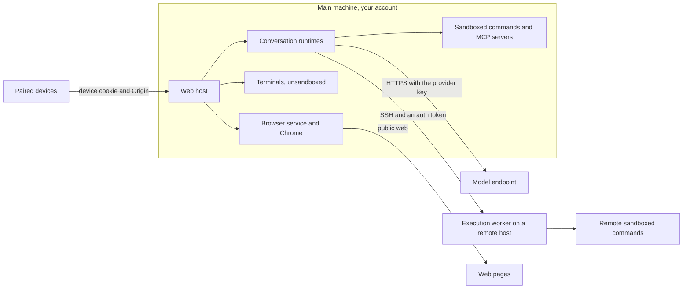

# Security

µAgent is a local, single-user coding agent. Every process it starts runs
as your user, with your authority: the web host, the conversation
runtimes, the agent's commands, the terminals and the agent's Chrome.
Approval decides who is asked before a call runs; the OS sandbox decides
what a command can reach once it runs. Neither makes µAgent a container:
an approved call acts with your permissions within the sandbox's limits,
and the configured model endpoint receives what the model reads. Use a
container, a VM or a restricted account for code you do not trust.

This page states every boundary and what you may rely on; the
[architecture pages](docs/README.md#architecture) explain the mechanisms.

## Assets

- Provider keys, in clear text in `~/.uagent/config/settings.json`.
- What decides the agent's authority: saved settings, the trust record of
  each folder's `.mcp.json`, remembered approvals
  (`~/.uagent/config/permissions.json`), instruction files and skills.
- Conversation history: sessions, attachments, plans, debug logs.
- The paired devices' tokens in `~/.uagent/web`; the browser profile with
  its logins and cookies.
- Your other files and other tools' credentials (`~/.aws`, `~/.ssh`…), and
  what you can reach: SSH hosts, the LAN, cloud metadata addresses.

## Actors

- **The model's tool calls.** Only native calls that pass their schema
  run; text resembling another harness's call syntax is recognised only so
  the reply can be suppressed and retried, never executed.
- **Content the model reads** (files, web pages, MCP output, memory,
  search results) is evidence and cannot widen what you approved; schema
  validation, path checks, the sandbox and approval enforce that.
- **Paired devices**, which act as you; **other local users**, kept out by
  owner-only files; **a remote host's account and administrators**; **the
  network** between µAgent and its endpoints, devices and hosts.

## What the agent may do without asking

No approval mode turns the sandbox off; yolo raises the `default` level to
`relaxed` and plan mode lowers it to `readonly` ([Sandboxing](#sandboxing)).

| Mode | Set with | Effect |
| --- | --- | --- |
| `ask` (default) | `/permissions ask` | a person approves each mutating, process, network, cost-bearing or untrusted MCP call, and each path outside the work area (the folder and the roots commands may write) |
| `auto` | `/permissions auto`, `UAGENT_APPROVAL=auto` | a decision model allows or denies the calls the sandbox contains; what it cannot decide, every call naming a path outside the folder, and every `run` call while the sandbox is off or not enforced go to a person, and are denied when nobody can answer |
| `yolo` | `--yolo`, `/yolo`, `/permissions yolo` | those calls run unasked; commands stay sandboxed, at `relaxed` where the level is `default` |
| `plan` | `/plan`, `/permissions plan` | only reads run: commands at `readonly` and file calls on the conversation's plan file; every other change is refused before anyone is asked; other calls ask as in `ask` |

In every mode:

- A call a kept rule covers is not asked again: `s` keeps one for the
  conversation, `a` ("Always allow here") for the repository in
  `permissions.json` (`/permissions rules`, `/permissions forget N`). A
  rule names a tool and a simple command's prefix, a folder, a host, or the
  exact call. A command that chains, substitutes or redirects matches no
  prefix, and prefixes match only while the sandbox is enforced, which
  bounds what they let through; without it commands match only exactly.
- Some calls always need a person, under yolo, auto or a kept rule alike.
  No parent agent or reviewer may answer them, and they are denied when
  nobody can, as in a headless run whose stdin is not a terminal:
  - writing µAgent's configuration through the file tools: the saved
    settings, the trust store, `permissions.json`, your instruction files
    in `~/.uagent`, your own skills (`~/.uagent/skills`, `~/.agents/skills`
    and the Claude Code and Codex folders µAgent reads), any `.mcp.json`;
  - reading any of those through the file tools, except the trust store,
    the instruction files and the skills, which hold no credential;
  - reading or changing, through the file tools, a folder the sandbox
    closes to commands (see **Reads** below);
  - the `uagent` tool's `set` (settings), `write` (instructions,
    stylesheet, system message, the folder's `.mcp.json`, a skill) and
    `command`: a slash command runs only as the exact line you approved,
    when the turn ends, and is never offered to an agent or headless run;
  - `run(sandbox=false)`, `run(root=true)`, and `agents` `delete`.

An **agent**, a conversation another one started, acts for you unattended.
It runs in Auto, or in Ask when its parent asks, unless a mode is chosen
for its own conversation (`/permissions`, `--yolo`, the web's approval
control); the saved setting does not reach it. With `edits` `none`, the
default and the only choice in plan mode, it runs at `readonly` with no
tool that edits, and so do the agents it starts. Otherwise it runs at
`default`, or `relaxed` in yolo; in Auto with that sandbox enforced, its
`run` commands and its file changes inside the work area run unreviewed.
What would ask a person goes to its parent first, which decides or passes
it on, and to you after five minutes; once you write in the agent's own
conversation, that turn asks you directly. What always needs a person goes
to you, never to the parent. An agent is never offered `root` or `command`.

**Auto review** sends the `decisions_url` of an endpoint declaring
`decisions` the tool, the folder, your latest and first messages and the
action preview, each cut to 16 KiB; with provider routing it asks for
providers that retain no data (`decisions_private`), and a session id goes
as a hash. A call is allowed only at or above the model's allow bar with
no risk question at or above its risk bar; without such an endpoint, or
when the review fails, it asks.

## Trust boundaries

### The model endpoint

The main sends the configured endpoint the system message (instructions,
memory, the skills list), the conversation, tool results and attachments;
the reviewer, title, memory, image and search routes send their own
requests. Treat every configured endpoint as trusted infrastructure.
Requests leave from the main only: a remote host never receives provider
configuration or keys, and `localhost` in a provider means the main. API
redirects are refused, and requests carrying a key use HTTP(S) only.
`web_fetch` connects, without credentials, only to public IPv4 or IPv6
addresses, checked before every connection, redirects included; proxy
variables are ignored so they cannot bypass that check.

### The folder and the processes it starts

Settings come only from flags, the environment and
`~/.uagent/config/settings.json` ([Settings](docs/interfaces/settings.md));
no settings or `.env` file is read from the folder. Folder trust concerns
`.mcp.json` alone. `~/.mcp.json` is trusted
executable configuration. A folder's `.mcp.json` runs nothing until trusted
interactively or with `--trust-project-config`, and a change to its parsed
content revokes the trust. Instruction files, memories and skills enter
model context without trust because they grant no capability; an explicit
`$skill-name` loads that skill before the first model call. Treat an
untrusted checkout as prompt input and read what it makes the agent ask
for before approving it.

Paths are canonicalised, and hidden paths are checked again when a call
runs, so a link an earlier call made cannot reach them. File writes are
atomic. Requests, responses, attachments, tool output, scans, activities,
MCP data and logs are bounded. Model, MCP and tool text is sanitised before
it reaches a terminal.

**Environment.** Every child gets a filtered environment: names that look
like credentials, `SSH_AUTH_SOCK` and `XAUTHORITY` are withheld, and so are
µAgent's settings variables except from an agent's runtime. An MCP server
also gets its entry's `env`. `UAGENT_SHELL_ENV_ALLOW` gives approved `run`
commands the exact variables it names, never MCP servers or agents;
`UAGENT_SANDBOX_HIDE_ENV` withholds more names from every child, whatever
the allowlist says.

**Activities.** `activity` `write` sends raw bytes to a `run(tty=true)`
activity's PTY with the process's permissions: treat it as process
control. An activity without a PTY, or a detached one, takes no input.

**Memory.** Extraction reads at most one idle conversation of the folder,
never one run with `--no-memory`, in one model request without tools. Its
excerpt and every memory written or read are redacted for credential
assignments, bearer tokens, private keys and known vendor token prefixes.
Codex and Claude memories are read-only evidence.

### MCP servers

An MCP call skips approval only when its server's entry sets `"trust":
true` and the tool declares itself read-only. A stdio server runs under the
command sandbox unless its entry, in `~/.mcp.json` or a trusted folder's
`.mcp.json`, sets `"sandbox": false`; the prompt to trust a folder names
the servers that would run unconfined. Server stderr goes to a
size-bounded log. An agent starts no MCP servers.

### Paired devices and the web host

The web host listens on `127.0.0.1` unless `web.bind` says otherwise.
Pairing codes are single-use, last five minutes and are tried at most 12
times a minute. A device holds an `HttpOnly`, `SameSite=Strict` cookie
(`Secure` on HTTPS) for 30 days unless revoked; revoking or logging out
ends its access, its push subscription and every preview address. Every
request must name the configured origin or the loopback URL, a mutation
must carry that exact `Origin`, and every API route but pairing needs a
device. `--web-origin` must be bare `https://`, or `http://` on a
`100.64.0.0/10` address. The app runs under a content security policy that
allows only its own scripts, connections and frames.

A paired device acts as you:

- It reads a conversation's folder as the agent can: nothing outside it,
  through a link or otherwise, and never the hidden stores or µAgent's
  configuration files. Images are served inline, other files as downloads.
- It opens terminals: your login shell, unsandboxed, with the filtered
  environment plus `SSH_AUTH_SOCK`. The agent never reads one; **Add to
  chat** puts its text into your message. `UAGENT_WEB_TERMINAL=off`
  removes terminals.
- With terminals on, it may start an update (Settings → About): the host
  runs the installer of the release GitHub names, as you, and restarts.
  The agent cannot start one.

### Previews and artifacts

A folder's pages open from `/preview/<token>/…`, a 24-byte random token
per conversation. The token is the grant: the route takes no cookie, and
the address works for whoever holds it until the host stops or a device is
revoked. It serves only web file types, with the refusals above. Each page
runs sandboxed in an opaque origin, so it reaches neither the app, its
cookie nor the API; its policy lets it load only from its own address and
Google Fonts and submit no form. `Origin: null` is accepted only to read
under `/preview/`. Under `~sheet/` the host serves its installed sheet
engine, with WebAssembly and `blob:` workers allowed. An HTML attachment
opens sandboxed in an opaque origin too.

## Sandboxing

The OS confines the commands the agent runs (`run`) and the stdio MCP
servers it starts: `sandbox-exec` (Seatbelt) on macOS, Landlock on Linux.
It is on by default, in every approval mode. The built-in file tools are
not confined by it; approval and their own path checks govern them, with
the same hidden and closed paths. `sandbox.level` (`UAGENT_SANDBOX`) sets
how far it goes:

| Level | Writes | Reads | Network | Hidden stores |
| --- | --- | --- | --- | --- |
| `readonly` | temporary files and the terminal logs only, never the folder | not your other folders | none | yes |
| `default` | the roots below | not your other folders | allowed | yes |
| `relaxed` | the roots below and your home folder, except `~/.uagent` | open | allowed | yes |
| `off` | unconfined | open | allowed | no |

In yolo at `default`, commands run at `relaxed` from the next command on;
`/status` shows `relaxed (yolo)`. `readonly`, `relaxed` and `off`, set
explicitly, stay. Plan mode runs commands at `readonly (plan)` whatever
the level, and none at `off`. A value that is no level refuses every
command until fixed; it never falls back to `default`.

Five settings win over the level, from the next `/restart`:
`sandbox.network`, `sandbox.write` (more writable roots), `sandbox.read`
(opens one of your folders to commands and the file tools), `sandbox.hide`
and `sandbox.reveal` ([Settings](docs/interfaces/settings.md)).

**Writes.** A confined command may write the folder; `$TMPDIR`, `/tmp`,
`/var/tmp` and `/dev`; the package caches (`kPackageCaches`, and
`kMacPackageCaches` on macOS, in `include/core/defaults.h`);
`~/.uagent/terminals/logs`; the `sandbox.write` roots; in a linked git
worktree, its git directory and the shared repository's `objects`, `refs`
and `logs`; at `relaxed`, the home folder. Nothing else. A requested root
is rejected, and reported at startup, when it is `/`, `~/.uagent` or an
ancestor, or inside `~/.uagent/config`. At `relaxed`, `~/.uagent` stays
closed but for its terminal logs and a workspace under `~/.uagent/spaces`.
A session started in your home folder therefore has no writable folder
below `relaxed`; start in a folder or a workspace.

**Reads.** Below `relaxed`, commands cannot read your own folders: the
visible entries of the home folder (`~/Documents`, `~/Library`, other
repositories…), the workspaces, and the folder's neighbours. Inside those
they still read the folder, the writable roots, `kReadableHomePaths`, the
folders their environment names (each `PATH` entry, the parent of a `bin`,
`GOPATH`…, and `~/go` while `GOPATH` is unset), a linked worktree's git
directories, the skill folders and the `sandbox.read` folders. Dot-folders
and everything outside the home folder stay readable. On Linux a closed
folder's names can be listed. On Linux, Landlock grants around hidden paths
by the entries present at spawn, so a running command cannot read a file
created later directly in a folder on the way to a hidden path, nor create
one directly in the home folder at `relaxed`.

**Hidden stores.** At every level but `off`, commands cannot read, write or
connect to sockets under these paths, and the file tools refuse them in
every mode:

- the browser data directory and `~/.uagent/web`;
- `~/.uagent/config`: saved settings and keys, trust store, remembered
  approvals;
- `~/.aws`, `~/.config/gcloud`, `~/.azure`, `~/.kube`, `~/.gnupg`,
  `~/.netrc`, `~/.git-credentials`, `~/.docker/config.json`
  (`kHiddenCredentialStores` in
  [`include/core/defaults.h`](include/core/defaults.h));
- `sandbox.hide` paths, less `sandbox.reveal` ones.

`~/.ssh` and `~/.config/gh` stay readable: git over ssh and `gh` are
expected work. `run(sandbox=false)` and `off` lift the hiding; yolo does
not. A path is hidden only if it exists when the command starts.

**Network.** Outbound access is allowed by default. Denying it blocks all
IP traffic on macOS, and TCP bind and connect on Linux.

**Inside the folder** a confined command cannot change `.mcp.json` or, in
a repository, `.git/config` and `.git/hooks`; it can still commit. macOS
denies the write; Linux records them before the command and puts them back
when it ends (`restored .git/hooks: sandboxed commands may not change
it`). A folder's `AGENTS.md` is an ordinary file any session may edit.

**MCP servers** run under the same policy, hidden stores included, with
the folder and package caches writable and no folder closed to reads. A
server keeps the sandbox it started with when the approval mode changes.

**Unconfined**, besides `off`:

- `run(sandbox=false)`, which always asks a person.
- `run(root=true)`, offered only to an interactive top-level conversation
  and asked every time: `sudo -S` outside the sandbox, or over ssh with
  `host`. The password, asked once a turn per machine, is written only to
  sudo's random prompt token, never reaches model context, events, logs or
  the session, shows as `***` if printed (4 or more characters, within one
  read), and is wiped at the turn's end or when a second prompt stops the
  command. A command's own `sudo` fails and names `root=true`.
- No Landlock (Linux before 5.13) or no `sandbox-exec`: the sandbox
  degrades with a warning and a `capability.changed` event, and commands
  run unconfined; if the level was set explicitly, commands are refused
  instead. A denied network on Landlock before ABI 4 refuses commands too.

A policy over 64 KiB (macOS) or 96 KiB (Linux) refuses the command.

## Browser automation

The `browser` tool drives the web host's Chrome, on Linux, while
`web.browserData` is set. You and the agent drive the same browser, and its
profile keeps your logins and cookies.

- Actions that change a page need approval like any mutating call; a
  remembered approval for a site stops applying once the page leaves it.
- The agent can use a saved login without reading it: `fill_saved` has
  Chrome fill the focused field and reads back only its length; `type`
  refuses password fields. Page text shows the start of ordinary field
  values and only `(filled)` or `(empty)` for password, one-time-code and
  card fields. The request list has no bodies. Screenshots are taken only
  once password fields, also one switched to text, are drawn as dots.
- With the sandbox on, commands cannot read the profile, and the file tools
  refuse it; keep the data directory outside the writable roots, such as
  `~/.uagent/browser`. The managed policy (`deploy/chrome-policy.json`,
  installed by the container image, by hand elsewhere) blocks Chrome's
  password and autofill pages, `passwords.google.com`, `view-source:` and
  DevTools.
- `open` takes only `http`, `https` or a file of the folder; uploads take
  only files of the folder; downloads land in its `downloads`.
- There is no CDP or VNC TCP port: the agent reaches Chrome over pipes, the
  viewer over the authenticated web host, and only the device in control
  sends input. A research browser gets a fresh profile per conversation.

## Remote execution

The main keeps provider settings, keys, approvals, memory and history.
Only file, Git, command and terminal operations cross SSH, over a master
with `BatchMode=yes`, `StrictHostKeyChecking=yes`, `ForwardAgent=no` and
`SendEnv=-*`. Every request carries an auth token the worker checks; the
token travels on SSH stdin, never in argv or the environment. The remote
side loads no settings, history or provider configuration, and the main
uses only a worker of its own build. Several mains may share one installed
executable through separately authenticated workers.

Remote commands run under the remote OS sandbox and account, with the
worker's socket and lease and the account's `~/.uagent` hidden from them.
A paired device's remote terminal is that account's unsandboxed shell.

## The container

The [Compose appliance](deploy/compose.yaml) runs the web host, the agent,
its terminals and its Chrome as one nonroot user (UID 10001); operation is
in [Container](docs/operations/container.md).

- **Files and processes.** Only the workspaces folder and a data volume are
  mounted; the root filesystem is read-only, `/tmp` is `noexec`, every
  capability but `SYS_CHROOT` is dropped, `no-new-privileges` is set and
  processes are limited. No Docker socket or host home is mounted. The port
  is published on the host's loopback only.
- **The network.** A separate container, alone holding root and
  `NET_ADMIN`, owns the shared network namespace and refuses the Docker
  bridge's gateway, `0.0.0.0/8`, `10.0.0.0/8`, `100.64.0.0/10`,
  `169.254.0.0/16` (cloud metadata), `172.16.0.0/12`, `192.168.0.0/16`,
  `224.0.0.0/3`, `fc00::/7`, `fe80::/10` and `ff00::/8`
  ([`deploy/firewall.sh`](deploy/firewall.sh)). Without its rules the
  agent's container does not start. `UAGENT_NETWORK_ALLOW` names
  exceptions; `UAGENT_NETWORK=open` loads no rules.
- **One trust level inside.** The command sandbox is on there as anywhere;
  the web terminal is yours and reads everything the container holds. The
  seccomp profile lets every process create user namespaces, as Chrome's
  sandbox requires.
- **Chrome** is fetched onto the data volume at start and daily, and
  accepted only when its checksum is in the package index Google signs,
  checked against the key shipped in the image.

## What is not defended

- **Your authority.** An approved call, an unconfined command and a paired
  device act as you. The mandatory approvals on configuration files bind
  the file tools only; an unsandboxed command reaches the same paths.
- **Exfiltration.** Commands have the network by default and read
  dot-folders (`~/.ssh`, `~/.config`, `~/.mcp.json`) and everything outside
  the home folder: a confined `cat ~/.ssh/config` puts the file into model
  context, and a command can send what it reads. In the container public
  addresses stay open, a public address of the Docker host is not refused,
  and DNS goes to the resolver Docker forwards to, which may be on your LAN.
- **The home folder at `relaxed`** (and in yolo at `default`): commands
  write shell startup files, `~/.ssh`, `~/.mcp.json`, whose servers may
  run unconfined, and the skill folders outside `~/.uagent`, which later
  sessions read.
- **Linux limits.** The `.mcp.json` and `.git` guard is a check at a
  command's end: a hook a long-running command adds is live until it ends,
  a change you make there meanwhile is undone, and a detached activity
  still running when the session ends is not checked. A denied network
  stops only TCP. Sockets under hidden paths are blocked only from Linux
  7.1 (ABI 9); before that a command can drive the browser.
- **macOS keychains** are not hidden: access goes through `securityd`.
- **Prompt injection** is bounded by approval and the sandbox, not
  detected. **Redaction** finds the forms listed above, not a bare token or
  a password named in prose.
- **Previews and attachments.** A preview address is readable by whoever
  holds it; a preview page's script can put any text, its address
  included, into a request to Google Fonts. An HTML attachment's policy
  restricts no destination.
- **The browser.** Whatever a signed-in page shows can enter model context;
  use a profile that holds only the accounts the agent should reach.
  One-time-code and card fields, closed shadow roots and other sites'
  frames are not masked in screenshots. Outside the container Chrome runs
  as you, without the seccomp profile or network rules, and the managed
  policy applies only where installed.
- **Remote hosts.** A shared SSH account isolates no user from another;
  the account and its administrators can read remote execution data and
  process memory.
- **Container output.** A script the agent wrote in the workspaces folder
  runs with your rights on the host when you run it.

## Sensitive data

Sessions and debug logs may hold source, prompts, commands, output and
reasoning. They are owner-only, not encrypted, and pruned by age and count
([On disk](docs/interfaces/on-disk.md)). `~/.uagent/config/settings.json`
is owner-only but holds saved API keys in clear text; treat it as a
secret. The web's HTTP captures redact credential headers; bodies hold
folder content. Do not attach secrets or enable debug logging unless
disclosure is acceptable. If a credential appears in a prompt, attachment,
result or trace, delete the affected artifacts and rotate the credential.

## Reporting

Use GitHub private vulnerability reporting. Include the version,
reproduction, impact and a suggested mitigation. Never put credentials or
private traces in a public issue.
