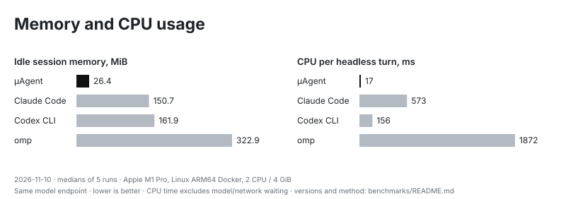

# Benchmarks

Measurements of the agent's behavior and footprint. They are trend signals,
not correctness gates, except the hermetic evaluation, which CTest runs as
`behavior_eval`. Run from the repository root:

```sh
python3 benchmarks/eval.py build/debug/uagent --check    # scenarios against the baseline
python3 benchmarks/audit.py build/debug/uagent           # request and schema sizes
cmake -B build/bench -DCMAKE_BUILD_TYPE=Release -DUAGENT_BUILD_BENCHMARKS=ON
cmake --build build/bench --target uagent_bench && build/bench/uagent_bench
```

[Testing](../docs/TESTING.md#behavioral-evaluation) covers the scenarios and
the other options.

| Path | Contents |
| --- | --- |
| `eval.py`, `run_trace.py` | Scenario evaluation and the shared run timing |
| `audit.py`, `session_metrics.py` | Request-size report and a summary of real sessions from their journals |
| `compare_agents.py` | Footprint of µAgent beside other coding-agent CLIs: a JSON report and, with `--chart`, an SVG chart |
| `bench_core.cc` | Source of `uagent_bench`, built with `UAGENT_BUILD_BENCHMARKS=ON`; `--session PATH` measures a saved conversation in place of the built long one |
| `scenarios/` | One declarative JSON file per evaluation scenario |
| `baselines/` | Committed results: `hermetic.json` gates `eval.py` |
| `results/`, `plot.py` | Dated measurement snapshots and the reproducible encoding chart; `charts.py` shares SVG layout and styling |

## Current measurements

Snapshot: **2026-11-10**, production commit `015ce3a1`, runtime build
`9bcf08dc…55a976c`. [Raw results](results/2026-11-10.json) retain package
hashes, five native benchmark samples per case, the hermetic summary and web
asset sizes. These are dated measurements, not floating claims about a later
checkout. [CI artifacts](https://github.com/timongentzsch/uAgent/actions/runs/42872865321)
supply all four native installations; local CPU measurements use an Apple M1
Pro, macOS 27.0.1 and Apple clang 21.0.0, Release `-O3`, Web Push enabled.

| Target | Main binary | Complete installation | Remote binary | Remote transfer with resources |
| --- | ---: | ---: | ---: | ---: |
| Linux x86_64 | 7.35 MB | 20.52 MB | 4.82 MB | 2.31 MB |
| Linux ARM64 | 6.43 MB | 19.60 MB | 3.94 MB | 2.10 MB |
| macOS x86_64 | 11.62 MB | 24.79 MB | 9.11 MB | 3.94 MB |
| macOS ARM64 | 10.64 MB | 23.81 MB | 8.10 MB | 4.24 MB |

MB is 1,000,000 bytes. Complete installation sums unpacked regular-file sizes,
including documentation, skills and **all four compressed gateway payloads**.
Remote binary excludes those resources; transfer includes the selected binary,
skills and licenses in one compressed archive. Filesystem allocation and system
libraries are not counted. No remote performance comparison between platforms
is implied by these size measurements.

The fresh hermetic evaluation passes **13 scenarios, 16 variants and 110
checks**, including the baseline and variant comparisons. A separate fresh-HOME
mock-provider probe advertises **14 tools / 11,437 schema bytes**, with a
2,574-character system message. It is the observed request, not every optional
tool or a count of billed provider tokens. The audit reads captured schemas
directly; no generated tool-reference file or personal profile is required.


The chart measures local payload serialization, not model or network latency.
All five core runs use the same built-in workload without a personal session.
The web bundle's first JS/CSS fetch is **192,908 compressed bytes**; all shipped
web assets total **2,289,382 compressed bytes**, including optional renderers.

Reproduce the local measurements and charts from the repository root:

```sh
cmake -S . -B build/bench -DCMAKE_BUILD_TYPE=Release \
  -DUAGENT_BUILD_BENCHMARKS=ON -DUAGENT_WEB_PUSH=ON
cmake --build build/bench --target uagent uagent_bench --parallel 4
python3 benchmarks/eval.py build/bench/uagent --check --report /tmp/eval.json
python3 benchmarks/audit.py build/bench/uagent --json /tmp/audit.json
for run in 1 2 3 4 5; do build/bench/uagent_bench > "/tmp/core-$run.txt"; done
(cd web && npm run size)
python3 benchmarks/plot.py benchmarks/results/2026-11-10.json
```

Build `web/dist` first as described in [Testing](../docs/TESTING.md#common-cases).
The charts use the committed snapshot; changing it requires new measurements,
not just a date edit. Package figures come from summing regular-file members of
each complete release archive and checking the matching gateway manifest.

## Footprint comparison

Measured **2026-11-10** on Apple M1 Pro in Linux ARM64 Docker, with 2 CPUs,
4 GiB memory and no additional swap. All tools answered the same one-word
prompt through the same Claude Haiku 5.5 endpoint. Each row is a median of
five interleaved runs; all 20 headless turns succeeded. Startup uses 30 runs
following three warm-ups. [Raw samples and provenance](results/comparison-2026-11-10.json)
include actual versions, all samples, cleanup checks and the CI archive hash.



| Tool | Measured version | Complete install (MB) | Idle memory (MiB) | CPU per headless turn (ms) |
| --- | --- | ---: | ---: | ---: |
| µAgent | 1.8.0 / `0fc24e65` | 19.6 | 26.4 | 17 |
| Claude Code | 2.1.322 | 341.5 | 150.7 | 573 |
| Codex CLI | 0.167.0 | 480.7 | 161.9 | 156 |
| omp | 18.18.6 + Bun 1.4.4 | 401.3 | 322.9 | 1872 |

µAgent's install includes all four gateway payloads. The measured binary came
from [CI run 42888183412](https://github.com/timongentzsch/uAgent/actions/runs/42888183412);
subsequent review fixes are not relabeled as measured. The runtime-only stage
of the recipe installed the competitors; the verified CI installation was
mounted read-only at `/opt/uagent`. The container shared the proxy's network
namespace to reach its localhost endpoint. Proxy CPU is outside the measured
process tree. See the raw report for the exact archive and resource limits.

CPU time measures local work, not model quality or response speed. Idle RSS
sums the tool's processes and helpers; shared pages can be counted more than
once. MiB = 1,048,576 bytes, while installation MB = 1,000,000 bytes. Detached
helper CPU uses the last observed OS process sample; sub-second work may fall
below that sampler's resolution. The current harness adds this to reaped CPU
usage, refuses to chart failed comparisons, and retains each raw sample.

Render this chart again without calling a provider:

```sh
python3 benchmarks/compare_agents.py \
  --from-report benchmarks/results/comparison-2026-11-10.json \
  --chart docs/images/comparison.svg
```

### Method

`compare_agents.py` measures each tool the same way, with runs alternating
between the tools so background load affects all of them:

- **Size:** the executable, and the installed tree (`cmake --install --strip`
  for µAgent: `bin/` and `share/uagent/`; the single versioned file for
  Claude Code; the cask directory for Codex CLI; the `node_modules` tree for
  omp). omp's sizes include the Bun runtime that runs it, as Claude Code's
  executable embeds its own.
- **`--version`:** 30 runs after 3 warm-ups; wall and CPU time.
- **Idle session:** 10 s in a 120×40 pseudo-terminal after the screen settles,
  with the provider's model list cached, at the folder-trust prompt where a
  tool asks. Resident memory is summed over the tool's own processes, helpers
  included. Codex CLI's interactive UI cannot skip the user config, so its row
  counts only Codex's own executables.
- **Headless turn:** one one-word prompt. Claude Code runs with
  `--strict-mcp-config`, an empty MCP config and only project settings; Codex
  CLI with `exec --ignore-user-config`, or with only the provider config the
  container writes (`--codex-config`); omp without extensions, skills, rules,
  LSP or a saved session, with its provider set through `--omp-env`.

Processes are attributed by PID: the started process, its descendants, and new
detached processes started from the tool's executable. Idle memory varies
between runs by tens of MB for the Node-based tools. Time to first screen ends
at the first half second without output, so a startup animation (omp's logo)
counts in full.

### In a container

`footprint.Dockerfile` builds µAgent from its
checkout beside Claude Code, Codex CLI and omp, all four answering through one
endpoint that serves Claude
Haiku 5.5 on the Responses and Anthropic Messages routes (`footprint-run.sh`
lists the paths). The current recipe installs the complete gateway bundle
through `install.sh`. For an unpublished checkout, put its verified matching
bundle in `remote-bundle/` before building; see
[source/container installation](../docs/REMOTE_HOSTS.md#installers-and-containers).
Codex, Bun and omp have pinned build arguments; Claude Code uses its installer.
Retain the generated JSON's actual version strings with any new comparison.
Run it on an otherwise idle host with fixed limits:

```sh
docker build -f benchmarks/footprint.Dockerfile -t uagent-footprint .
docker run --rm --cpus=2 --memory=4g --memory-swap=4g --network host \
  -e PROXY_URL=http://127.0.0.1:8787 --env-file proxy-key.env \
  -v "$PWD/out:/out" uagent-footprint \
  --machine "YOUR CPU, Linux container, 2 CPU / 4 GiB"
```

`proxy-key.env` holds `PROXY_KEY=…`; keep it out of the repository. The chart
and the raw runs land in `out/`.
