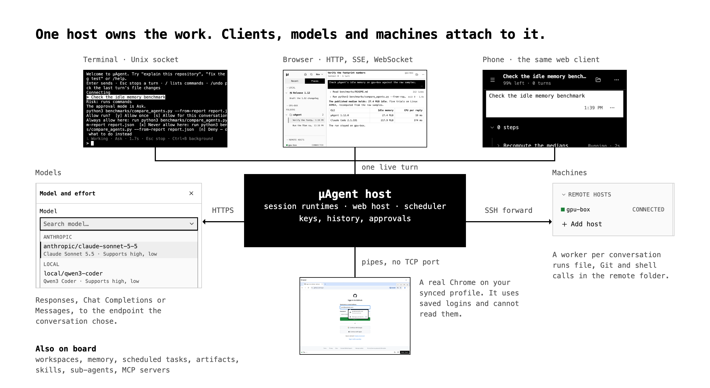

# Documentation

µAgent is one executable that takes several roles. A long-lived host process
owns conversations, provider keys, approvals and schedules. Terminal, browser
and phone clients attach to it. Tools execute in the host's folders, on
machines reached over SSH and in a Chrome the host drives.

## Headline features

| Feature | Use it | How it is built |
| --- | --- | --- |
| Native remote: a conversation's tools execute in a folder on another machine while the agent loop, keys and history stay on the host | [Remote hosts](manual.md#remote-hosts) · [Connect an SSH host](operations/remote-access.md#connect-an-ssh-execution-host) | [Execution gateway](architecture/execution-gateway.md) |
| Chrome with your profile: the agent drives a real, signed-in Chrome and uses saved logins without reading them | [The agent's browser](manual.md#the-agents-browser) | [Browser service](architecture/browser.md) · [Password handling](../SECURITY.md#browser-automation) |
| One host, every client: terminal, browser and phone follow and steer the same live turn | [Join a running conversation](manual.md#join-a-running-conversation) · [Pair a device](operations/remote-access.md#pair-a-device) | [Process model](architecture/overview.md) · [Web host](architecture/web-host.md) · [Sessions](architecture/sessions.md) |
| Any model: OpenAI Responses, Chat Completions and Anthropic Messages, chosen per conversation | [Models and providers](manual.md#models-and-providers) | [Providers](architecture/providers.md) |

## Also on board

| Feature | Use it | How it is built |
| --- | --- | --- |
| Workspaces, folders, side chats and search | [Conversations](manual.md#conversations) | [Sessions](architecture/sessions.md) · [Web client](architecture/web-client.md) |
| Approvals, rules, Auto review and the sandbox | [Approvals and plan mode](manual.md#approvals-and-plan-mode) | [Tools and approvals](architecture/tools.md) · [Sandbox](architecture/sandbox.md) |
| Memory, skills and scheduled tasks | [Memory, skills and schedules](manual.md#memory-skills-and-schedules) | [Memory and schedules](architecture/memory-and-schedules.md) |
| Artifacts: documents, decks, sheets, designs and whiteboards | [Artifacts](manual.md#artifacts) · [Supported formats](interfaces/artifact-formats.md) | [Artifact rendering and editing](architecture/artifacts.md) |
| Sub-agents and the to-do list | [Agents and the to-do list](manual.md#agents-and-the-to-do-list) | [Turn loop](architecture/turn-loop.md) |
| MCP servers over stdio | [Settings](manual.md#settings) | [Tools and approvals](architecture/tools.md) |

[Full user manual](manual.md) · [Terminal shortcuts](manual.md#slash-commands-and-shortcuts)

## Architecture

Start with the [process diagram and source map](architecture/overview.md). The subsystem guides describe ownership, contracts, failure modes and tests.

| Subsystem | Guides |
| --- | --- |
| Model requests and tool execution | [Turn loop](architecture/turn-loop.md) · [Providers](architecture/providers.md) · [Tools and approvals](architecture/tools.md) · [Sandbox](architecture/sandbox.md) |
| Durable conversations | [Sessions](architecture/sessions.md) · [Memory and schedules](architecture/memory-and-schedules.md) |
| Devices and remote machines | [Web host](architecture/web-host.md) · [Web client](architecture/web-client.md) · [SSH execution gateway](architecture/execution-gateway.md) |
| Browser and file previews | [Chrome service](architecture/browser.md) · [Artifact rendering and editing](architecture/artifacts.md) |

## Interfaces

[CLI and commands](interfaces/cli.md) · [Settings](interfaces/settings.md) · [Tool schemas](interfaces/tool-schemas.md) · [Runtime limits](interfaces/limits.md)

[Headless JSON and streaming](interfaces/headless.md) · [HTTP API and sockets](interfaces/http-api.md) · [On-disk layout](interfaces/on-disk.md) · [Artifact formats](interfaces/artifact-formats.md)

## Operations

[Install and update](operations/install.md) · [Container](operations/container.md) · [Remote access](operations/remote-access.md) · [Budgets and recovery](operations/budgets-and-recovery.md)

## Development

[Build and contribute](../CONTRIBUTING.md) · [Tests and CI](testing.md) · [Benchmarks](../benchmarks/README.md) · [Security](../SECURITY.md)
