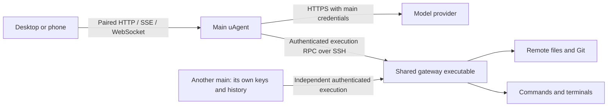

# Remote hosts

The main uAgent owns settings, providers, API keys, model selection, conversations,
history, memory, approvals and schedules. Provider HTTP requests go directly from
that main machine to the configured provider. A remote host supplies files, Git,
commands and terminals through a small execution gateway. Provider localhost URLs
refer to the main machine.

## Connect

1. Open **Hosts** at the bottom of the sidebar, then **Add host**.
2. Enter an SSH alias or `user@machine`. This uses the main machine's SSH
   configuration, keys, jump hosts and known hosts.
3. The main copies the matching bundled native executable when needed. Opening a
   remote folder or conversation starts or reuses its isolated execution process.
4. Choose **New conversation** or **New folder**, select its **Host**, then choose
   a folder in the shared Files tree. You can also enter a path or `~`.
   Conversations appear under their host and name it in the header. Pins work
   across hosts; **Recent** is collapsible.

The bottom **Hosts** panel monitors connections; it does not switch application
mode. Open a host for its status, reconnect/disconnect controls and measured
**Main → host** SSH request round trip. Connected rows refresh this measurement
every 30 seconds; open details refresh every 5 seconds. The value includes
SSH command startup and is not a browser ping or raw network ICMP latency.
Choose the execution host with an action; an existing conversation or folder
already supplies that context. Settings, providers and models remain global.

The first connection requires working, noninteractive SSH access. On the main
machine, run `ssh ALIAS` to verify the fingerprint. If key access is missing, run
`ssh-copy-id user@machine`, then verify `ssh ALIAS` again. Never copy keys into the
browser or disable host verification.

Linux requires glibc 2.38 or later; macOS requires version 15 or later. Both
support x86_64 and ARM64. Linux also needs the standard C++ runtime, libcurl,
OpenSSL 3 and zlib. Remote setup needs no compiler, sudo or network download.
Managed executables and resources live in immutable build directories under
`~/.uagent/remote/builds/`. The user's normal uAgent CLI stays in place.

## Ownership and isolation

Several main instances can use the same installed executable. Each main has a
private client identity, and each conversation or terminal has its own execution
process, cwd, sandbox and cancellation state. Different SSH accounts run under
their own OS identities. Sharing an account shares that account's ordinary file
permissions; it does not create filesystem isolation between people.

The gateway receives execution arguments, a narrow sandbox preset and a private
RPC credential, supplied over SSH stdin. It receives no provider configuration,
model catalogue or provider keys. RPC credentials are held in memory remotely and
are required on every request. They are not placed in remote argv or environment.
SSH helpers use a filtered environment and disable agent/environment forwarding.

The remote gateway does not load or save application settings, history, memory,
pins or schedules. Workspace edits and installed executables persist; process
handles, terminal buffers and request receipts are ephemeral. A remote administrator
can inspect remote work and execution-process memory; provider credentials remain
on the main. Existing remote CLI data is neither migrated nor removed.

## Connection and recovery

| State | Behavior |
| --- | --- |
| Connected | SSH is available; execution contexts attach when used. |
| Connecting | Repeated Connect or Reconnect joins the current attempt. |
| Reconnecting | Network failures retry with bounded, jittered delays around 1, 2, 4, 8 and 15 seconds. |
| Disconnected | Initial main startup, explicit disconnect, authentication failure or exhausted retries waits for Connect or Reconnect. |
| Main unavailable | Restore the browser's connection to the main first. |

**Reconnect** is available in host details and resets the retry budget.
Authentication failures show an SSH action to take instead of retrying forever.
Paging loaded history, expanding groups and refreshing the page do not initiate
SSH. Explicitly opening a remote conversation or folder can connect its host.
Saved hosts start disconnected after restarting the main. You can also choose
**Reconnect** in host details, or **Connect** while selecting a host for new work.

**Disconnect** closes SSH access. Main-owned history remains readable; already
running remote commands and terminals can survive a transport drop. Reconnect
queries request receipts instead of replaying uncertain mutations. A restarted
remote process reports lost handles as interrupted. Closing a conversation stops
its owned jobs; an unused execution process exits after a grace period.

Terminal identities are saved on the main so the same build can reattach after a
main restart. Remote restart or a main build upgrade interrupts access to old
terminal handles; it cannot reconstruct terminal output from durable history.
Keep terminal work in a remote terminal multiplexer when it must survive those
boundaries.

## First-version limits

Remote project MCP, project skill discovery, browser tools/transfers, named remote
workspaces, worktree delegation, worktree schedules and moving remote conversations
between folders are unavailable. Global skills and manual memory tools stay on the
main; automatic memory extraction and interactive remote sudo prompts are deferred.
Settings, providers, model selection, Library assets and Scheduled are main-owned.
Remote previews are served through the main's authenticated preview capability.

## Installers and containers

A remote-ready installation contains a manifest and four verified payloads in
`share/uagent/remote/BUILD_ID/`. Native CI assembles all four from identical
runtime inputs and includes the complete bundle in each release archive.
The remote executable omits the web app and carries its bundled resources.

A source install looks for an installed matching bundle, an explicit
`UAGENT_REMOTE_BUNDLE` directory, or the exact published bundle for that build.
An incomplete or mismatched bundle fails before replacing the main executable.
`UAGENT_LOCAL_ONLY=1` explicitly permits a local-only developer install.

For a container built from an unpublished checkout, place the verified complete
bundle in `remote-bundle/` before building. Published source builds can retrieve
the exact bundle from the matching release. The image includes OpenSSH.

The container's `agent` user runs SSH. Configure aliases and owned `known_hosts`
in `/data/agent/.ssh`. Supply a dedicated key owned by UID 10001 with mode 0600,
or mount an SSH agent socket and set `SSH_AUTH_SOCK`. Mount only the keys/config
needed for these hosts. Check access as that user with
`docker compose exec uagent ssh -o BatchMode=yes ALIAS true`.
