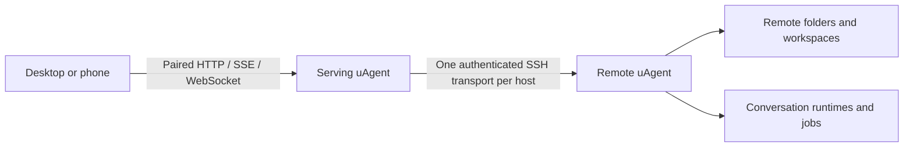

# Remote hosts

The serving uAgent host owns the web interface and SSH connections. A remote
host owns its conversations, files, tools, configuration and schedules. A
folder path always refers to the selected host.

## Connect

1. Open **Hosts** at the bottom of the sidebar, then **Add host**.
2. Enter an SSH alias or `user@machine`. This uses the serving host's SSH
   configuration, keys, jump hosts and known hosts.
3. The serving host copies the matching bundled native payload, starts or
   reuses the remote backend, and forwards its private API over SSH.
4. Open the host or enter an absolute path in **Open folder**. Workspaces and
   conversations appear under their host. Pin conversations as usual; Recent
   is a collapsible list of the ten newest unpinned top-level conversations.

The first connection requires working, noninteractive SSH access. On the
serving host, run `ssh ALIAS` to verify the fingerprint. If key access is
missing, run `ssh-copy-id user@machine`, then verify `ssh ALIAS` again.
Never copy keys into the browser or disable host verification.

Linux requires glibc 2.38 or later; macOS requires version 15 or later. Both
support x86_64 and ARM64. No compiler, sudo or network download is used during
remote setup. The user's normal uAgent CLI is left in place. Managed payloads
live under `~/.uagent/remote/`; resources stay beside each version's executable.

## Connection and recovery

| State | Behavior |
| --- | --- |
| Connected | The remote catalogue and event cursor catch up before writes are enabled. |
| Connecting | Repeated Connect or Reconnect joins the current attempt. |
| Reconnecting | Unexpected failures retry with bounded, jittered delays around 1, 2, 4, 8 and 15 seconds. |
| Disconnected | Explicit disconnect and exhausted retries stay down until a user chooses Connect or Reconnect. |
| Serving host unavailable | Restore the browser's connection to the serving host first. |

**Reconnect** is always available in remote host details. It resets an exhausted
retry budget. **Disconnect** closes SSH access; remote work continues. Reading
cached metadata, expanding groups, refreshing the browser, restoring a URL or
resuming the UI never initiates SSH.

Unsent drafts and navigation metadata are retained per host. Transcripts and
remote files are not cached on disk by the browser. Commands are never replayed
after a drop; receipts determine the status of uncertain sends.

The backend is detached from SSH and shares the existing per-user master lock
and state. Reboot persistence is separate: no service or login item is generated.
An existing web service is reused when its exact build matches. A different
service build requires its owner to update and restart it.

Automatic managed updates use an authenticated remote admission gate. Mutations,
scheduler admissions, live runtimes, jobs and terminals block replacement.
An attached idle runtime is conservatively treated as active until it closes
or retires. Older hosts without the gate require an explicit update. A private
install lock serializes publication; each version's resources are immutable.

## Installers and containers

A remote-ready installation contains a manifest and four verified payloads in
`share/uagent/remote/BUILD_ID/`. Native CI assembles all four from identical
runtime inputs and includes the complete bundle in each release archive.
The normal executable embeds the app; the remote executable embeds only the
required preview helper and carries its bundled skills and notices.

A source install looks for an installed matching bundle, an explicit
`UAGENT_REMOTE_BUNDLE` directory, or the exact published bundle for that build.
An incomplete or mismatched bundle fails before replacing the main executable.
`UAGENT_LOCAL_ONLY=1` explicitly permits a local-only developer install.

For a container built from an unpublished checkout, place the verified complete
bundle in `remote-bundle/` before building. Published source builds can retrieve
the exact bundle from the matching release. The image includes OpenSSH.

The container's `agent` user, not the browser or Docker host, runs SSH. Configure
its aliases and owned `known_hosts` in `/data/agent/.ssh`. Supply a dedicated key
owned by UID 10001 with mode 0600, or mount an SSH agent socket and set
`SSH_AUTH_SOCK`. Mount only the keys/config needed for these remote hosts. Do not
mount a whole personal home directory. Check access as that user with
`docker compose exec uagent ssh -o BatchMode=yes ALIAS true`.

Device pairing, gateway hosts, push subscriptions and app appearance belong to
the serving host. Library, Scheduled, search and execution settings name the
selected execution host. Remote push aggregation is deferred.
