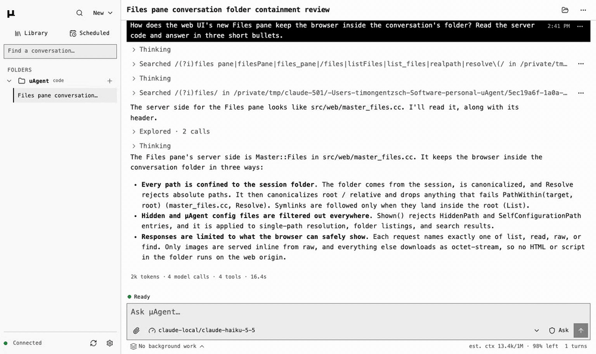

# Web interface

`uagent --web` serves µAgent to a browser: the same conversations as the
terminal, on this machine or on a paired phone.

## Quick start

```sh
uagent --web
```

```text
uagent web: http://127.0.0.1:8080
Pairing code (single use, 5 minutes): <code>
Or open: http://127.0.0.1:8080/#pair=<code>
```

Open the `#pair=` link: it pairs the browser and drops the code from the
address. Or open the URL and type the code.

- **Pair another device.** Run `uagent --web` again. It reuses the running
  host, which keeps its port and origin whatever flags you pass, and prints a
  fresh code that replaces the previous one.
- **A refused code** (used, mistyped or older than five minutes) says it
  expired. Run `uagent --web` again.
- **Remove a device.** Settings → Host → Paired devices → **Revoke**, or
  **Log out this device**.
- **Keep it running.** The installer offers to run `uagent --web` as a
  service of yours that starts when you log in: a systemd user unit
  (`uagent-web`, and with lingering also while you are logged out) on Linux,
  a launchd agent (`com.github.timongentzsch.uagent.web`, logging to
  `~/Library/Logs/uagent-web.log`) on macOS. It runs with the `PATH` of the
  shell that installed it, so agent commands find the same tools, and an
  update restarts it. `uagent --web` then only prints a pairing code.

The sidebar groups this main's conversations by execution host, then by place:
**Workspaces** on Local and **Folders** on Local or a remote host. A place's name opens its overview, the chevron
before it folds the place away (remembered per browser) and **+** starts a
conversation there. Each conversation is followed by its agents: those at
work or waiting with their state; finished agents remain accessible from
their reports and search. **Recent** is collapsible. **Pin** in the
menu of a conversation, workspace or folder moves it to a **Pinned** section
at the top, in the order pinned; **Unpin** returns it. The pins belong to
the main, so every paired device shows the same, including remote conversations. Browsing saved history
starts no model and runs no command.

On a touch screen only the open row draws its ⋯; a long press on any row opens
its menu when you lift, once the row has marked itself held. A screen reader
and a keyboard reach every row's menu as usual. On a phone, opening a
conversation slides it in, pulling a sheet down closes it, and a swipe from the
left edge opens the list.

A place's **overview** shows its name, path and, in a git repository, the
branch and how many files are uncommitted; a field that starts a
conversation there; what is working, what needs you, today's spend (and 7
days'), the files changed today and how many conversations there are. Below
come the decisions that wait on you, each answered in place as in its
conversation, and the conversations as cards (a list on a phone; the toggle
is remembered per browser), each with its state (Working, Needs you,
Stopped, Idle), current step, to-do progress, agents, last change and cost.

**New** at the top of the sidebar and **New conversation** on the home screen
start work. Conversation and folder actions choose a **Host** and reuse the
Files tree to browse a directory; typing a path remains optional. Named
**Workspaces** belong to Local. An existing conversation or folder supplies its
host, shown beside the conversation title. There is no application-wide host
switch. The bottom **Remote hosts** panel shows status and measured main-to-host SSH
round trip, with **Add host**, **Reconnect** and **Disconnect** in host details.
[Remote hosts](REMOTE_HOSTS.md) explains setup and recovery.

- A **workspace** is a folder the host keeps under `~/.uagent/spaces/`,
  created the first time its name is used. Use one for work that belongs to
  no folder, rather than the home directory, which
  [commands cannot write](../SECURITY.md#sandboxing). Its name may be several
  words; renaming it (the menu beside the name) moves nothing. Deleting a
  workspace removes its conversations and its folder with every file in it.
- A **folder** is a directory of yours. It is listed while it has
  conversations, and µAgent never removes it.

**Files** (the folder button in a conversation's header) shows the
conversation's folder beside the chat, or as a sheet on a small screen. The
folder is a tree, as VS Code's Explorer draws one: a folder opens in place,
the arrow keys walk and open it, and the folders left open are kept per
folder on this device. Search finds a file by name anywhere in the folder.
Code opens with line numbers and highlighting, Markdown rendered with its
images (**Source** shows the text), a picture where it can be zoomed, a film
to play; an HTML page runs live (**Source** shows its code); any other file
offers a download. In a git repository, **Changes** lists what differs from
the last commit, with its count, and opens each as a diff. What is open is
read again when a turn ends. Files changes the folder only where this guide
says so: a document's or a slide's text edited in place, a deck's slides moved,
duplicated or deleted, a sheet's cells edited, and a sheet saved from an
Excel or CSV file.

### Artifacts

What the agent makes as HTML with the `artifact` skill opens live in Files,
each page in a sandboxed frame that reaches neither the app nor its API. A
page's head says what it is:

| Artifact | In the folder | Opens as |
| --- | --- | --- |
| Document | one page with `<meta name="print" content="flow a4">` | the page, beside a legend of its pages |
| Deck | a folder of pages with `<meta name="artboard" content="1920x1080 slide">`, one file per slide in name order | the slide, beside a legend of the slides |
| Design | a folder of pages with `<meta name="artboard" content="1440x900">` (or a width only, for a page as tall as it reads) | a canvas |
| Design system | a folder with a `tokens.css` | its brand book, `book.html` |
| Sheet | one page with `<meta name="sheet">` and a `<table data-sheet>` per tab | a spreadsheet grid, its tabs under it |

**The viewer.** A page opens across the pane with what it is part of in a
legend beside it (under it, as a filmstrip, in a narrow pane): a deck's
slides or a document's pages as numbered thumbnails, a design's pages. A
counter with previous and next sits on
the page; the arrow keys, Page Up and Down, Home and End step through it,
by slide or by page. **Find** looks through every slide or the whole
document. **Select** picks an element: a comment on it is added to your
message as a line naming the page, the element and its text, and the pane
stays open for the next one. **Tweaks** tries the levers the page declares
(colours, ranges, choices, switches) and a design system's themes at once;
**Keep** adds them as a line for the agent. **Present** shows the page over
the whole app (full screen where the browser allows). **Export** saves a
PDF, at the artboard's size or on a document's paper, and where the
[agent's browser](BROWSER.md) runs, a PNG at twice its size (or copied as an
image); **Draw on it** opens that picture in the image viewer's markup. The
page starts at its fit and zooms with −, + and Fit, ⌘/Ctrl with the wheel or
a pinch. A page that fails is marked in the legend, and **Ask agent to fix**
puts its errors in your message. A page the agent writes reloads as the
write finishes.

**A deck** is 16:9 unless you ask for another size. A slide's last `<aside>`
is its speaker notes: shown under the slide, never on it, and in **Presenter
view**, a window of its own with the slide now and the next, the notes and a
clock; either window moves both. Drag a slide in the legend to a new place,
or use **Slide actions** beside the counter (also a right click on a slide)
to move it up or down, duplicate it or delete it; the files are renamed to
keep the order. Export offers the deck's PDF, a sheet a slide.

**A document** is on A4 unless you ask for Letter, Legal, A3, A5, landscape
or a size in millimetres, with margins of 25 mm unless you ask for narrow,
moderate, wide or your own. It is shown a sheet of its paper at a time; the
browser breaks the pages as it does for print, so they are the PDF's but
for what browsers do differently (Safari leaves a heading at the foot of a
page). A link to a place in it turns to that page. Export gives it as PDF or
Markdown, and the page shown as a picture.

**Edit**, on a document or a slide, lets you type in its headings,
paragraphs, list items and table cells. What you type is saved to the file
when you pause, and before the pane goes anywhere else or exports; the
legend follows once you leave the block. A block the agent changed
meanwhile is not written over: the pane says so and keeps what you typed on
the page.

**A design's canvas** shows everything its folder holds: the pages, each
live, and also its pictures and films at their own size, and a document or a
deck in it as a stack with a count. Pages named `NN-screen[--state].html`
form a row per step `NN` (`02-sign-in.html` and `02-sign-in--error.html`
share row 02); what has no step forms the first row. The canvas is a plane:
drag or scroll to pan; pinch, a trackpad pinch or ⌘/Ctrl with the wheel
zooms at the pointer; − and + zoom, **Fit** shows everything. A click opens
a page in the viewer, a picture or a film as its file, a stack as its
document or deck; **Back** returns to the canvas.

**A design system's brand book** is a page the agent writes beside its
`tokens.css`: A4 pages art-directed in the system's own colours and type,
printed to PDF a sheet a page. A page that links a `tokens.css` shows its
themes and colours under Tweaks; **Keep theme** adds them as a line for the
agent.

**A sheet** is a workbook in one page: each table is a tab, a cell holds
what a person would type, and the grid shows what the formulas come to. The
engine that calculates ([IronCalc](https://www.ironcalc.com), WebAssembly)
is installed with µAgent and loaded by the page, never by the app. The bar
above the grid shows what the selected cell holds; typing replaces it, and
Enter, F2 or a double click edits it in place. Arrows, Tab and Enter move;
copy, cut and paste work with other spreadsheets; ⌘/Ctrl+D fills down and
⌘/Ctrl+Z undoes. A header's ▾ sorts by its column or shows only the rows
that contain some text; a row's number or a column's letter inserts and
deletes; a right click offers all of these. Every change is saved into the
file, where only that tab's table is rewritten; if the agent changed the
file meanwhile, the change is not saved and the sheet is shown as the file
is now. The bar under the grid holds the tabs (⌘/Ctrl with Page Up and Down
changes tab), what a selection of numbers comes to, **Undo**, **Redo** and
**Comment**, which adds the selected range (`Costs!C2:C6`) to your message.
Cells in error are listed with **Ask agent to fix**. A grid is as large as
its table: a new row or column is inserted, not typed past the edge.

The agent can give a sheet rules, which fill, embolden or strike the cells
or rows that meet a condition (done, overdue, below zero), and charts: bars,
stacked bars, lines or a pie drawn over the grid from a range, redrawn as
its cells change. **Chart** adds one from a selection; its menu changes its
kind or deletes it, and the mouse moves and resizes it.

An `.xlsx` or `.csv` file opens in the same grid, read-only. **Save as
sheet** writes it as a sheet beside the file, which is then edited like any
other. Export gives a sheet as an Excel workbook, with its rules, or its
open tab as CSV, as the cells show. From an Excel file come the cells, their
formulas, number and date patterns and column widths; merged cells, fonts,
borders, fills and the file's own charts and conditional formats do not. A
CSV file's cells are kept as written: only a plain number, a date or TRUE
and FALSE is read as more than text, so a phone number or a code with
leading zeros stays what it was.

What the agent hands over with `present` shows under its reply as a card
with its cover live and small, what it is and how much it holds; **Open**
shows it in the pane. The Library lists every artifact of every folder.



Drag the edge of the sidebar, Files or its list, or the top of the
terminal, to resize it, or focus the edge and use the arrow keys (Shift for
larger steps). A double-click or Enter restores the default size. Each device
keeps its own sizes.

`--web` starts no conversation itself, so it refuses session flags (`-p`,
`--json`, `-c`, `--resume`, `--yolo`, `--attach`, `--model`, …). It reads the
settings saved for all conversations and the environment, never a folder's.

| Flag | Setting | Default |
| --- | --- | --- |
| `--web-port PORT` | `UAGENT_WEB_PORT` | `8080` (1024–65535) |
| `--web-origin ORIGIN` | `UAGENT_WEB_ORIGIN` | empty (loopback only) |
| | `UAGENT_WEB_BIND` | `127.0.0.1`; `0.0.0.0` listens on all interfaces |
| | `UAGENT_WEB_PUSH_CONTACT` | empty (no background push) |
| | `UAGENT_BROWSER_DATA` | empty (no shared browser) |
| | `UAGENT_WEB_NOTIFICATION_DETAIL` | on (background notifications name the conversation) |
| | `UAGENT_WEB_TERMINAL` | on ([the terminal](#terminal)) |
| | `UAGENT_WEB_TERMINAL_IDLE_MINUTES` | `60` (1–10080) |
| | `UAGENT_WEB_UPDATE_CHECK` | off (ask GitHub for a newer release once a day) |

Save one from a terminal session with `/config user KEY=VALUE`, or set it in
the host's environment. Each applies when the web host next starts.

## Remote access and installation

The host listens on loopback. To reach it from another device, put an HTTPS
reverse proxy in front of the port and give the host its exact public origin:

```sh
uagent --web --web-origin https://your-host.example
```

The origin is bare (scheme, host and optional port, no path). Forwarded
headers never override it, and the browser must use exactly that origin.
[Tailscale Serve](https://tailscale.com/docs/features/tailscale-serve) can
provide a private HTTPS endpoint. The proxy must forward the event stream
(`/api/events`, Server-Sent Events) and WebSocket upgrades on
`/api/terminals/` and, for the [shared browser](BROWSER.md),
`/api/browser/viewer`.

For a quick test without HTTPS, an HTTP origin with a literal IPv4 address in
the tailnet range `100.64.0.0/10` is also accepted:

```sh
uagent --web --web-port 18080 --web-origin http://100.64.0.10:18080
tailscale serve --bg --tcp=18080 tcp://127.0.0.1:18080
```

Tailnet HTTP is not a browser secure context, so the app cannot be installed
and notifications stay off. To test those without trusted HTTPS, forward the
port and open the loopback URL:

```sh
ssh -N -L 18080:127.0.0.1:18080 you@100.64.0.10
# Open http://127.0.0.1:18080 in the local browser.
```

The loopback origin is always accepted alongside the configured one, with the
same pairing, device authentication and Origin checks.

**Install as an app.** Settings → Host → Install. Installing from another
device needs trusted HTTPS. On iOS, use Safari → Share → Add to Home Screen,
then pair the installed app if its storage is separate. Settings → Host →
**Apply update** offers a new version; it never reloads by itself over a
draft or a pending decision.

## Notifications

Turn them on per device under Settings → Host → Notifications. A
notification is sent when a turn completes, a decision waits on you or a
conversation fails. It names the conversation and why (needs your approval,
has a question, ran into an error, finished), never a prompt, command or
answer, and opens the conversation at its decision. That text shows on the
lock screen and goes through the browser's push service, encrypted; with
`UAGENT_WEB_NOTIFICATION_DETAIL=off` the notice says only that µAgent needs
your attention.

| Mode | When | Needs |
| --- | --- | --- |
| Background push | The app may be closed | `UAGENT_WEB_PUSH_CONTACT` set to a `mailto:` or `https://` contact, a build with Web Push, a browser with push support |
| Connected view | Only while this page stays connected | Nothing on the host |

Both need a secure context (HTTPS or loopback) and the browser's permission.
On iOS, enable them from the installed Home Screen app. Without background
push, the pane says why. **Send test notification** checks delivery, which is
best effort; the conversation remains authoritative.

Web Push is built into release archives and the Docker image. Source builds
opt in with `-DUAGENT_WEB_PUSH=ON` and need OpenSSL 3.

## Terminal

A terminal is your own shell on the conversation's execution host. There are two kinds, up to eight
shells at once:

- **A folder's terminal** starts from **+ → Terminal** on a folder or
  workspace in the list, or **New terminal** on its overview. It is listed
  under that place, beside its conversations, and on the overview, on every
  paired device, and opens in the conversation's place (the whole screen on
  a phone). Its row is a conversation's: a name, the time it started, and a
  ⋯ menu to pin, rename or close it. It is called "Terminal 1", "Terminal 2"
  and so on, the lowest number free in the folder, and keeps its name when
  another closes; a name lasts as long as the shell.
- **The page's own terminal** (the button in the header, Ctrl+`, also ⌘+`
  on a Mac) opens a panel under the chat and Files, in tabs like VS Code's
  terminal. **+** starts another, in the open conversation's folder, or in
  your home folder when no conversation is open. Its shells belong to this page:
  hidden, the panel keeps them running; they end when their tab closes or
  the page is left or reloaded, and are never listed.

- **It is your shell, unsandboxed.** It runs as you, your login shell
  (`$SHELL`, else `/bin/sh`) with `TERM=xterm-256color`, and can do whatever
  you can. That is why only a [paired device](#security-model) reaches it,
  from the app's own origin. µAgent's credentials and settings are not in its
  environment: it gets the same environment as the agent's commands, without
  API keys or `UAGENT_*` settings, but with your ssh agent (`SSH_AUTH_SOCK`),
  so `git push` works as in any terminal.
- **The agent never sees it.** **Add to chat** puts the selection, or what
  the terminal shows, into the conversation's message as a code block. It
  sends nothing; you read it and send it.
- **A folder's terminal keeps running.** It lives in the web host, not the
  page. A reload, a phone that slept or another device opens it again from
  the list and is shown its recent output; one device at a time types into
  it, and the one it moved from offers **Use here**. It ends when you close
  it, when it exits, or when no device has had it open and it printed
  nothing for `UAGENT_WEB_TERMINAL_IDLE_MINUTES` (Local) or 24 hours (remote).
  Stopping the web host ends
  its Local shells; no shell output is written to disk. Remote shells live in
  the execution gateway; the main saves only their identities, so they can
  survive SSH loss or a same-build main restart.
  Reconnect to reattach; a remote restart or build upgrade loses their handles.
- **Turn it off** with `/config user UAGENT_WEB_TERMINAL=off`, or in
  Settings → All conversations; it applies when the web host restarts. The
  routes then refuse and the terminals are gone.
- **In the Docker image** the web host runs in the container, so the shell
  is one in the container, not on the machine that runs it.

On a touch screen a key bar under the terminal adds Esc, Tab, a sticky Ctrl
and the arrows.

## The agent's browser

The web host can run a Google Chrome that the agent drives and that you can
watch, take over and sign in to from any paired device, in the Docker image
or on a Linux host. [The agent's browser](BROWSER.md) covers setup, profiles
and saved logins, the viewer and isolation.

## Execution and persistence

A conversation has one runtime, whichever interface started it. The terminal
and the web can both send messages, add guidance, answer approvals, change
settings and inspect activity. See [Architecture](ARCHITECTURE.md) and
[Persistence](PERSISTENCE.md).

| Action | Effect |
| --- | --- |
| Close the tab, detach a terminal, restart the web host | The runtime keeps running |
| **Stop** | Interrupts the current turn |
| **Close conversation** (conversation menu) | Saves the conversation, then stops the runtime and its supervised children |
| 15 minutes with nothing to do | The runtime stops the same way by itself |

"Nothing to do" means no turn, no queued message, no running command and no
terminal attached. The next message, or a change to the conversation's
settings (model, approval mode, tools), starts a runtime from the saved
conversation with its model and approval mode. It never repeats an earlier
command. Commands started with `detach` keep running through both.

On Linux, a web host launched by systemd starts each runtime in its own user
scope through `systemd-run` (254 or newer), so a service restart does not
kill it. Keep the service's normal kill policy; Close owns session shutdown.

When the connection drops or the page reloads:

- A reload paints the app's frame before any script runs, then the page it
  showed (a conversation, Library or Scheduled) drawn from samples, and the
  conversation fills it in place. The conversation is asked for together
  with the conversation list.
- A host that cannot be reached keeps the app on screen and says so while it
  tries again; only a host that refuses this device shows the pairing form.
- The status control under the input shows "Reconnecting…". The browser reopens the event stream
  at the last event it applied and the host replays the rest; the list and
  open conversation are read again only when the host can no longer replay.
  Controls stay disabled until the browser has caught up.
- A sent message shows as pending until the runtime accepts it. Reconnecting
  does not send it twice.
- A message the host refused or never confirmed stays at its row with the
  reason, **Retry** and **Return to composer**. A failed decision reply stays
  on the decision with **Retry**.

Cost and the context counter work as in the terminal; see
[Budgets and accounting](OPERATIONS.md#budgets-and-accounting).

## Conversation controls

### Status and decisions

One control under the input says how the conversation stands, and nothing
else does: "Working · 4m 02s · 1 command · 2 agents" while a turn runs or
work runs behind it, **Needs you** with **Show** (to the decision),
**Stopped · reason** with **Continue**, or "Reconnecting…". It is absent
while nothing runs. It never names a step; the step's own row does, with its
time. Its sheet starts with the turn (to its live row), then the background
commands and the agents this conversation started, each with Stop. A
command moved to the background keeps its row running until it ends, and
that row then takes its result; a wait or a list that only looks at earlier
work shows at full detail only.

Decisions waiting on you are counted once, across every folder:

- The count heads the sidebar ("2 need you") and opens every waiting
  decision, with its folder and question, to answer there or open in place.
- It also shows in the tab title ("(2) µAgent") and, where the browser
  supports it, on the installed app's badge.
- Answering there or in the conversation is the same act; the first answer
  wins.

An approval opens above the input, which stays in place, read-only, until it
is answered; the **Approval** control stays usable. The card shows what the
call would do (the command, or the change as a diff that scrolls past about
six lines), the folder and its risks, with **Deny**, **Allow for this
conversation** and **Allow once** in one row. Under **More options**,
**Always allow here** makes Allow once keep the rule it names for the
repository, listed under Settings → This folder → *Allowed actions*, and
**+ guidance** answers in words instead. Numbered choices are cards.

The agent's questions are answered a page at a time. The steps above the page
show which are answered and lead back to any already seen. A tap on a single
choice moves on, and three or more questions end on a review of every answer
before Submit.

### Composer

- The model control combines provider/model and reasoning effort. Choosing
  applies to this conversation and sends nothing; **Also use for new
  conversations** makes it the default.
- Enter sends; Shift+Enter inserts a newline. On a touch keyboard Enter
  inserts a newline and the Send button sends.
- While a turn runs, Enter adds guidance to it and Esc stops it; with an
  empty draft the Send button is Stop. **Queue next** (Alt+Enter), beside
  the status control once there is a draft, holds the message until the turn
  ends and then runs it as its own turn.
- After a turn stopped short (Stop, an error, a step or budget limit) the
  status control reads **Stopped** with **Continue**, which sends `continue`.
- While the agent keeps a [to-do list](GUIDE.md#the-to-do-list), it
  sits above the input: the item in progress stands out, done
  ones are struck through.
- `/` opens slash commands with suggestions and Tab completion. The list
  offers the commands the page has no control for; others still run when
  typed. `/restart` does the same as the menu; `/quit` closes nothing here. A
  terminal command the page has no equivalent for (`/clear`, `/open`,
  `/overview`) says so instead of running.
- Typed without an argument, `/config`, `/detail`, `/permissions`,
  `/mcp`, `/tools`, `/rename`, `/memory`, `/skills`, `/schedule`, `/context`
  and `/sessions` open their screen. With an argument they run on the host,
  as in the terminal.

### Transcript

- A turn that changed files ends with its receipt (files, lines, cost, time).
  It opens the changed files, each with **Undo**, and **Undo all**; a file
  changed since is kept and says why. Changes made by shell commands are not
  tracked.
- A turn's work is one tree drawn from the host's nodes
  ([Tools](TOOLS.md#presentation)): a "Worked" row holding the steps. Each row is
  one line with its result on the right and opens to its body; Enter or Space
  toggles it and ←/→ close or open it. **Detail** in the conversation menu
  sets how deep the tree starts open on this device; a turn of more than 30
  steps shows the latest ones under "… N earlier steps".
- An opened call offers **Input and output** and, for cut output, **Full
  output**. Each message has one time and one ⋯ menu: on your message's
  first line, and at the end of an answer's footer, with statistics and HTTP
  request and response captures. Credential headers are redacted; bodies can
  contain sensitive folder content.
- Background completions, memory updates and compaction appear as notice
  rows. An agent's link opens its conversation.
- Markdown supports code highlighting, math and fenced `mermaid` diagrams
  (the ELK layout engine is left out: a diagram that asks for it is laid out
  by dagre). A code block is highlighted once it closes, not while it streams.
  Raw HTML and trusted math commands are disabled, remote images are inert
  and links use a scheme allowlist. Renderers and fonts ship locally and load
  on demand.

### Finding and managing conversations

- **Search**: Ctrl+K (⌘K on a Mac), the search button atop the sidebar or
  `/sessions` opens it, as a panel in the middle of the window (atop the
  screen on a phone). An empty field lists recent conversations. Words list
  conversations and folders by name (letters in order, prefixes first),
  then the messages that hold them (agents included, tool output too):
  grouped by folder, the open conversation's first, and under each
  conversation its newest three with the words marked, then a row for the
  rest. Actions, slash commands and settings follow; `>` lists only
  those. On a wide window the rows around the selected message show beside
  the list. A message opens its conversation at that message, with find
  open on the words. Esc clears the field, then closes.
- **Find in a conversation**: Ctrl+F (⌘F), or **Find in conversation** in
  its menu, marks every occurrence in yellow, the current one stronger, and
  says which of how many it is. Enter and Shift+Enter (or the arrows) step to
  the next and previous one across the whole conversation, loading older
  messages and opening a folded tool row to reach it; Esc closes it.
- `?` outside a text field lists every shortcut. Alt+↑ and Alt+↓ step through
  the conversations in sidebar order.
- **Several at once**: Ctrl-click (⌘-click) picks a conversation or a
  workspace's header without opening it, and Shift-click adds the run from
  the last one picked, across places; on a phone, **Select** in a row's
  menu starts picking with taps. While picking, the sidebar's footer is a
  bar with **Move to…**, **Close** and **Delete…**; Ctrl+A (⌘A) picks all,
  ⌫ asks to delete and Esc stops. One confirmation names what goes: a
  workspace takes its conversations, and what could not be deleted stays
  picked with the reason. The Library picks the same way.
- **Move to…** in a conversation's menu (not an agent's, and not before the
  first message) moves it, with the agents it started, to another folder or
  workspace on Local: pick a place from the list or type a folder's path, and Move.
  Moving remote conversations or moving between hosts is unavailable.
  Its files stay in the old folder, an agent working in a worktree of its
  own keeps it, and memories stay with the old folder; the conversation says
  so in a note the model reads in its next request. The dialog names what
  runs and keeps Move off until it has stopped; an idle runtime is closed
  for the move. Moving changes the conversation's address, and every open
  page, on every device, follows it there with its draft. A move is refused
  while mail waits for the conversation or an agent of it, or another
  program holds one of them (a terminal that has it open).
- The conversation menu has **Find in conversation**, **Fork conversation**,
  **Move to…**, **Rename**, **Statistics**, **Tools**, **Export transcript**, **Detail**,
  **Compact**, **Restart**, **Close conversation** and **Delete**. Tools
  controls the active schema. Close a live runtime before deleting its
  history; files in the folder are unaffected.

### Agents

[The guide](GUIDE.md#agents) explains agents and the to-do list. In the web:

- Agents are listed under the conversation that started them, and an agent
  links back to it under its title.
- What needs you is above the input and in the sidebar's "need you" count.
- An agent's approvals and questions go to its parent first. Once you write
  in the agent's own chat, those of that turn come to you directly. Its
  approval control offers every mode, yolo included.

### Settings

Settings are grouped by what they affect:

| Scope | Holds |
| --- | --- |
| **All conversations** | Instructions, global MCP servers (`~/.mcp.json`), every saved setting |
| **This folder** (the open conversation's) | Folder instructions, its MCP servers (`.mcp.json`), *Allowed actions*, the settings it overrides |
| **This browser** | Appearance, Animations, Clock, Timestamps, Zoom |
| **Host** | Install, Notifications, Paired devices |
| **About** | This build, how it was installed, updates |

- The first two list every setting under its group, with a box that filters
  them by name or variable. A switch or a choice applies as it changes; text
  and numbers are saved when you leave the field or press Enter, and Escape
  takes back what was typed.
- The arrow beside a changed setting puts it back to what applies without it.
  **Reset all to defaults** (or **Remove all overrides** for a folder) does
  that for the whole scope; API keys are kept.
- A value set by the environment or the command line is shown read-only; one
  this folder overrides says so. Saves reach every open browser.
- A change that needs a restart offers it: running conversations restart once
  idle and keep their history, and the web host re-executes itself for its
  own settings.
- **About** names the version and how µAgent was installed. **Check for
  updates** has the host ask GitHub for the newest release (it asks unasked
  only with `UAGENT_WEB_UPDATE_CHECK`, once a day) and shows its notes. An
  install made by the installer offers **Update**: the host runs that
  release's installer, which replaces the files, and restarts itself;
  conversations keep running and restart once idle. A container, a checkout
  and an install in a folder the host cannot write show the command to run
  instead, and where. Only a person starts an update: the agent sees that
  one exists, and the button is absent where the terminal is turned off.
- **MCP servers** shows each server's state and tools and, when it failed,
  its reason and stderr tail. **Retry** starts a failed server again; the
  switch sets `disabled` in the file that defines the server and applies at
  once. A file in the folder is edited only while it still matches what was
  trusted, and the trust follows that edit.

The terminal has the same through `/config`, `/restart`, `/mcp` and
`/permissions rules`. Memory, skills, schedules and instructions have their
own editors; see [Memory, skills and scheduled tasks](MANAGEMENT.md) and
[Instructions](INSTRUCTIONS.md).

### Your own look

`~/.uagent/config/style.css` restyles the interface on every device you
pair. The app draws everything from design tokens (colours, spacing, type
sizes, motion, including how new messages glide in), defined in
`web/src/shared/styles/tokens.css`, and this
sheet outranks them and every other app rule; class names change between
releases, the tokens are what to rely on. Ask the agent ("make the accent blue") and it opens the
`uagent-config` skill, writes the sheet and shows you the diff to approve;
open pages apply it when the turn ends. A sheet you edit yourself applies
on the next turn or reconnect. An empty file restores the default look.

### Zoom and touch

The page stays pinch-zoomable; inside the browser viewer a pinch zooms the
remote display instead. Settings → This browser → Zoom scales the whole
interface; [Accessibility](ACCESSIBILITY.md) covers zoom, contrast and
motion.

## Attachments

Attach files in the composer; what a model accepts depends on the selected
model. See [Tools](TOOLS.md) for `read_path` media input and
[Operations](OPERATIONS.md) for extraction and fallback limits.

The image viewer fits the whole image and zooms like a document viewer: the
**− / + / Fit** controls, ⌘/Ctrl+wheel or a trackpad pinch, ⌘/Ctrl with −, +
and 0, a touch pinch or a double-tap. The zoom level is relative to the
image's real size.

**Annotate** in the image viewer marks up an image to steer the agent: pen
strokes and numbered pins with a note each, drawn with mouse, trackpad,
finger or pencil and zoomed the same way (two fingers pinch, one draws).
**Attach** bakes the marks into a copy (PNG, or JPEG past the upload limit)
that replaces the draft image it was drawn on.

## Offline behavior

The app needs a connection to the host: transcripts and history are not
stored in the browser, and commands are disabled while disconnected. The
browser keeps only unsent drafts, the last conversation list (titles,
folders and workspace names) and, per tab, the page it showed. Signing out
or a revoked device clears local UI state.

## Security model

- The private `~/.uagent/web` directory holds host discovery, pairing and
  device state, push keys and subscriptions, and draft metadata. Sandboxed
  agent commands cannot read it.
- Pairing codes are single-use, expire after five minutes and are limited to
  12 attempts a minute. Pairing sets an `HttpOnly`, `SameSite=Strict` device
  cookie (also `Secure` on HTTPS).
- A paired device stays authorized for 30 days unless revoked. Revoking or
  logging out removes its access and its push subscription.
- Every request must address the configured origin or the loopback URL, and
  mutations must carry that exact Origin. API routes other than pairing
  require device authentication.
- A paired device can read the files of a conversation's folder, as the
  agent can: the [hidden stores](../SECURITY.md#sandboxing) and µAgent's own
  settings files are refused, and nothing outside the folder is served,
  through a symlink or otherwise. Images are served inline under a
  sandboxing policy; every other file only as a download.
- A folder's pages open from a preview address, `/preview/<token>/…`, that a
  device gets for a conversation; it lasts until the host stops or a device
  is revoked. It serves only web files (pages, stylesheets, scripts, data,
  fonts, media, `.csv` and `.xlsx`) with the same refusals as above, carries
  no cookie, and is the one place a request with `Origin: null` is accepted,
  for reading. Each page runs sandboxed in an opaque origin, so it reaches
  neither the app nor the API, and its policy lets it load only from its own
  address and Google Fonts, so it cannot send its address anywhere. Under
  `~sheet/` of that address the host serves the sheet engine installed with
  it, the same for every folder; the policy allows WebAssembly for it.
- The page runs under a content security policy that allows only its own
  scripts, connections and frames. Attached HTML opens sandboxed in an opaque
  origin.
- A paired device can open [a terminal](#terminal): a shell of yours on the
  host, unsandboxed. Turn it off with `UAGENT_WEB_TERMINAL=off` where a
  paired device should not have that. The same switch decides whether a
  paired device may start an update, which downloads a release from GitHub
  and runs its installer as you.

## Development

[Contributing](../CONTRIBUTING.md) has the build and the checks,
[Testing](TESTING.md#web-tests) how the web tests run and
[Architecture](ARCHITECTURE.md) how the frontend is laid out. Automated tests
do not cover a physical iOS keyboard, installation or notifications, and
browser emulation does not establish them.
