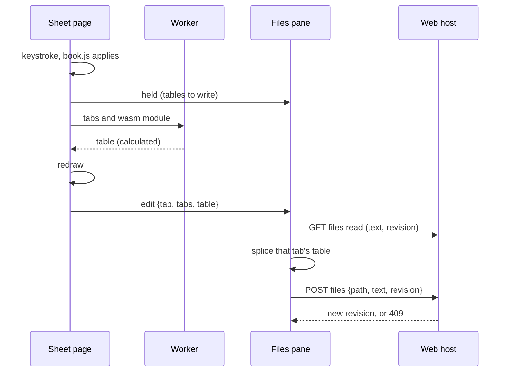

# Artifacts

This page explains how an HTML page the agent writes becomes a deck, a
document, a sheet, a whiteboard or a design in the Files pane: how it is recognised,
served, framed and edited, and how a person's edit reaches the file. The
`meta` tags and attributes a page uses are listed in
[Artifact formats](../interfaces/artifact-formats.md); the preview route and
its policy are in [Web host](web-host.md#protocol).

## Responsibility

An artifact is an ordinary file in the conversation's folder. Nothing
converts it: the agent writes HTML (guided by `skills/artifact/`), the host
classifies and serves it, and the client draws it in a sandboxed frame.
Four parts cooperate:

| Part | Where | Does |
| --- | --- | --- |
| Classifier | `src/app/workspace_files.cc` | names each page and folder a kind for listings, the Library and `present` |
| Page helper | `web/public/design-helper.js`, inlined first in every previewed page | reports what the page is and what is wrong with it; pages documents; edits blocks; applies tweaks |
| Sheet code | `web/sheet/*.js` with the IronCalc engine, served under `~sheet/` | draws and calculates a sheet inside its own frame; `whiteboard.js` draws a whiteboard |
| Viewer | `web/src/features/files/` | frames, legends, editing, saving, export |

Saving is always the client's job: a frame never writes a file.

## Processes and threads

Each page runs in an `<iframe sandbox="allow-scripts allow-forms">` loaded
from `/preview/<token>/<path>`, so it has an opaque origin and cannot reach
the app, its cookie or the API. A sheet's engine runs in a Web Worker the
page makes from a `blob:` URL (the only kind an opaque origin may make),
one worker per answer, terminated when it answers or after 20 s (`LIMIT` in
`web/sheet/sheet.js`). The WebAssembly module is fetched and compiled once
per page and handed to each worker, since an opaque origin has no cache.
PNG and direct PDF downloads run in the agent’s Chrome. Without it,
the deck viewer prints through the person’s browser ([Browser](browser.md)).

## Data and formats

**Kinds.** `PageKind` reads the first 4 KiB of a page, without comments:
`<meta name="sheet">` makes a sheet, a `print` meta starting `flow` a
document, an `artboard` meta a slide (`… slide`), a whiteboard (with a
`board` meta) or a design page. A folder is a design system if it holds
`tokens.css`, a deck if every page that is not a document is a slide, a
whiteboard if every one is a board, and a design if any page has an
artboard. Sheets (`.xlsx` and `.csv` files too) and documents are `alone`,
artifacts of their own, even inside such a folder; a design system's
document is its book. The listing gives each page the type it is shown as,
and the app reads that rather than the page.

**Sheets.** Each `<table data-sheet>` is a tab; a cell holds what a person
would type and the engine computes what it shows. Merged ranges
(`data-merge`), groups and folds (`data-group`, `data-folded`), rules and
charts (`<figure data-chart>` directly after its table) are attributes and
elements of the page, so the file stays the record.

**Engine.** `@ironcalc/wasm-xlsx` (pinned in `web/package.json`) is copied
with the sheet code into `web/dist/share/sheet` by
`web/scripts/promote-dist.js`, installed as `share/uagent/sheet`, and served
under `/preview/<token>/~sheet/` with a one-hour private cache. The preview
policy adds `'wasm-unsafe-eval'` and `blob:` workers for it.

## Protocol

**Opening.** The client gets a base from `POST /api/sessions/<id>/preview`
and frames the page. The host inserts `design-helper.js` after the doctype
of every HTML it serves there. The helper reads the meta tags and sends
`ready` with title, artboard size, notes, tweaks and stylesheets, then
`drawn`, `size`, `pages`, `error` and `checked`. Every message carries
`uagentDesign: 1`; the app takes one only from its own frame's window, and
clips every field before use (`cellOf`, `offerOf`, `fileOf`). The app sends
`select`, `edit`, `format`, `markdown`, `tweak`, `find`, `input`, `suggest`,
`do` and `board`. Message types are listed in `web/src/shared/page-frame.tsx`.

**Following the file.** While the pane is shown in a visible tab it asks
`files?stamps=<dir>` for the open folder every second, and at once when a
write call ends: each file's size, inode and modification time, nothing
read. A stamp that changed, and is not the one the pane's own write left
(a write answers with its `stamp`), is someone else's change: a call, a
command, a sub-agent, another conversation. The open page is sent the new
text (`update`); the helper makes its body like it where it stands,
matching elements by id or else as the next of their kind, so zoom, scroll
and selection stay; a document pages again, a whiteboard's items glide to
their places, and what changed is outlined for two seconds. A page with
scripts of its own, in either version, or another head, loads again, and
so does any other frame of the file (the legend, the canvas); a stylesheet,
image or data file reloads every page. An update waits while a block's
typing is not in the file (or was refused, until the page is left) and
while an item is held or retyped. An open sheet reloads only for a change
to itself, since a reload ends its undo. A call still writing the open
file shows `Agent writing` in the viewer's bar.

**Decks and documents.** A deck's slides are its pages in name order; a
slide with `<meta name="slide" content="skip">` is left out of presenting
and of the PDF. Its last `<aside>` is speaker notes, hidden by the helper.
Presenter view is a second window kept in step through a
`BroadcastChannel`. A document is paged on screen by CSS columns: the
helper sets `@page` from the print line, makes the body columns the size of
the text area, turns forced page breaks into column breaks, and moves and
clips the body to show one sheet (`--uagent-page`). Pages are counted from
the columns the body's children reach, so screen pages match the
browser's print pages.

**Editing a block.** With Edit on, a document's headings, paragraphs, list
items and table cells are `contenteditable`; on a slide only the block a
press types in is (see Slides by hand). The helper sends `edit` with the block's
place among the blocks it lists, its HTML and the text of it and its
neighbours. `blockSaver` (`web/src/features/files/doc-edit.ts`) waits for a
1 s pause, another block, or a flush, then hands the edit to the pane's one
write of a file by hand, `fileSaver` (`file-save.ts`). That reads the file
with its revision; `applyEdit` finds the block in the parsed source by the
same place and neighbours, keeps of the typed HTML only the block's own
tags and attributes, bare marks and links, and serialises the document; the
saver posts `{path, text, revision}` to `/api/sessions/<id>/files`. One
write runs at a time. The host checks the revision and replaces the file
under an advisory lock on its folder (`FolderLock`), which the agent's
`write_file`, `edit_file` and `delete_file` take too, on the machine that
holds the folder; a save meanwhile waits and then sees the agent's text. The first save rewrites the file as a parser reads
it; line endings and a byte-order mark are kept.

**Undo.** `fileSaver` keeps each write as `{path, before, after}`. ⌘Z (or
Undo in the tools) writes `before` back and ⇧⌘Z or Ctrl+Y (Redo) writes
`after` again, through the same write, and the stage is drawn again from
the file. A file whose revision is no longer the one the last write from
here left (the agent wrote it) is not undone: its history is dropped and
the pane says so. In a block being typed in, or an item being retyped,
the keys stay the browser's; the helper forwards them otherwise.
A sheet keeps its engine's own undo.

**A sheet change.** The grid in the page applies the change to its copy of
the tabs (`book.js`), says `held` with the tables it would write, and asks a
fresh worker to calculate. On an answer the grid redraws and, for each tab
changed, says `edit` with `{tab, tabs, table}`; a refused change is undone
on screen and said with `refused`. `tableSaver`
(`web/src/features/files/sheet-edit.ts`) splices only that tab's
`<table data-sheet>`, and the charts directly after it, into the file's
text and writes it with the revision it read.

**Excel and CSV.** An `.xlsx` or `.csv` previewed with `?sheet` is served as
a stub page whose `sheet` meta names the file. The sheet code fetches it
and a worker reads it (`workbook.js`): cells, formulas, number and date
patterns, column widths and merged cells from Excel; CSV cells as text
unless a plain number, ISO date or boolean; at most 200,000 cells. It is
read-only until Save as sheet, which writes a new `.html` with `create`
(refused if the name exists). Export goes the other way: `xlsxOf` in a
worker builds the workbook with rules as rules and folded groups as hidden
rows and columns, or the open tab goes out as CSV. Either comes to the app
as a `file` message, at most 8 MiB.

**Designs.** The canvas (`plane.tsx`) lays boards out at real size, 80 px
apart in a row and 240 px between rows; pages named `NN-…` share row `NN`.
Each page has a menu: copy as PNG, PNG at 1× or 2×, PDF, and every page of
the design as one PDF.

**Whiteboards.** A page with `<meta name="board">` loads `~sheet/whiteboard.js`
from the helper, which places its items, draws shapes as stretched SVG
paths and arrows in right-angled legs between the items' sides, round what
stands between them. Open in the pane it is only looked at (one finger
pans, two zoom) until Edit is on, as for a document or a slide; then it is
changed by hand on the item layer below (`whiteboard.js` `edit` turns the
layer on and off); `whiteboard.js` adds what is a
board's own: the item a tool puts where the board is next pressed, and
arrows drawn from a dot on the picked item's side or picked by their line.
Its changes are written with `boardEdit` (`board-edit.ts`), changing only
what the change names in the source, new items after the last item, and copies with the arrows that run between
two of them.

**Slides by hand.** With Edit on, the helper loads `~sheet/slide.js` for a
slide instead of making every block editable. A press picks the outermost
heading, paragraph, list, table, quote, figure, picture or shape that holds
it; Select container picks its parent. A move is the element's
`translate` and a corner its `width` (a shape's `height` too), in its own
`style`, so the rest of the slide stays in its flow; Put back takes them
away. A tool's text, table or shape is put in last in the slide's content,
placed `position: absolute` at the press; a copy is placed so beside its
original. A press again on the one picked (or a double click) types in the
block under it through the block edits above. `slideEdit` (`doc-edit.ts`)
finds each element in the parsed source by the path the helper's
`selector` gives, checked by its tag and its text, and builds every style
from bounded numbers and every new element from a known kind.

**The item layer.** `web/sheet/items.js` is shared by both: a press picks
an item (Shift adds, a frame drawn from the empty page picks what it
touches; on touch that drag scrolls), a press inside a picked item drags
it, the picked move together, a corner resizes one (a finger-sized target
on touch, kept at any zoom by `--uagent-scale`), the keys nudge, delete,
duplicate, copy, paste, pick all and let go, and a press again on the one
picked types in it. A second finger joining a drag undoes it, says nothing,
and the two fingers zoom the stage (`zoom` messages). The type gives what its items are, an item's box, how
its place and size are put, and the change each act makes. The page says
what is picked and its box (`items`), which Sequence shows as a bar over
it (`PickBar`) beside the tools at the stage's foot (`InsertBar`,
`shared/float-bars.tsx`), both from `ItemTools` (`item-tools.tsx`) fed by
the type's table (`BOARD`, `SLIDE`): its tools, its controls for one item,
its edit. Those tell the page `arm {tool}` or `act {act, value}`. Each
change is one `change` message; Sequence hands it to the pane's `rewrite`,
which writes it through `fileSaver` with the type's edit: one write and one
undo step. A change the file does not take is said, and the page is drawn
again from the file. Someone else's change keeps what is still picked and
lets an armed tool go on both sides.

**Builds and transitions.** While a deck is presented the slide's address
ends `#build=N`; the helper hides `[data-step]` elements past N from the
first paint and shows more on `build` messages. Sequence counts the steps
the slide reported and steps through them before the next slide; coming
back shows a slide built. `Frame` keeps the page before until the new one
has drawn, then fades the new one in over it, or pushes both for a slide
marked `push`.

**Data marks.** After a sheet or whiteboard is drawn, the helper fetches
each `data-source` file once (workspace files carry `Access-Control-Allow-Origin: *`),
fills the marks and chains onto `window.uagentReady`, so exports wait for
the values and the agent's page check lists marks naming a missing file,
column or row. A pointer on a value shows its file, column and row; Open
says `cite {path, line}` and Files opens the file there.

**Turn changes.** A file opened from a turn's changed files shows that
turn's change: the `changes` command diffs the edit journal's stored copy
against the file with `git diff --no-index`, and Undo there is `revert`.

**Export.** `GET /api/sessions/<id>/files?png=<path>` or `?pdf=<path>` asks
the browser service for `capture` on instance 0 at the artboard's size
(1440 × 900 for a page, 1920 × 1080 for a deck by default). A deck's PDF is
the host's `?deck` page, one iframe per slide or design page (documents
and sheets left out), each with a named `@page` of its own artboard's size,
with slide scripts confined to their opaque frames. The outer print page runs
only the host’s `/deck-print.js`. Each included frame signals when its fonts,
tracked fetch requests and rendering promise settle. A slide that draws
asynchronously can assign its completion promise to `window.uagentReady`.
Chrome renders in a throwaway
context, waits up to 10 s for readiness, and prints or shoots. A browser
print window at `?deck#print` uses the same ordered frames and page sizes.
It opens Print when every slide is ready. After 10 s the person can print
the slides as displayed. The review manifest keeps `script-src 'none'`.

A browser `observe` on a deck folder uses the same ordered artboards,
including their individual page sizes. The host serves them inside an inert
HTML template and Chrome loads up to eight selected slides. Each sandboxed
frame sends its existing Files title and layout checks to the review page.
The tool returns a numbered contact sheet and the corresponding file names
and diagnostics. A single `part` draws that slide in detail. Observing a
slide file with a CSS `selector` captures that element at its drawn size.

**`present` and the page check.** `present` (`src/app/present.cc`) asks the
folder listing what a path is. An artifact becomes a result part
`{kind: "artifact", type, path, cover, count}` that the conversation shows
as a live card; any other file is copied into the conversation's asset
store as a snapshot, or names the copy already there when its name and
bytes are unchanged. When the agent opens its own page with the browser
tool, the helper resolves `window.uagentChecked` after load; the service
reads the `uagent page:` console lines it logged, or, if the window is not
the artboard's size, reloads the page at that size in a throwaway context
and reads them there. The checks are: files that did not load, a page
larger than its artboard, a section that overflows, overlapping text on a
slide, a print line not understood, and a sheet's cells in error. The
overlap check measures visible letter bounds when two text ranges intersect.
Files distinguishes layout findings, formula errors and page failures.

## Invariants and limits

- The file is the only state: a frame holds edits only until they are
  written, and every write names the revision it read.
- Files over 1 MiB (`kFileViewBytes`) are not saved from the pane.
- A write from a page being closed uses `keepalive` and carries at most
  48 KiB (`CLOSING_BYTES`); larger edits are not sent then.
- The engine never runs in the app's thread or origin; a formula that never
  returns costs one worker for 20 s.

## Failure modes

- The agent wrote the file meanwhile: the host answers 409. A block is
  marked owed with `this text changed in the file meanwhile`, kept on the
  page and not written over; a sheet is drawn again from the file and the
  pane says why.
- A document's or a slide's edit that cannot be written in place by itself
  (its block's end tag left out, a comment in its text) is refused with
  `this part of the file cannot be changed here`; the file is not touched.
- A sheet whose engine fails or times out is shown as written, and a change
  is refused with the reason. Without the engine installed, the page notes
  that formulas show as text.
- Export without a browser service answers 503.

## Source and tests

| Path | What |
| --- | --- |
| `src/app/workspace_files.cc` | kinds, deck page, revisioned writes |
| `src/web/master_files.cc` | preview serving, helper injection, `~sheet/`, export |
| `web/public/design-helper.js` | page messages, document paging, checks |
| `web/sheet/sheet.js`, `web/sheet/calculate.js`, `web/sheet/book.js`, `web/sheet/workbook.js` | sheet page, worker, model, import |
| `web/src/shared/page-frame.tsx` | frame and message types |
| `web/src/features/files/doc-edit.ts`, `web/src/features/files/sheet-edit.ts`, `web/src/features/files/board-edit.ts` | saving |
| `web/sheet/items.js`, `web/sheet/whiteboard.js`, `web/sheet/slide.js`, `web/src/features/files/item-tools.tsx` | items changed by hand: the layer, a whiteboard's and a slide's |
| `web/src/features/files/sequence.tsx`, `web/src/features/files/plane.tsx` | viewer, canvas |
| `src/app/present.cc` | `present` |
| `web/tests/doc-edit.spec.js`, `web/tests/sheet-edit.spec.js`, `web/tests/sheet-files.spec.js` | edits, conflicts, import |
| `web/tests/sheet-merge.spec.js`, `web/tests/sheet-groups.spec.js`, `web/tests/sheet-rules.spec.js`, `web/tests/sheet-format.spec.js` | sheet features |
| `web/tests/whiteboard.spec.js`, `web/tests/board-edit.test.js`, `web/tests/data-marks.spec.js`, `web/tests/doc-checklist.spec.js` | whiteboards, data marks, checklists |
| `web/tests/slide-items.spec.js`, `web/tests/slide-edit.spec.js` | a slide's elements by hand |
| `web/tests/live-files.spec.js` | following a file changed by someone else |
| `tests/integration_web/preview.py` | preview address and policy |
