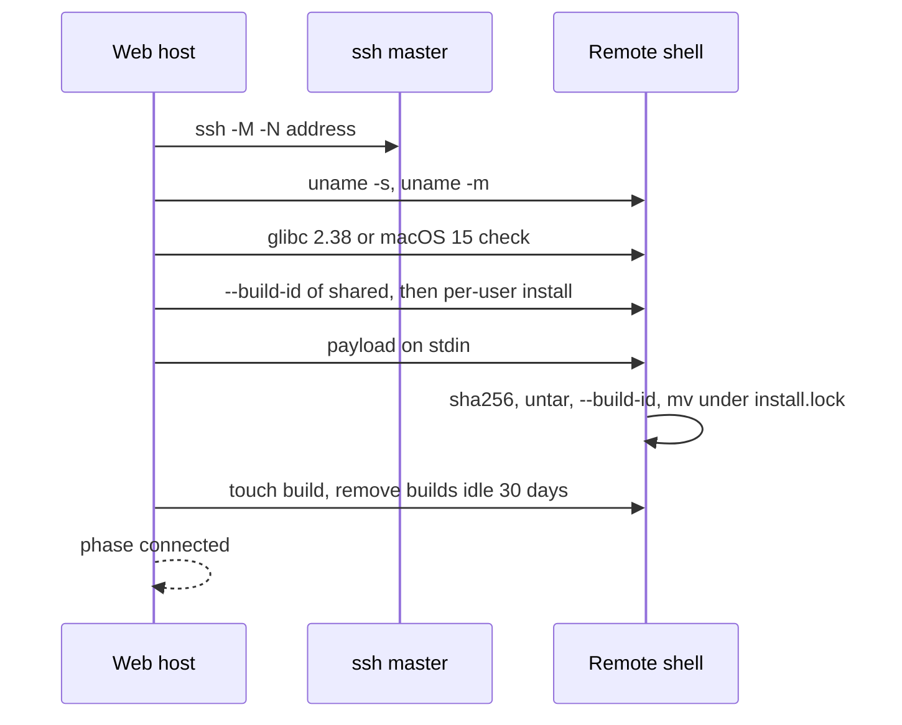

# Execution gateway

This page explains how a conversation on the main machine works in a folder
on another machine over SSH: connecting a host, installing the matching
build, the remote processes, the RPC and recovery after a drop. What a
remote account may do is in [Security](../../SECURITY.md).

## Responsibility

The main keeps the agent loop, providers, keys, settings, history, memory,
approvals and schedules. A remote host supplies files, Git, commands and
terminals. `web::RemoteHosts` owns one SSH master per host and installs the
build; `execution::Client` sends requests; `execution::Main` is the remote
side, which loads no settings, history or provider configuration and keeps
nothing durable but changed files and installed builds.

## Processes and threads

| Process | Where | Lifetime |
| --- | --- | --- |
| `ssh -M -N` master, one per host | main | Disconnect, web host stop, or SSH failure |
| host thread (`Work`) | main, web host | the web host |
| `uagent --execution-start <client> <runtime> <cwd>` | remote, over SSH | prints the worker's identity |
| `uagent --execution-worker <client> <runtime> <cwd>` | remote | 5 min with no connection and no children |

`client` is a 16-byte token per host, kept with a 32-byte `auth` token in
`~/.uagent/web/client-<id>.json`. `runtime` is a conversation's session id,
a remote terminal's record id, or a fixed hash for the folder browser, so
each conversation, agent and terminal has its own worker, cwd, sandbox and
cancellation. A remote conversation's runtime runs on the main in an empty
`RuntimeDir()/remote-cwd/<id>`. A worker serves one request per connection,
each on its own thread, at most 64 at once.

## Data and formats

**Bundle.** A remote-ready install holds `share/uagent/remote/<build>/`
next to `bin/` (or `web.remoteBundle`, `UAGENT_REMOTE_BUNDLE`):
`manifest.json` (`v`, `build`, `targets`) and `linux-x86_64.tar.gz`,
`linux-arm64.tar.gz`, `macos-arm64.tar.gz`. Each target record has `bytes`,
`sha256`, `minimum` and every member's size and hash. A payload is the
stripped `uagent`, `share/uagent/skills/` and the licences, without the web
app. `.github/remote_bundle.py` builds each payload on its native target,
checks the glibc 2.38 or macOS 15 floor, and assembles only three payloads
of one build id.

The build id (`--build-id`) is a SHA-256 over the version and the hashes of
the runtime inputs listed in `CMakeLists.txt`. `CheckRemoteBundle`
(`--check-remote-bundle`) accepts only the running build's bundle, with
three targets whose sizes and SHA-256 match; `install.sh` and
`cmake/install_remote_bundle.cmake` refuse an install without one unless
`UAGENT_LOCAL_ONLY=1`.

**Installed.** Remotely in `~/.uagent/remote/builds/<build>/` (`umask 077`)
or a read-only `/usr/local/lib/uagent/remote/<build>/uagent`, tried first.
On the main, `~/.uagent/web/hosts.json` (`id`, `address`, `connected`; at
most 16), `ssh-<id>.log` and `remote-terminals.json`.

## Protocol

**Connecting a host.** `POST /api/hosts {action: "add", address}` saves the
host and wakes its thread. The master runs with `BatchMode=yes`,
`StrictHostKeyChecking=yes`, `ForwardAgent=no`, `SendEnv=-*`,
`ControlPersist=no` and a 10 s keep-alive; the host waits up to 30 s for its
control socket. Later SSH calls reuse it with `ControlMaster=no`.

Only Linux on x86_64 or ARM64 and macOS on ARM64 pass. Each connection
touches its build; one untouched for 30 days (`kRemoteBuildDays`) that no
process runs from is removed.

**Starting a worker.** `Client::Attach` checks the master with `ssh -O
check` and never opens a new SSH session, so a Disconnect holds. It runs
`--execution-start` with one stdin line, `{"auth", "sandbox"}`: the token
and the conversation's own `UAGENT_SANDBOX` preset. Start clears every
`UAGENT_*` variable, publishes only the preset, and pings
`RuntimeDir()/exec/<hash of build, client, runtime, preset>/socket`; if
nothing answers it spawns `--execution-worker` with the same stdin line and
pings for up to 5 s. It prints `{build, cwd, socket}`. The main refuses a
build other than its own, then runs `ssh -O forward -L
RuntimeDir()/e-<hash>.sock:<socket>`. The worker holds `owner` as a lease;
a second one exits 65.

**RPC.** A request is one JSON object with `op` and `auth`, checked on
every request. `Send` cuts it into session-protocol lines `{v, data, end}`
of at most 128 KiB on a UTF-8 boundary; a message is at most 128 MiB
(`kMessageBytes`). Operations: `open` (the worker's file, exec and activity
tools; a changed preset is refused), `check` (canonical arguments, issue,
approval class, subject, preview), `run` (a tool, with the `scope` from
`check`; refused if it changed), `files`, `folders`, `folder`, `bytes`,
`diff`, `undo`, `instructions`, `schedule_check`, `sandbox`, `activities`,
`completions`, `activity_control`, `terminal`, `ping`, `shutdown`, `result`
and `cancel`. `Client::Tools` keeps only the presentation of the built-in
tools and backs every hook with `check`, cached 1 s. The memory tools and
`todo` stay local; the other local built-ins are dropped.

**Receipts.** `run`, `undo`, `terminal`, `activity_control`,
`schedule_check`, `completions`, file `write` and `move` and instruction
writes carry a random `id`. The worker keeps up to 256 results
(`kReceiptEntries`), evicting the oldest completed; with 256 pending it
answers `Remote execution is busy.`

**Binary data.** Bytes travel hex-encoded: `bytes` and `write_file` up to
8 MiB, undo preimages 2 MiB, terminal writes 64 KiB. Files a tool attaches
return in `attachments` (8 MiB per call) into the main's asset store.
Arguments naming the main's history directory are refused.

**Terminals.** A remote terminal has its own worker; the web host keeps at
most 8 (`kWebTerminals`). A folder shell with no viewer silent for 24 h ends.
The web host relays the WebSocket through `read` (waits 1 s), `write` and
`resize`; a viewer silent for 60 s is dropped. Folder terminals are saved
and reattached after a main restart; a panel terminal ends with its viewer.

## Invariants and limits

- An uncertain mutation is never sent twice. A refused connect is resent
  once; after `Send` began, recovery only reads the receipt.
- Keys and settings never cross; token and preset travel only on stdin.
- One reattacher at a time, under `RuntimeDir()/e-<hash>.sock.lock`.
- Unavailable remotely: the browser tool, project MCP servers, memory
  extraction, title and folder suggestions, worktree agents and schedules,
  moving between folders, named remote workspaces. Skills are found from
  the runtime's local cwd, so a remote folder's own skills are not listed.

## Failure modes

- Host key, `Permission denied` or an unknown name ends `disconnected` with
  an SSH action. Other failures retry after 1, 2, 4, 8 and 15 s plus a small
  per-host offset, then stop. A master that dies is retried after 1 s; a
  restarted main reconnects hosts saved as `connected`.
- After a drop the client reattaches and polls `result` every 100 ms until
  the call's deadline, sending `cancel` if the turn was aborted. An unknown
  receipt (a restarted worker) yields `Remote host is unavailable`; nothing
  is repeated. Old terminal handles report interrupted.

## Source and tests

| Path | What |
| --- | --- |
| `src/web/remote_hosts.cc`, `include/web/remote_hosts.h` | hosts, master, probe, install, pruning, retries |
| `src/app/execution.cc` | start, worker, operations, receipts |
| `src/app/execution_client.cc`, `include/app/execution.h` | `Client`, attach, recovery, forwarded tools |
| `src/app/execution_internal.h`, `src/app/execution_wire.cc` | chunk framing, result encoding |
| `src/web/master_remote.cc`, `src/web/master_remote_terminal.cc` | `/api/hosts`, remote terminals |
| `src/core/capture.cc` | `SshCommand` |
| `.github/remote_bundle.py`, `cmake/install_remote_bundle.cmake` | bundle build and checks |
| `tests/integration_web/remote.py` | statelessness, receipts, isolation, bundle, auth failure |
| `tests/unit/web_remote_test.cc` | workspace identity, result encoding, preset |
