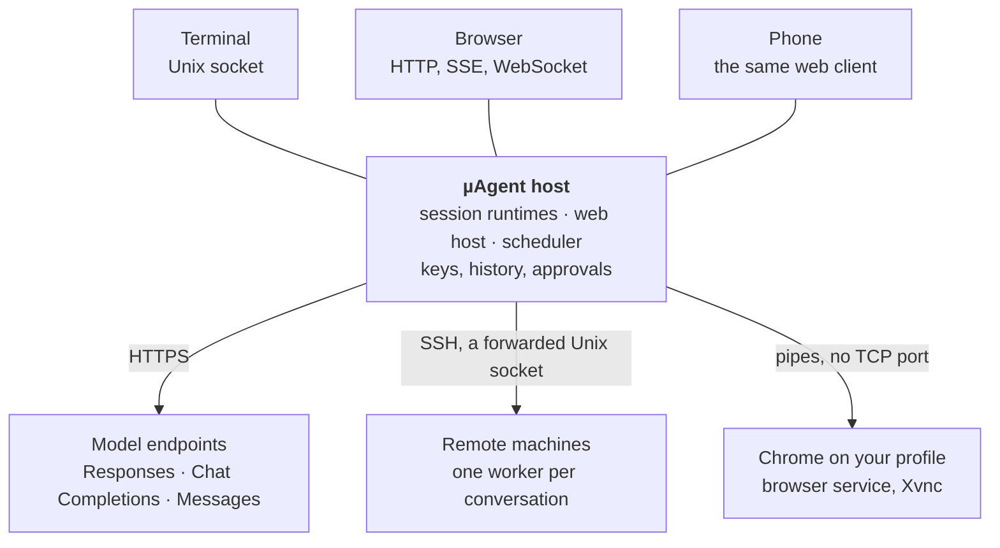
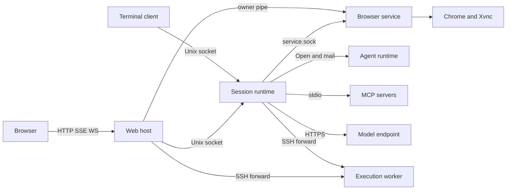

# Overview

This page describes the processes one `uagent` executable can become, who
starts each, how long it lives, the channels between them, and the library
layers the source is built in. What happens inside a turn is in
[Turn loop](turn-loop.md); the web host's routes are in
[Web host](web-host.md) and [HTTP API](../interfaces/http-api.md).

## Responsibility

One C++20 executable holds the agent runtime, the provider adapters, the tool
executor, the web host with its embedded client, the browser service and the
SSH execution gateway. `src/main.cc` picks the role from the first argument.
There is no plugin loader and no second language runtime; extension happens
through MCP servers, which run as child processes.

## Processes and threads

| Process | Entry | Started by | Lives until |
| --- | --- | --- | --- |
| Terminal client | `uagent` (no prompt) → `session::TerminalMain` | the user | the user quits |
| Web host | `uagent --web` → `web::MasterMain` | the user or a service manager | signal or a restart over HTTP (`execv` of itself) |
| Session runtime | `uagent --session-worker <cwd> <path> <id> <title> <launch>` → `session::WorkerMain` | `session::Open`, called by a client, the web host, a parent agent or mail | idle for `UAGENT_IDLE_MINUTES` with no client attached; 1 s for an agent |
| Headless run | `uagent -p`, `--json`, `--json-stream` → `HeadlessMain` | a script | the run's last turn |
| Execution start | `uagent --execution-start <client> <runtime> <cwd>` | the main, over SSH | it prints the worker's identity |
| Execution worker | `uagent --execution-worker …` | execution start | 5 min with no connection and no children |
| Browser service | `uagent --browser-service` | the web host at start, when `UAGENT_BROWSER_DATA` is set | its owner pipe (fd 3) closes |
| MCP server | the configured command | a session runtime or headless run at bootstrap | the runtime shuts down |
| Tool children | shell, `--log-pump`, `--sandbox-child` | the tool executor | the command ends or is cancelled |

Short-lived commands share the binary and start nothing else: `--control`
(metadata requests, `include/app/control.h`), `setup`,
`--show-system-prompt`, `--check-remote-bundle`, `--build-id`, `--version`.

Every process except `--build-id` and the two hidden re-execs
(`--sandbox-child`, `--log-pump`) first runs `HardenProcess`: no core files,
`PR_SET_DUMPABLE` 0 on Linux, and no `LD_*` or `DYLD_*` variables.

A session runtime calls `setsid()` and so survives the client that started
it. Under systemd (`INVOCATION_ID` set) `session::Open` wraps it in
`systemd-run --user --scope`, so restarting the web service does not kill
running conversations. Inside a runtime the model and tools run on the
application thread; one poll thread (`session::Server`) owns every client
socket, and a `TransientBatcher` coalesces stream deltas and usage before
they are published.

The web host runs cpp-httplib with a pool that idles at 4 threads and grows
to 41: 8 event streams (`kWebSseConnections`), 5 browser viewers
(`kViewerInstances`), 16 terminal sockets (`kWebTerminalSockets`) and 12
request workers. Beside the pool it runs a file-watch thread (settings,
catalogue, presence), the scheduler thread and the notification thread, and
one reader thread per attached session runtime.

## Data and formats

Per-user state lives under `~/.uagent` (`GlobalBase()`); sockets and leases
live under `/tmp/uagent-<euid>-<hash>` (`RuntimeDir()`), which keeps
`AF_UNIX` paths under the 104-byte macOS limit. A session's id is the hash
of its history file's path; its socket is `RuntimeDir()/<id>.sock` with a
writer lease at `<id>.sock.lock`. File layouts are in
[On-disk formats](../interfaces/on-disk.md).

| Channel | Between | Transport and framing |
| --- | --- | --- |
| Session protocol | terminal or web host ↔ runtime | Unix socket; one JSON object per line, version `kProtocol` 2 (`include/transport/session.h`) |
| Launch file | `session::Open` → runtime | private JSON file in `RuntimeDir()`, deleted on read; a boot error comes back in `<launch>.error` |
| HTTP, SSE, WebSocket | browser ↔ web host | `POST /api/command`, `GET /api/events`, terminal and viewer sockets |
| Mail | session ↔ session | one JSON file per message in `~/.uagent/mail/<id>/new`, watched with inotify or kqueue (`include/core/mailbox.h`) |
| Browser service | runtime or web host → service | `<UAGENT_BROWSER_DATA>/service.sock`; 4-byte big-endian length, then JSON, at most 12 MiB; 8 requests at once |
| Execution RPC | main → worker | a local Unix socket forwarded by `ssh -O forward -L` to `RuntimeDir()/exec/<hash>/socket`; session-protocol lines carrying 128 KiB chunks of one JSON message up to 128 MiB |
| MCP | runtime ↔ server | stdio JSON-RPC ([Tools](tools.md#protocol)) |
| Providers | runtime → model endpoint | HTTPS through libcurl ([Providers](providers.md)) |

## Protocol

A client reaches a conversation in three steps:

1. `session::Connect` checks that the socket and its directory are owned by
   the user with no group or other bits, then reads a `hello` line:
   `v`, `pid`, `session_id`, `generation`, `binary` and, once the runtime
   has state, `status` (`idle`, `working`, `needs you`).
2. If nothing answers, `session::Open` writes the launch file and spawns
   `--session-worker`, then polls `Connect` for up to 30 s
   (`kRuntimeStartTimeout`). Exit statuses 64–68 (`WorkerExit`) say why a
   runtime did not come up; status 65 means another runtime holds the
   lease, and `Open` waits for it.
3. After `hello` the runtime sends its last `state` checkpoint, a `gap`
   frame if events were lost, then the events since that checkpoint, each
   with a `sequence` number.

Commands are lines with `kind`, `request_id`, `session_id` and `generation`
(`src/app/session_command.cc` lists the kinds). A command for an old
generation is refused, and every command is answered by an `outcome` frame
for its `request_id`. The runtime sends `state`, `event`, `turn_status`,
`outcome`, `gap`, `error` and `retiring`. When idle it sends `retiring`,
waits up to 2 s for clients to detach, and exits if none remains. The web
host detaches on `retiring`; a terminal stays attached and keeps the
runtime alive.

The web host remembers each runtime's `binary` identity. When the
executable on disk changes, it closes an idle runtime and starts a fresh one
at the next activation; a busy runtime is marked and recycled when its turn
ends.

## Invariants and limits

- One runtime per session file, enforced by the lease; clients never take it.
  The client that started a runtime has no extra authority.
- Publishing never blocks the model thread. A frame over 1 MiB
  (`kFrameBytes`) becomes a `gap`; a client more than 4 MiB (`kQueueBytes`)
  behind is disconnected; a command line is at most 512 KiB
  (`kCommandBytes`); at most 16 clients attach (`kMaxClients`).
- Recovery after a `gap` is a refresh, never a replay of commands.
- Provider keys and settings stay on the main machine. The execution worker
  clears every `UAGENT_*` variable at start and receives only an auth token
  and a sandbox preset on stdin ([Execution gateway](execution-gateway.md)).

Build layers are static libraries; each links the one above it:

| Layer | Library | Sources |
| --- | --- | --- |
| core | `uagent_core_base` | `src/core/`, `src/transport/` |
| api | `uagent_api` | `src/api/` |
| toolcore | `uagent_toolcore` | `src/tools/tool.cc`, `src/media/`, `src/providers/` |
| agent | `uagent_agent` | `src/agent/` |
| tools | `uagent_tools` | the rest of `src/tools/`, `src/mcp/`, `src/browser/` |
| app | `uagent_app` | `src/app/`, `src/cli/`, `src/ui/` |
| web | `uagent_web` | `src/web/` and the embedded `web/dist` |

`tests/boundary_test.py` fails when a file under `src/` or `include/`
includes a header from a higher layer; its `KNOWN` exception set is empty.
Public headers are in `include/<module>/`; declarations used inside one
module stay in `src/<module>/*_internal.h`. Static linking hides an upward
include until the symbol moves, which is why the check reads includes.

## Failure modes

- A runtime that cannot boot writes its reason beside the launch file and
  exits 68; `Open` reports that text. One alive but silent for 30 s is
  killed.
- A runtime that ends mid-turn is reported `interrupted` by the web host; a
  pending command fails. Nothing is repeated on the next start.
- A second `uagent --web` finds the master lock held, authenticates to the
  recorded instance with `POST /api/instance`, prints its pairing text and
  exits 0. It never binds a second port.
- The browser service exits when the web host's owner pipe closes, so it
  cannot outlive its owner.
- A lost SSH forward is reattached by one process at a time under a lease
  on the forward socket; an execution worker with no main for 5 min exits.

## Source and tests

| Path | What |
| --- | --- |
| `src/main.cc` | role dispatch, `HardenProcess`, `WebMain`, `HeadlessMain` |
| `src/app/session_server.cc`, `include/transport/session.h`, `include/app/session.h` | `Connect`, `Open`, `Server`, frame limits |
| `src/app/session_worker.cc` | `WorkerMain`, idle retirement, approvals routed to a parent |
| `src/app/session_terminal.cc` | `TerminalMain` |
| `src/app/session_host.cc`, `src/app/session_supervisor.cc`, `src/app/session_router.cc` | the web host's view of runtimes |
| `src/web/master.cc` | `MasterMain`, thread pool, discovery |
| `src/browser/browser.cc` | `StartService`, `ServiceMain`, packet framing |
| `src/app/execution.cc`, `src/app/execution_client.cc`, `src/app/execution_internal.h` | gateway processes and framing |
| `src/app/bootstrap.cc` | what every runtime and headless run builds |
| `CMakeLists.txt` | library targets |
| `tests/boundary_test.py` | layer order |
| `tests/unit/session_server_test.cc` | restart waits, binary identity, close, frame partitions |
| `tests/integration_runtime/sessions.py` | runtime start, headless runs |
| `tests/integration_web/remote.py` | execution start reuse, isolation, receipts |
