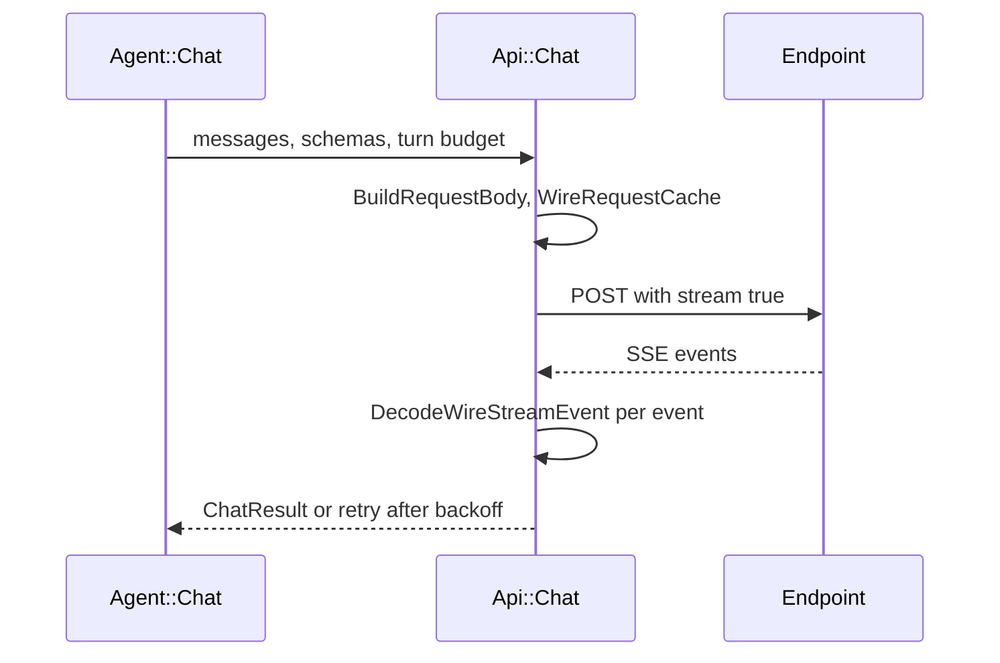

# Providers

How a model call leaves the runtime: route resolution, request encoding for
the three wire APIs, stream decoding, retries, the cached prefix and usage
accounting. The step loop is in [Turn loop](turn-loop.md); provider
settings are in [Settings](../interfaces/settings.md).

## Responsibility

`Api` (`include/api/client.h`) sends one chat request and returns a
`ChatResult`: content, reasoning, tool calls, annotations, usage, stop
cause and error classification. `src/providers/` turns configuration into
`Route`s (endpoint, wire API, features, model, effort, context window).
Route behaviour is declared, never inferred from a provider or model name:
everything uAgent knows of particular vendors is one data file,
`src/providers/presets.json`: setup's presets, the endpoints it recognizes by
host, the hosted search tool each wire API names, and the Anthropic API
version. It is built into the binary.

## Processes and threads

Calls run on the asking thread (the turn, or a side request with its own
`Api` copy of the route). One `Api` serializes calls on one libcurl handle,
reusing connections, and polls the abort pipe beside it, so an interrupt
ends a transfer at once.

## Data and formats

A route is `Endpoint` + `Route` (`include/api/endpoint.h`). Providers come
from `UAGENT_PROVIDERS`: each entry has `base_url`, `api_key`, `wire_api`
(`chat_completions` default, `responses`, `anthropic_messages`), optional
`context`, `supports` (features), `options`, `hosted_tools`, `features`
(model features) and `models` (aliases). An address on `openrouter.ai` or
`api.openai.com` gets that host's features from `presets.json`; a
`supports` list replaces them (names: `enum class Feature`,
`include/api/capabilities.h`). An endpoint with `options.free_only` loses
hosted search, the PDF parser, decisions and hosted tools.

Selection grammar (`ParseModelSelection`): `[provider/]model[:effort]`;
only a valid effort suffix is peeled, so `vendor/model:free:high` keeps
`:free`. `ResolveModelRoute` matches `provider/alias`, then
`provider/<raw id>`; a bare id works on the active endpoint if it declares
`raw_vendor_ids` or its catalogue lists the id. `ProbeModel` fills context
window, efforts, modalities and model features from `GET /models`, cached
24 h in `~/.uagent/models/<hash>.json` keyed by base URL and wire API, never
by key; a model missing from the cache triggers a fresh query (8 s).
Configured model features win over catalogue ones.

## Protocol

Request shape (`src/api/wire_request.cc`), from one canonical message list
in Chat Completions form:

| Wire | Path | Encoding |
| --- | --- | --- |
| Chat Completions | `/chat/completions` | messages as stored; `stream_options.include_usage` unless `inline_usage`; `max_tokens` or `max_completion_tokens`; `reasoning_effort` or `reasoning.effort` (`reasoning_object`); `provider` pin with `allow_fallbacks: false` (`provider_routing`); `session_id` (`session_passthrough`); `plugins` file parser for PDFs (`pdf_parser`) |
| Responses | `/responses` | `input` items; `store: false`; `include: ["reasoning.encrypted_content"]`; `reasoning.effort`, and `reasoning.summary: auto` when summaries are on and effort is not `none`; `prompt_cache_key` = hash of the session id |
| Anthropic Messages | `/messages` | leading system messages become `system`; later ones become user text prefixed `[harness note, not a user message]`; `tool_use`/`tool_result` blocks; `max_tokens` always set; with an effort other than `none`, `output_config.effort`, plus `thinking: {type: adaptive}` when the model declares adaptive thinking |

Headers: `Authorization: Bearer` (or `x-api-key` and
`anthropic-version: 2023-06-01`), `Accept: text/event-stream`, and
`X-Session-Id` on every wire so a proxy can keep account affinity.
Redirects are refused, so a key cannot follow one to another origin.
`WireRequestCache` splices cached per-message and tool encodings into the
payload, so a step re-encodes only new messages.

Assistant messages carry `_uagent_wire_replay`: the provider's own output
items (Responses) or content blocks (Anthropic), including signed or
encrypted reasoning. On the same wire they are replayed unchanged; other
wires use the canonical text and calls. Replay data is kept while a turn
continues and dropped from a final prose answer unless it records a hosted
tool other than web search.

Stream decoding (`src/api/wire_stream.cc`, `include/api/stream.h`):
`SseParser` splits events; `DecodeWireStreamEvent` updates the
`ChatResult` and returns a delta of text, reasoning parts, hosted-tool
phases and tool-argument activity. Tool calls are assembled by stream
index, or by call id when a provider omits the index. `CollectToolCalls`
then gives empty arguments as `{}`, assigns ids to calls without one or
with a duplicate, drops a nameless call (counted for the turn loop), marks
a named call with invalid JSON as `malformed` (answered as an argument
error), and drops a last call cut off by the length limit. Leading text
that looks like tool-call markup (`<tool_call…`, `[TOOL_CALL]{…`) is held
back and suppressed (`ClassifyLeadingToolMarkup`); it is never executed.

Hosted tools: the `web_search` tool exists only when the active endpoint
or some provider declares `hosted_search`. It runs a side request carrying
only the endpoint's own search (`web_search` on Responses,
`web_search_20250305` on Anthropic, `openrouter:web_search` on Chat
Completions), on the active route when it has the feature, else on a
provider that has it with the model `UAGENT_WEB_SEARCH_MODEL` names.
Object entries in `hosted_tools` are sent as written in requests that offer
tools, replacing the agent's tool of the same `name`. Their phases become
`response.hosted_tool` events; nothing is dispatched locally.

## Invariants and limits

- Request ≤ 64 MiB (`kRequestBytes`), checked before and after
  serialization; streamed response ≤ 32 MiB (`kResponseBytes`).
- Connect timeout 10 s. One attempt is capped by `UAGENT_REQUEST_TIMEOUT`
  (600 s); the stream must produce an event within `UAGENT_STREAM_TIMEOUT`
  (300 s) of the request and then of each byte. A turn call is bounded by
  the remaining turn deadline; without one, by 3 attempt timeouts.
- Up to 3 attempts (`kChatAttempts`) with 2 s, then 4 s backoff (8 s cap),
  each 75–100% jittered; a `Retry-After` is the minimum. Retried: HTTP 408,
  409, 429, 5xx, the transient error names in `kTransientErrors`, stream
  stalls, connection errors and an in-band stream error before any output.
- A response is retried only before visible text, tool calls, annotations
  or usage arrived (`SafeToRetry`). Reasoning alone does not block a retry.
  A context-length error is never retried here; the turn loop compacts.
- The output cap is `UAGENT_MAX_TOKENS` when set; Anthropic requires one,
  so it falls back to the model's `max_output_tokens` feature (from the
  catalogue's `max_tokens` or configuration), else 8,192.
- Compaction from the live conversation keeps the tool array (the prefix
  stays cached) and forbids calls with `tool_choice: none`, except on
  Anthropic, where that drops the cache and the prompt alone forbids them.

Cached prefix. Message zero (system prompt) and the tool array stay
byte-stable; harness notes are appended, never rewritten. Anthropic
requests set top-level `cache_control` plus a breakpoint on the system
block; Chat Completions endpoints with `prompt_cache_control` get top-level
`cache_control`. When the to-do tail is present, the last stored message
carries an explicit breakpoint. The prefix changes on compaction, pruning,
a change in the offered tools, a model or effort change, and a fork (new
session id); instruction files and memory are read once per runtime.

Usage (`Usage::Add`, `include/core/usage.h`) normalizes every dialect to
disjoint `input`, `cache_read`, `cache_write`, `output` and `reasoning`,
plus reported `cost` and `web_searches`. Cached tokens inside a prompt
total are subtracted; Anthropic-style counts are taken as given. Cost is
only what the provider reports; none is inferred. Each call is charged to a
route key `authority|provider-or-purpose|model|effort` (`RouteKey`), so
side requests show under their purpose (`compaction`, `image_analysis`,
`permission_review` and others).

## Failure modes

- HTTP 400 or 422 naming an unsupported modality, parallel tool calls,
  stream usage or reasoning summary switches that capability off for the
  route and retries (`RejectedRouteCapability`). A summary is switched off
  only if the attempt produced nothing.
- HTTP 413, or a context error by name or message phrase
  (`kContextOverflowPhrases`), is classified `context_length_exceeded`.
- A failed request may already have been processed upstream, so a retry
  can repeat provider cost. A retry wait ends on interrupt. Without a usage
  report, token and cost limits cannot be enforced (warned once).

## Source and tests

| Path | What |
| --- | --- |
| `include/api/client.h`, `src/api/client.cc` | `Api::Chat`, transfers, timeouts, retries |
| `include/api/retry.h` | retry classification and backoff |
| `src/api/wire_request.cc`, `include/api/wire.h` | request encoding, `WireRequestCache`, replay |
| `src/api/wire_stream.cc`, `include/api/stream.h`, `include/api/tool_protocol.h` | stream decoding, call assembly, markup suppression |
| `src/api/capabilities.cc`, `include/api/capabilities.h` | features, negotiated capabilities |
| `src/providers/catalog.cc`, `src/providers/selection.cc`, `src/providers/policy.cc` | providers, known hosts, catalogue cache, selection, side routes |
| `src/core/usage.cc`, `src/agent/usage_accounting.cc` | usage normalization and route keys |
| `tests/unit/wire_test.cc`, `tests/unit/stream_test.cc` | encoding and decoding per wire |
| `tests/integration_providers.py` | hosted search, permission review routes |
| `tests/integration_runtime/turns.py` | stop causes and recovery through a real stream |
