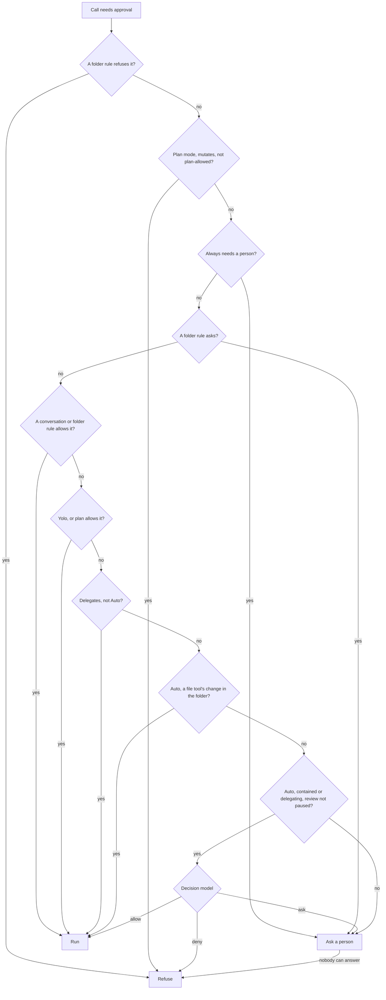

# Tools

How a tool is defined, how calls are validated, approved and bounded, the
approval pipeline, activities and MCP. Parameters are in
[Tool schemas](../interfaces/tool-schemas.md); mode policy and the sandbox
in [Security](../../SECURITY.md); the step loop in [Turn loop](turn-loop.md).

## Responsibility

A `Tool` (`include/tools/tool.h`) bundles a JSON schema, its handler and
the metadata the executor and approver read. `BuildTools`
(`src/app/bootstrap_tools.cc`) builds the list once per runtime; MCP rescans
may replace a server's entries between steps. Tools own no session state;
agent tools, `present`, `schedule` and `uagent` live in `src/app/`.

## Processes and threads

Handlers run on the turn's thread or `std::async` batch workers. Commands
are children in their own process group under the sandbox wrapper
(`SandboxWrapperFor`); `ActivitySupervisor` owns their I/O, output and
reaping and wakes waiters on output, exit and signals. MCP servers are
long-lived children of the runtime.

## Data and formats

`Tool` fields the executor reads:

| Field | Effect |
| --- | --- |
| `parameters`, `action_requires`, `validate` | schema check, required fields per `action`/`operation`, semantic check |
| `canonicalize`, `clamped_arguments` | normalization; pacing values clamped to bounds with a `[clamped …]` hint instead of rejected |
| `parallel_safe` | may run beside adjacent parallel-safe calls |
| `timeout_s` | `-1` uses `UAGENT_TOOL_TIMEOUT`; `0` is bounded only by the turn |
| `result_chars`, `max_calls_per_turn`, `dedupe_output`, `retain_output` | result cap, per-turn cap, collapse of a byte-identical recent result, exemption from old-result pruning |
| `capabilities` | `inspect`, `execute`, `mutate`, `delegate`, `external` |
| `mutating`, `mutates`, `needs_approval`, `approval_class` | whether a call needs approval, and whether only a person may give it |
| `approval_preview`, `approval_subject`, `mandatory_reason` | what a person sees, what a remembered rule covers, why a person is required |
| `available`, `skill` | withheld while it cannot run; offered only once its skill is open |

`ToolResult` carries `output`, `hint` (model only), `facts` (exit, lines,
count, outcome), `diff` (person only), an `artifact` (spilled log), a
`FileEffect` for `/undo`, the to-do list, and `background` (an activity id).

Built-in tools and discovered MCP tools share a transcript row. The headline
and result facts stay visible when folded; it names an agent by its `name`
and an activity by its description or command, never by an id. The body uses the tool's recorded
parts for fields, code, links, sources and agent reports. Calls with a
retained exchange expose their original request and response in the inspector.
A patch records its child receipt IDs in execution order so reopening it
shows each path's diff or failure.

The offered set is filtered three ways. `UAGENT_TOOL_CAPABILITIES` removes
every tool needing a capability not listed (`ApplyToolPolicy`); an unknown
name removes all tools. A conversation's `ToolSelection` (profiles
`default`, `coding`, `research`, `minimal`, plus per-tool overrides) hides
tools from the model without changing what exists. An agent with
`edits: none` loses every `mutate` tool that is not also `execute`. Turn
progress never changes the offered set, because the tool array is part of
the cached prompt; a tool at its per-turn cap stays offered and refuses.

## Protocol

A model changes files with `apply_patch` (`src/tools/patch.cc`): one call
adds, updates and deletes any number of files. The tool loop
(`Agent::RunCalls`) runs a patch as the `write_file`, `edit_file` and
`delete_file` calls it holds, one per file, each an update hunk an exact
replacement. So every file is validated, approved, journalled and shown as
its own call, a rule or setting that names one of the three applies, and
the model's one call gets their results together. The three are not
offered themselves, except `write_file` while the conversation has an
attached file to copy.

The approval decision for one call runs only when `RequiredApproval` is
not `kNone`: a mutating call, a `needs_approval` call (a path outside the
work area, a network tool, `agent_start` and `agent_send`), or one an
`approval_class` escalates.
`MakeApprover` (`src/app/approvals.cc`) gathers the facts of the call and
the situation; `Decide` (`src/app/approval_policy.cc`) is a pure function
of them, and the first stage that matches decides:

- Always needs a person (`ApprovalClass::kMandatoryHuman`): file-tool
  access to µAgent's own configuration (`SelfConfigurationPath`: settings,
  trust store, `permissions.json`, global instruction files, the user's
  skills, any `.mcp.json`), a write to a file that runs code at login or
  for another agent (`kAuthorityPaths`: `~/.ssh`, shell startup files,
  git's global config, `.agents`, `.claude`, `.codex`, launch agents and
  user services), a folder the sandbox closes to reads, `run` with
  `sandbox: false` or `root: true`, the `uagent` tool's writes and `agents`
  `delete`. Allow rules, yolo and Auto do not apply; a refusing rule does.
- With nobody to ask (`InteractiveApprovalAvailable` false: no terminal on
  stdin and no client), every stage that would ask a person refuses
  instead (`kNobody`). Piped input never answers an approval.
- A person answers `y` (once), `s` (this conversation, kept in
  `SessionRules`), `a` (always in this folder), `x` (never in this folder),
  `n`, or free text, which denies and is queued as guidance. Silence or end
  of input denies.
- A rule is `{tool, match, effect}` (`PermissionRule`,
  `src/app/permissions.cc`), its effect `allow`, `ask` or `deny`; a refusing
  rule wins over an asking one, an asking one over an allowing one. The
  match is `*` (every call; offered for MCP tools), `PREFIX *` (a command
  starting with one or two plain words), `DIR/` (a path under a folder), or
  the exact subject. The subject is the command, a `web_fetch` URL's host,
  the first line of an agent's brief or message, a path relative to the
  folder, or the arguments. An allow rule covers only
  a whole simple command (no chaining, substitution, redirection, backslash
  or newline), and a prefix only while the sandbox is enforced. A deny or
  ask rule covers any part of a command split at `&&`, `||`, `;`, `|`, `&`
  and line breaks, sandbox or not.
- Auto lets a file tool's change inside the folder through unjudged: undo
  takes it back. It sends every other call that names no path outside the
  folder, and whose command runs in the enforced sandbox, to the decision
  model (`decisions_url` on an endpoint declaring `decisions`), for the
  main conversation and its agents alike. The model is shown the tool, the
  folder, the latest and first user messages and the action preview
  (16 KiB each). It answers a
  choice (`allow`, `ask`, `deny`) and four yes/no reasons:
  `destructive`, `beyond_request`, `sends_data_off_machine`,
  `touches_secrets`. Allow needs P(allow) at or above the model's bar and
  no reason at or above its veto bar; deny needs P(deny) at or above its
  bar; anything else asks. A model with no `decision_bars` row gets 0.9 /
  0.95 / 0.3. Reviews are memoized per action within a turn.
- A delegation (`agent_start`, `agent_send`: `ApprovalFacts::delegates`)
  runs nothing itself, but its brief becomes the agent's request, which
  that agent's own review then trusts. Auto sends it to the decision
  model, sandbox or not; every other mode allows it (`kDelegation`).
  Each child records the parent's effective approval mode in its role at
  launch, including YOLO and Plan. A child with read-only edits stays
  read-only. Its default mode survives restarts and an explicit conversation
  setting takes precedence. Folder rules also apply to delegation. The
  preview includes the brief or message, edit scope, model, wait setting
  and batch items.
- In Auto an agent's report is judged before the conversation that started
  the agent reads it, in `Agent::DeliverMail` (mailed) and the `wait` of
  `agent_start`, by `MakeReportJudge` (`src/app/approvals.cc`). The model
  gets the stand-in tool `agent_report`, the report as the action, the
  agent's latest and first messages as the request, and the report
  questions (`ReportQuestions`, from `src/app/report_questions.json`):
  `instructs_reader`, `beyond_brief`, `touches_secrets`, under the same
  bars. Allow delivers the report; ask holds it for a person (`source`
  `report`, answers Deliver or Withhold); deny, a person's Withhold or
  nobody to ask gives the parent only `[agent <id> finished; its report was
  withheld: <reason>]`. The whole report stays in the agent's conversation.
- After 3 refusals by the review in a row, or 20 in a conversation, Auto
  asks a person instead (`kRefusals`) until one answers.
- Plan mode allows commands in the `readonly` sandbox and file calls on the
  plan file; it refuses every other mutation before anyone is asked, a
  mandatory one included.

Asking a person emits `approval.requested` with the whole preview, the
risks (`runs`, `writes`, `network`, `outside`, then the review's reasons),
the stage that asks (`source`: `mode`, `ask_rule`, `review`, `refusals`,
`mandatory`, or `report` for a held report), why in a line (`reason`) and an asking rule. Each decision
emits `approval.resolved` with its `effect`, `source`, `reason`, `rule`,
`mode` and the review. A call the review or a refusing rule turned down
without asking carries a `refusal` part on its row, with the action to
allow for the conversation (the `permissions` control's `allow`) or the
rule.

Activities. `run` waits `yield_ms` (default 10 s, clamped to 250 ms–30 s;
`0` waits for exit within the turn) and then returns a still-running
command as an activity with an id. A foreground command's output is read by
the supervisor into a log under `~/.uagent/activity/`; `detach: true`
starts a session-independent command whose output a `--log-pump` child
writes to a log of two rotating halves (`UAGENT_ACTIVITY_LOG_MB` in all),
recorded by pid so an identical live command is reused. The `activity`
tool lists, polls (`until` a marker), waits (`any` or `all`, up to
300,000 ms), writes input (`\u0003` interrupts), resizes a PTY or stops
(TERM, then KILL, to the group). Output already returned is not returned
again. When an activity ends its result joins the next model request; if
the conversation is idle and has a client channel, it starts a turn. A
headless run has no wake channel, so a late result starts nothing.

MCP. Servers come from `~/.mcp.json` and, once trusted, the folder's
`.mcp.json` (the folder entry wins on a name clash). Only the `stdio`
transport is supported. Each server is spawned in its own process group,
under the command sandbox unless its entry sets `"sandbox": false`, with
stderr copied to `~/.uagent/mcp/<name>-<pid>.log` (16 MiB). The protocol
is the stateless `2026-07-28` revision: newline-delimited JSON-RPC, every
request carrying `_meta` with the protocol version and client info. The
client sends `server/discover`, pages `tools/list` (at most 100 pages), and
subscribes with `subscriptions/listen` for `notifications/tools/list_changed`.
A `tools/call` that returns `input_required` is answered for `roots/list`
with the server's roots and for `elicitation/create` by the person, up to
8 rounds. `UAGENT_MCP_TIMEOUT` bounds each request, so time spent answering
is not counted; the retry after an accepted link waits on the person's
browser and is bounded only by the turn and by stopping it. Where someone
can answer (a session with a client), every request declares
`elicitation: {form, url}`; `McpInputResponses` (`src/mcp/elicit.cc`) puts
at most 4 requests of a round to the person as `elicit` interactions, and
the first one not accepted cancels the rest unseen. A form must be the flat
schema the protocol allows, with string titles and defaults and bounds that
fit; a link must be a plain `http(s)` URL whose host has no userinfo,
backslash, escape or non-ASCII byte, and a punycode host is marked. Anything
else is declined and the result tells the model why. The person's reply is
checked against the schema before it is sent, and no answer is `cancel`.
Every request also declares the `io.modelcontextprotocol/tasks`
extension, and a `tools/call` answered with a task (`resultType: "task"`)
is followed inside the same call (`src/mcp/tasks.cc`): `tasks/get` every
`pollIntervalMs` (1 s when absent, held between 250 ms and 60 s), the wait
ending on a stop, and the task's `statusMessage` shown as the running
call's status. Its `inputRequests` are answered as above through
`tasks/update`, each key once; `completed` gives the result a direct call
would, `failed` its error and `cancelled` a cancelled call. A stop, the
turn's deadline or any other early end sends one `tasks/cancel`. In a
conversation the task is an activity of kind `mcp_task` with no process,
labelled `<server>/<tool>` with its status message as progress. After a
command's default yield (10 s), or at once on Ctrl+B, the web's background
button or guidance, the call returns as a backgrounded `run` does. The
session then polls it, one poll at a time through
`ActivitySupervisor::Tick`: on the runtime's thread before each model step
and on an idle wake the supervisor times, and inside `activity wait` and
`poll`, never from the thread that takes a client's commands. A background
`tasks/get` waits at most 3 s and is never stopped by a person's Stop,
which is the turn's; a slower reply is skipped, and the wait to the next
poll doubles, up to 60 s, until one answers. Its input requests open the
card only on the runtime's thread, at once in an idle conversation; an
`activity wait` on it returns so the step can end and ask. Its end delivers the result as
a finished command's does, starting a turn when the conversation is idle;
`activity stop` sends `tasks/cancel`, and `write` and `resize` refuse it. A
headless run, and a conversation in a remote workspace, whose activity
controls reach that host, keep the task in the call, bounded by the turn
(`limits.maxTurnSeconds`) and stopping. A background task ends with its
runtime: shutdown sends each one `tasks/cancel`, its stdio server stops,
and the row reads cancelled when the conversation is opened again.
A tool is named
`<server>_<tool>`, sanitized to `[A-Za-z0-9_-]` and 64 characters; a name
that collides is skipped. Every MCP tool is `external` and needs approval
unless its entry sets `"trust": true` and the tool declares
`readOnlyHint`.

## Invariants and limits

- Prose that looks like a tool call is never executed; only native calls
  that pass the schema run.
- Results: `UAGENT_TOOL_RESULT_CHARS` per call (head and tail kept), a
  larger window for `read_path`, 6,000 characters for `activity`
  (`kActivityResultChars`); `run` and `activity` take `max_output_chars`
  between 256 and 65,536.
- Concurrency: `UAGENT_TOOL_CONCURRENCY` calls of a batch at once;
  `UAGENT_MAX_ACTIVITIES` live activities.
- MCP: `UAGENT_MCP_MAX_SERVERS` servers, `UAGENT_MCP_MAX_TOOLS` tools per
  server, 256 KiB of schemas per server (`kMcpSchemaBytes`), 400-character
  descriptions, `UAGENT_MCP_TIMEOUT` per request (not the retry after an
  accepted link) and per required startup.
  Optional servers (`"required": false`) share a 2 s startup window and
  finish discovery at a later step. An agent starts no MCP servers.
- The file tools refuse hidden paths (browser profile, settings, credential
  stores) outright; the OS sandbox hides the same paths from commands.
- Others: [Limits](../interfaces/limits.md), [Settings](../interfaces/settings.md).

## Failure modes

- A required MCP server that fails to start, discover or list its tools
  stops the runtime's bootstrap; an optional one is reported and skipped.
  A server that exits is not restarted automatically; its calls fail with
  a pointer to its log until `/mcp retry`. A wedged write kills the server.
- A command past its deadline gets TERM, 1 s, then KILL, and returns
  timed out; an interrupt cancels it the same way.
- Without an enforceable sandbox where one is required, a command does not
  spawn (`SandboxWrapperFor` returns an error).
- File-tool approval is defense in depth: an approved unsandboxed command
  reaches the same paths. Nothing is re-run after a crash.

## Source and tests

| Path | What |
| --- | --- |
| `include/tools/tool.h`, `src/tools/tool.cc`, `src/tools/policy.cc` | `Tool`, `ToolResult`, schema checks, `RequiredApproval`, capability policy |
| `src/tools/registry.cc`, `src/tools/registry_files.cc`, `src/tools/registry_exec.cc`, `src/tools/registry_activity.cc` | built-in tool definitions |
| `src/tools/shell.cc`, `src/agent/activity_supervisor.cc`, `src/agent/activity.cc` | `RunShellCommand`, activities, logs |
| `src/app/bootstrap_tools.cc` | which tools a runtime gets |
| `src/app/approvals.cc`, `src/app/approval_policy.cc`, `src/app/approval_review.cc`, `src/app/permissions.cc` | approval driver, the decision order, the decision model, rules |
| `include/agent/path_policy.h` | self-configuration and hidden paths |
| `src/mcp/register.cc`, `src/mcp/discover.cc`, `src/mcp/rpc.cc`, `src/mcp/invoke.cc`, `include/mcp/config.h` | MCP startup, tools, protocol |
| `tests/unit/tool_execution_policy_test.cc`, `tests/unit/permission_review_test.cc` | executor policy, review bars |
| `tests/unit/mcp_session_test.cc`, `tests/integration_mcp.py` | MCP protocol and lifecycle |
| `tests/integration_tools.py`, `tests/unit/activity_sessions_test.cc` | tools and activities end to end |
| `tests/integration_sandbox.py` | commands under the sandbox |
