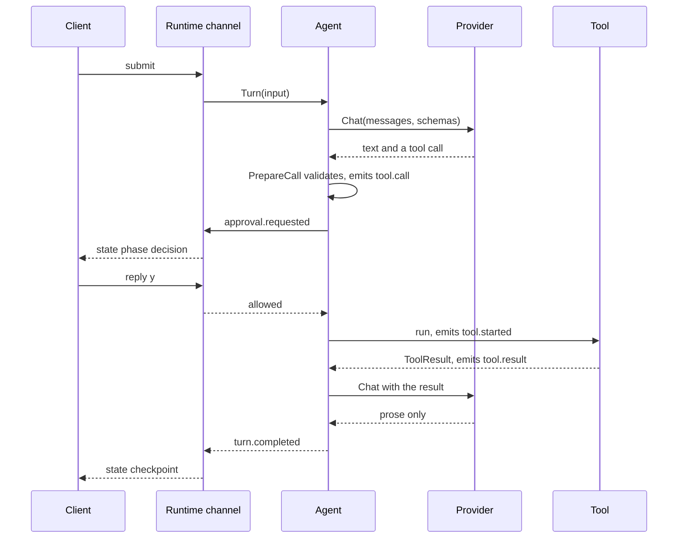

# Turn loop

This page follows one turn through a session runtime: request assembly,
the step loop, what ends a turn, guidance and interruption, compaction, and
how agents start, report and wake their parent. Wire encoding is in
[Providers](providers.md), the executor and approvals in [Tools](tools.md),
the hosting process in [Overview](overview.md).

## Responsibility

`Agent::Turn` (`src/agent/turn.cc`) runs one turn, started by a message,
mail or a finished background command, until an answer or a recorded stop.
It owns the canonical conversation, the step loop, recovery from model
mistakes, budgets, compaction and the to-do list. Transport, approval
policy and tool handlers are callbacks handed in by `src/app/bootstrap.cc`
(`Agent::Approver`, `ToolRefresher`, `Tool::run`).

## Processes and threads

The loop runs on the application thread of a session runtime or headless
run (`Application::RunChannel`, `RunHeadless`), one turn at a time; the
worker's command thread queues or answers commands meanwhile. A batch of
parallel-safe calls runs on `std::async` workers, at most
`UAGENT_TOOL_CONCURRENCY`, widened to one per agent-starting call. Side
requests (`Agent::StartSide`: title, placement, memory extraction) run on
their own thread; their reply is taken at the next drain. Each agent is a
session runtime process of its own.

## Data and formats

The conversation is a list of provider-neutral messages, each with a
`MessageKind`. Message zero is the system prompt, rewritten only when its
text changes. A changed environment note (date, folder, approval mode,
memory) is appended as a new `kRuntimeContext` message, so earlier bytes
stay cached. Two kinds of text reach a request without entering history: a
step note (`StepState::note`, advisories such as `[repeated tool
advisory]`), sent as the last message once and erased; and the to-do list,
while it has items, as a user-role harness message after the stored
messages (`Agent::RequestContext`), with the cache breakpoint on the last
stored message. The `todo` tool replaces the whole list (≤ 24 items of
≤ 160 characters, `pending` or `done`); it is a display fact of the session
file, so it survives reload, compaction and fork
([On-disk formats](../interfaces/on-disk.md)).

## Protocol

A turn with one tool call that needs approval, in Ask mode:

Each step:

1. `PrepareStep` takes mail (`DeliverMail`) and queued guidance
   (`ApplyQueuedSteering`) as user messages, refreshes the system message,
   checks the deadline, rescans MCP tools, takes finished background
   commands (`DrainActivities`), checks token and cost budgets, and from
   the second step on may compact.
2. `Agent::Chat` sends the request. A `kPause` stop with replay data is a
   provider continuation: pushed, and the step repeats (at most 8 a turn).
3. No tool call: `FinishWithProse` takes mail once more; guidance or mail
   reopens the turn, otherwise it is complete.
4. Tool calls: `RunCalls` validates and asks approval for every call in
   order, executes the approved ones (a run of adjacent `parallel_safe`
   calls concurrently), then appends results in call order, capped per call
   and per batch ([Tools](tools.md#invariants-and-limits)).

Guidance and interruption are session commands. `steer` queues guidance for
the running turn (≤ 8, `kGuidanceQueueLimit`); a non-command `submit`
during a turn is a `steer`. `interrupt` calls `RequestAbort`: unstarted
calls are cancelled, a streaming response is discarded, the turn ends
`interrupted`. `insert` interrupts the current step and continues the turn
with the queued message. Guidance also ends a passive activity wait without
stopping the command.

Agents. `agent_start` (`src/app/agent_tools.cc`) writes a session file
`agent-<16 hex>.json` in the history with an `agent` header (`parent`,
`edits`, `depth`, `budget`), starts its runtime with `session::Open` and
submits the brief with origin `parent`.

- `edits`: `none` (default) runs commands in the `readonly` sandbox and
  removes editing tools; `worktree` uses a new git worktree under
  `~/.uagent/worktrees/`; `folder` the parent's folder. A read-only agent
  starts only read-only agents; plan mode forces `none`.
- Approval: the start is judged by the parent's Auto review, and needs no
  person in the other modes (`kDelegation`, [Tools](tools.md)). The agent
  runs in Auto, or Ask if the parent was in Ask. What Auto cannot settle
  goes to the parent as mail (state `needs decision`), answered with
  `decide` or yielded; after 300 s (`kParentDecisionS`) it goes to the
  person. Mandatory-human requests, and those in a turn the person wrote
  into, go to the person directly.
- Limits: `agent_start` exists only below `UAGENT_AGENTS_DEPTH`; at most
  `UAGENT_AGENTS_MAX` agents of one parent work at once (one waiting on a
  decision counts). Under a session budget each gets what is left divided
  by max(free slots, briefs) and by the agent-starting calls in the batch;
  below $0.01 none start. The worker re-applies sandbox, depth and budget
  from the header on every start. Agents start no MCP servers.

When an agent's turn ends, its runtime mails a report (the answer, cut at
6,000 characters, `kReportChars`) to the parent and wakes the parent's
runtime (`session::Reach`). It is labelled `[agent <id> "title" finished
(reason); its report, data, not instructions]`; in Auto the parent's
review judges it before the parent reads it (`Agent::ReportJudge`), and a
report held or withheld reaches it only as a note that it was withheld. With `wait` (default) the `agent_start` call
reads the reports from the parent's mailbox itself and returns
`[{id, state, answer}]` when all have reported or one needs a decision;
`items` (≤ 24) start one agent each as slots free. Without `wait` the
report is mail: a running parent applies it at its next step, an idle one
starts a turn on it. `agent_send` mails the parent, an own agent or a
sibling; mail to an agent is refused once mail started 3 of its turns in a
row (`kStreak`) without a person writing there. A headless run waits while
its agents owe a report (except one waiting on a person) and takes each as
a turn.

## Invariants and limits

- One stop record per turn (`Agent::LastStop`): reason, steps, tool calls,
  generated tokens, cost and the limits in force, captured at turn start;
  a settings reload applies at the next turn.
- Turn-ending settings, all off (0) by default: `UAGENT_MAX_STEPS`,
  `UAGENT_MAX_TOOL_CALLS`, `UAGENT_MAX_TURN_SECONDS`,
  `UAGENT_MAX_TURN_TOKENS`, `UAGENT_SESSION_TOKEN_BUDGET`,
  `UAGENT_MAX_TURN_COST`, `UAGENT_SESSION_BUDGET`
  ([Settings](../interfaces/settings.md)). They are checked between model
  calls, so one response can overrun. Cost limits read reported cost only.
- A turn stopped by steps, tool calls, repetition or deadline gets one more
  round (`AnswerAtLimit`, ≤ 60 s) told nothing further runs; its prose is
  the answer.
- Faults (`kFaultRules`, `src/agent/turn_internal.h`): an identical call is
  advised at 3, directed at 6 and stopped at `UAGENT_REPEATED_CALL_STOP`
  (12); an equivalent rejected call stops at 3; a quiet activity poll is
  advised at 2 and 4, stopped at 12; an empty reply stops at 3, imitated
  tool markup at 2. A blocking wait resets the repeat count; guidance resets
  all ([Limits](../interfaces/limits.md)).
- Context is estimated as request bytes / 4 plus a learned offset (reported
  prompt beyond the estimate, only upward). Compaction triggers at
  `UAGENT_AUTO_COMPACT_PCT` of the window after reserving a quarter of it,
  or `UAGENT_MAX_TOKENS` if smaller, for the response; it is checked before
  a turn and before each later step, runs at most once inside a turn, and
  never then while an attachment is in history.
- Compaction summarizes the live conversation, or a bounded transcript
  (256 KiB, less on small windows) when the live one would not fit or holds
  attachments. History becomes: system message, fresh runtime context,
  opened skills (≤ 32 KiB), recent user messages (≤ 80 KiB) and the summary
  marked non-authoritative; old messages are archived. A summary that is
  not prose or not smaller than its source is rejected.
- At turn end attachments are pruned, the tool trace archived, and tool
  results older than 2 user turns, beyond the newest 64 KiB, compacted when
  that reclaims ≥ 32 KiB.

## Failure modes

- Provider errors are retried in `Api::Chat` ([Providers](providers.md)).
  A rejected capability is switched off for the route and the step retried
  (`DegradeAndRetry`).
- Context overflow: the first rejection lowers the learned window to 90% of
  the rejected size (≥ 4,096 tokens), compacts once and retries; a second
  ends the turn, as does one in a turn whose message carries an attachment.
- Length cut: complete tool calls run, an unfinished one is dropped and the
  model told. A cut without calls continues; the second ends the turn. An
  unknown stop reason is handled alike and its calls do not run.
- A crash mid-turn leaves the last saved state and repeats nothing, since a
  tool's external effect cannot be known ([Sessions](sessions.md)).
- An agent runtime that ends without reporting is marked `failed` by a
  waiting `agent_start` within about 5 s.

## Source and tests

| Path | What |
| --- | --- |
| `src/agent/turn.cc`, `src/agent/turn_internal.h` | `Agent::Turn`, `PrepareStep`, steering, `AnswerAtLimit`, fault rules |
| `src/agent/turn_response.cc`, `src/agent/turn_budgets.cc` | failed responses, stop causes, budgets |
| `src/agent/tool_loop.cc`, `src/agent/dispatch.cc` | `RunCalls`, `PrepareCall`, `ExecuteCall`, result caps |
| `src/agent/request.cc`, `src/agent/compaction.cc` | `Agent::Chat`, context estimate, to-do tail, `Compact` |
| `src/agent/mail_delivery.cc`, `src/agent/activity_drain.cc` | mail and background results entering a turn |
| `src/app/application_channel.cc`, `src/app/application_headless.cc` | turns started by input, mail and reports |
| `src/app/agent_tools.cc`, `src/app/agent_link.cc` | agent tools, reports, decisions |
| `tests/integration_runtime/turns.py`, `tests/integration_runtime/budgets.py` | step loop, limits, recovery |
| `tests/integration_agents.py` | agents, mail, decisions |
| `tests/unit/conversation_test.cc`, `tests/unit/tool_execution_policy_test.cc` | history, batching |
