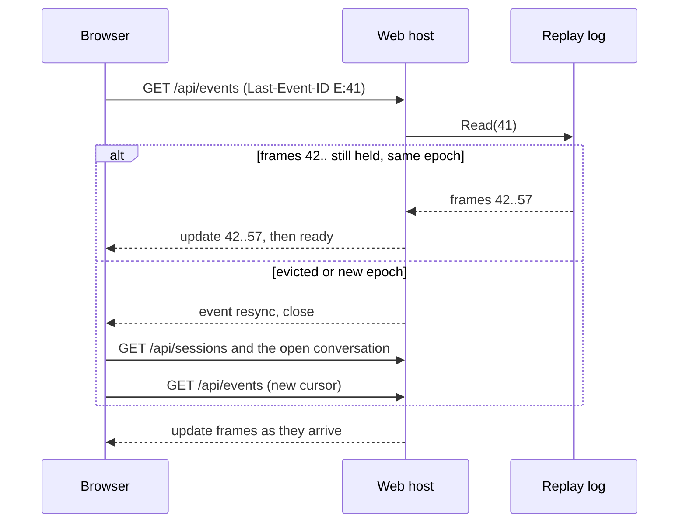

# Web host

This page explains `uagent --web`: how one host per user is found, how a
browser is paired, how a request reaches a session runtime, how events reach
the browser and are replayed after a drop, and what the host serves besides
the app. Routes and their bodies are in [HTTP API](../interfaces/http-api.md);
the client side is in [Web client](web-client.md); what a paired device may
do is in [Security](../../SECURITY.md).

## Responsibility

`web::MasterMain` (`src/web/master.cc`) owns the listener, device
authentication, the event stream, file and preview serving, terminals, the
browser viewer relay, Web Push and updates. `session::SessionHost`
(`src/app/session_host.cc`, `session_router.cc`, `session_supervisor.cc`)
owns the host's view of conversations: the catalogue, starting and
stopping runtimes, forwarding commands, and the replay log. The host never
runs a model or a tool itself; every conversation command goes to that
conversation's runtime over the session protocol ([Overview](overview.md)).

## Processes and threads

The listener is cpp-httplib with a pool that idles at 4 workers and grows
to 37: 4 event streams (`kWebSseConnections`), 5 browser viewers
(`kViewerInstances`), 16 terminal sockets (`kWebTerminalSockets`) and 12
request workers; the queue holds 24. Read timeout 5 s, write timeout 2 s.
Beside the pool, `Master::Run` starts three threads:

- `stopping`: waits on the settings file, the presence paths and the stop
  pipe; on a change it publishes `settings.changed` and refreshes the
  catalogue. SIGINT, SIGTERM and SIGHUP wake it.
- `scheduled`: runs due schedules.
- `notifications`: takes notices from the replay log and hands them to
  `PushSender`, one per active device.

`SessionHost` keeps one reader thread per attached runtime. With
`web.updateCheck` on, an update thread asks GitHub when the last answer is
24 h old, looking again hourly. `PushSender` has its own delivery thread.

## Data and formats

`~/.uagent/web` must be private and owned by the user
(`EnsurePrivateDirectory`). It holds:

- `master.lock`: the single-instance lease.
- `discovery.json`: `v` (`kProtocol`), `port`, `url` (the origin),
  `secret`, `epoch`.
- `devices.json`: `id`, `token`, `name`, `expires` per device, at most 16
  (`kWebDeviceLimit`).
- `vapid.pem` and `push-subscriptions.json`.
- pins and drafts ([Sessions](sessions.md)).

The replay log (`ReplayLog`, `include/app/replay_log.h`) holds the newest
frames, at most 4 MiB (`kQueueBytes`) and 2,048 events, each preformatted
as `id: <epoch>:<sequence>`, `event: update`, `data: <json>`. The `epoch`
is random per host process, so a cursor from an earlier one never matches.

## Protocol

**Discovery.** `MasterMain` takes `master.lock`. If another process holds
it, it reads `discovery.json`, calls `POST /api/instance` on loopback with
`X-Uagent-Instance: <secret>`, checks `epoch` and `v`, prints the pairing
text the running host returned, and exits 0. It tries 20 times, 100 ms
apart, then exits 2; a protocol mismatch also exits 2. The running host's
port and origin win over the new flags. A taken port ends the host; it
never binds another.

**Pairing.** `Pair()` makes a 12-byte random code valid for 5 minutes; a
new code replaces the old. `POST /api/auth` with `{code, name}` is limited
to 12 attempts a minute across all callers. On success the host stores a
device with a 16-byte id and 32-byte token, clears the code, and sets
`uagent_device=<token>; Path=/; HttpOnly; SameSite=Strict; Max-Age=2592000`
(30 days), adding `Secure` on an HTTPS origin. Expiry is not extended by
use. A request with two `uagent_device` cookies authenticates as nobody.

**Origin and Host.** The pre-routing handler maps `Host` to an expected
origin: the configured `--web-origin`, or `http://127.0.0.1:<port>`.
Anything else is refused with 403. A request that carries `Origin` must
match it exactly; a mutation must carry it, except `/api/instance`. Every
`/api/` route except `/api/auth` and `/api/instance` needs an active device.
`--web-origin` must be a bare `https://` origin or `http://` on an address in
`100.64.0.0/10`; forwarding headers are never read.

**Commands.** `POST /api/command` takes `{v, kind, request_id, …}`, at most
64 KiB (1 MiB, `kFrameBytes`, for `memory`, `skills` and `instructions`).
The receipt is keyed by device and `request_id`: a retry with the same body
returns the stored outcome, a different body is refused with 409. At most
256 receipts are kept (`kWebRequestReceipts`), evicting only completed ones.
Host commands (devices, push test, browser, settings, pins, spaces,
management, terminals, restart, update) run in the host. Every other kind
goes to `SessionHost::ExecuteCommand`: it starts the runtime if the command
names no generation (`ActivateLocked`, which calls `session::Open`),
refuses a stale `generation`, resolves `attachment_ids` against the asset
store, and writes the command with a host-made `request_id` to the runtime
socket. It waits up to 2 s for the runtime's `outcome`; if none arrives the
reply says `pending` and the client asks `GET /api/receipts/<id>`. A runtime
holds at most 32 unanswered commands (`kMaxPendingSessionCommands`).

**Events.** `GET /api/events` is Server-Sent Events. The cursor is
`Last-Event-ID` or `?cursor=`. The handler reads the log from the cursor up
to the cursor at connect time in batches of 64 KiB, then sends
`event: ready` with `{epoch, cursor}`, then waits for new frames, polling
each second and writing a `: heartbeat` comment after 15 s of silence. A
fifth stream ends the oldest. A stream ends when its device is revoked.

`ReplayLog::Read` resets when the epoch differs, the cursor is ahead of the
log, or frames after the cursor were evicted. The handler then sends
`event: resync` and closes; the client reads `GET /api/sessions` and the
open conversation again and reconnects from the new cursor.

**WebSockets.** `/api/terminals/<id>` and `/api/browser/viewer` check the
exact `Origin` and the device cookie (`WebSocketDevice`), else close with
policy violation. Terminal sockets are counted against 16; a message over
64 KiB (`kWebTerminalMessageBytes`) ends the socket. Binary frames carry
shell I/O; text frames carry `resize`. A newer socket for the same shell
replaces the older one. The viewer takes `instance` 0 to 4, one socket
each.

**Files and previews.** `/api/sessions/<id>/files` serves a conversation's
folder through `workspace_files::Resolve`: no absolute paths, nothing
outside the folder after canonicalisation, nothing hidden. `ServeFile`
replaces the app's CSP: HTML gets `sandbox allow-scripts allow-forms
allow-popups`, SVG a script-free sandbox, anything else
`default-src 'none'`; non-inline files are attachments.

`POST /api/sessions/<id>/preview` returns `/preview/<token>/`, a 24-byte
random token per conversation. It holds until the host stops or any device
is revoked. The preview route needs no cookie: the token is the grant. It
serves only the types `PreviewMime` lists (pages, styles, scripts, JSON,
CSV, `.xlsx`, fonts, images, media). Its CSP (`PreviewPolicy`) sandboxes the
page into an opaque origin and limits loads to the preview address, with
`'wasm-unsafe-eval'` and `blob:` workers for the sheet engine under
`~sheet/`. Because the page is opaque, its own subresource
requests carry `Origin: null`; the pre-routing handler accepts that only for
a GET or HEAD under `/preview/`.

**Web Push.** Enabled when `web.pushContact` names a `mailto:` or `https://` contact
and libcurl resolves asynchronously. A
subscription's endpoint must be HTTPS on port 443 at FCM, Mozilla or Apple,
and resolve to a public address at connect time. Payloads are `aes128gcm`
with a 1 h VAPID token, `TTL: 60`; two attempts; 404 or 410 drops the
subscription; a notice older than 60 s is dropped. A notice is raised by
`turn.completed`, an approval or question not routed to a parent agent,
`approval.escalated`, or an error. With `web.notificationDetail` off the
payload carries no title.

**Update and restart.** `restart_host` sets `reexec_` and wakes the stop
pipe; after 300 ms for the reply, the server stops, the host and browser
service are torn down, the lease is released and the host `execv`s its own
argv. `update` with `action: apply` downloads `install.sh` for the version
the last check named, runs it with `UAGENT_NONINTERACTIVE=1`, and restarts
the same way. It is refused unless an installer made this install, its
prefix is writable and `web.terminal` is on.

## Invariants and limits

- One host per user: the lease decides, never a port or PID file.
- Commands are idempotent per device and `request_id`; a pending receipt
  is never evicted.
- The host replays events; it never replays commands. Recovery from an
  evicted cursor is a fresh read.
- Uploads are capped at 8 MiB by the listener (`kUploadBytes`); JSON
  replies over 1 KiB are gzipped for clients that accept it.
- Embedded assets under `/assets/` are immutable for a year; others
  revalidate by ETag. Every response carries `Cache-Control: no-store`
  unless a route sets its own.

## Failure modes

- A runtime that ends mid-command fails its pending receipts
  (`OutcomeStore::FailPending`); one that ends mid-turn is reported
  `interrupted`.
- A revoked device's streams end at their next poll, and every preview
  token is dropped with it.
- A push service outage loses notices after two attempts.

## Source and tests

| Path | What |
| --- | --- |
| `src/web/master.cc` | startup, discovery, pool, Origin checks, routes, restart |
| `src/web/master_auth.cc` | pairing, devices, cookies |
| `src/web/master_command.cc` | `POST /api/command`, receipts, host commands |
| `src/web/master_stream.cc` | event stream, uploads, `ServeFile` |
| `src/web/master_files.cc` | folder files, previews, `PreviewPolicy` |
| `src/web/master_terminal.cc`, `src/web/browser_viewer.cc` | WebSockets |
| `src/web/push.cc`, `src/web/push_crypto.cc` | Web Push |
| `include/app/replay_log.h`, `src/app/replay_log.cc` | replay and notices |
| `src/app/session_router.cc`, `src/app/session_supervisor.cc`, `src/app/outcome_store.cc` | forwarding to runtimes |
| `src/app/update.cc` | update check and install |
| `tests/integration_web/auth.py` | pairing, origin, single instance |
| `tests/integration_web/recovery.py` | retries and `resync` |
| `tests/integration_web/preview.py` | preview address and policy |
| `tests/integration_web/push.py`, `tests/unit/web_push_test.cc` | push |
| `tests/integration_web/terminal.py`, `tests/unit/web_terminal_test.cc` | terminals |
