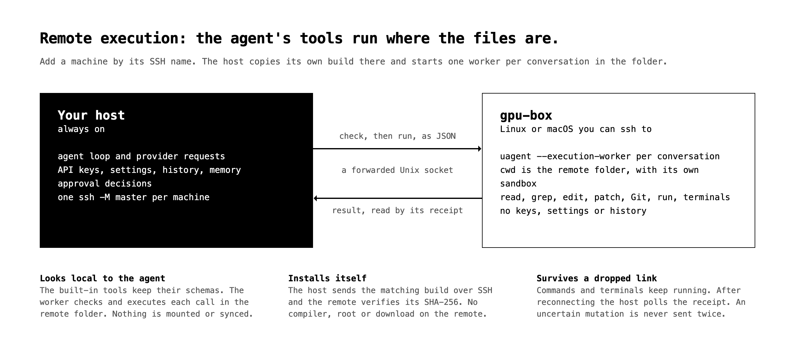
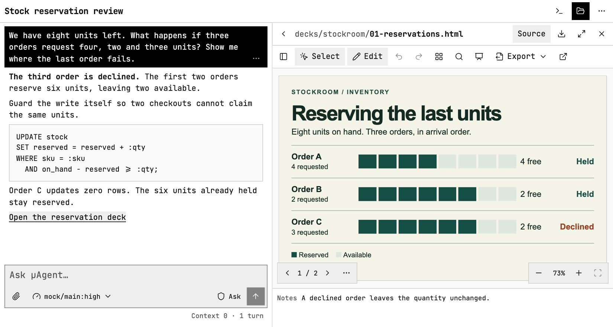

# Manual

One host process runs every conversation; the terminal and web clients
attach to it. This page covers attaching a second client, the two places a
conversation works beyond the local folder (a remote host and the agent's
browser), then models, conversations and the features built on them. The
[command reference](interfaces/cli.md) and [settings reference](interfaces/settings.md)
list every option; the [documentation index](README.md) maps each feature to
its design page.

## Join a running conversation

1. Run `uagent` in a project folder and start a task.
2. On the same host, run `uagent --web` in another terminal. Open the pairing
   link in your browser. To join from a phone, first give the host an address
   the phone can reach. [Pairing and remote access](operations/remote-access.md)
3. Open the conversation in the list. Both clients receive streamed replies,
   tool activity and approval requests. Approve a tool call from either
   device and watch the turn continue on both. You can close a client and
   rejoin while the host keeps working.

[Watch a terminal session and phone approve an edit and test run](images/terminal.gif)

## Remote hosts

A conversation's execution host is chosen when it starts, in the **Host**
field of a new conversation or folder: Local, or a host added with **Add
host** in the sidebar's Remote hosts panel, which shows each host's state
and round trip with **Reconnect** and **Disconnect**.

The agent loop does not move. Model requests, provider keys, settings,
history, memory and approval decisions stay on the µAgent host. On the
remote, a worker of the same build runs in the conversation's folder under
its sandbox preset and executes the file, search, edit, patch, Git, shell
and terminal calls there. To the agent the remote folder is its working
folder: it calls the same tools with the same arguments, and nothing is
mounted or synced. **Files** and the terminal dock show the remote folder.

Adding a host needs an SSH name that works without a prompt; the host
copies its own build there. When the link drops, remote commands and
terminals keep running and their results are read once it returns. A
remote conversation has no browser tool and no project MCP servers, and
cannot be moved. See [Remote access](operations/remote-access.md#connect-an-ssh-execution-host)
and [Execution gateway](architecture/execution-gateway.md).

## The agent's browser

On a Linux web host with `web.browserData` set (the container sets it),
the agent drives a real Chrome that every paired device can watch. The
globe button in a conversation's header opens the live screen, read-only.
**Take over** gives this device the input and pauses the agent's actions
until **Done** hands back. When the agent asks for a person (a sign-in,
MFA, a captcha, a payment), the card's **Open browser** opens the viewer
already in control, and only that device can finish it.

The active Chrome profile keeps its cookies and saved logins, so the agent
works in the accounts the profile is signed in to. To bring your own
logins, take control and choose **Sign in to profile**: Chrome restarts
without the agent's control channel, you sign Chrome itself in to your
Google account and turn on sync, and **Done** hands the browser back.

The agent uses a saved login without reading it. On a sign-in page it asks
Chrome to autofill a field; the tool reports the length of the filled value
and the password stays in Chrome. For a new login or MFA, take control and
enter the secret in the browser.
[Browser automation and password handling](../SECURITY.md#browser-automation)

The status menu holds **Page size**, **Browser scheduling** (the shared
browser, or 1, 2 or 4 research browsers whose profiles are reset between
conversations), **Viewing**, **Chrome profile**, **New profile** and
**Stop browser**. **Copy** and
**Paste** move the clipboard between device and Chrome. See
[Browser](architecture/browser.md) and
[Security](../SECURITY.md#browser-automation).

## Models and providers

A provider is an address that serves models, with its key. A model is
selected as `[provider/]model[:effort]` (the `model` setting also accepts a
`:variant` before the effort). A suffix that is not an effort stays in the
model id, so a routing suffix such as OpenRouter's `:nitro` or `:free` is
part of the name: `openrouter/vendor/model:nitro:high`.

| To | Terminal | Web |
| --- | --- | --- |
| add a provider | `uagent setup`, or edit `providers` in the settings file | Settings → All conversations → Providers |
| choose for this conversation | `/model NAME`, or `/model QUERY` to search | the model control under the composer |
| choose for new conversations | `/model NAME --default` | **Also use for new conversations** |
| set the reasoning effort | `/effort LEVEL` | the model control |

Providers and the default model are saved in
`~/.uagent/config/settings.json`; a choice for one conversation stays with
it. Providers apply to conversations started afterwards (`/restart` for a
running one). With no model set, the first interactive start opens the
model picker and saves the choice; `-p` and `--json` exit with an error
that names the configured providers.

`uagent setup` offers free-model setup, then asks for OpenRouter, OpenAI
and Anthropic keys (Enter skips one), checks each against its endpoint and
saves providers named `openrouter`, `openai` and `anthropic`.
`uagent setup openrouter` signs in instead of asking for a key: with a
local browser it receives the key on a loopback port; over SSH, without a
display or with `--no-browser` it prints a link to open on any device and
reads the code that page shows, valid once for ten minutes. The key is
saved as a separate `openrouter-free` provider restricted to free models.
The web home screen offers the same sign-in while the host has no provider.

Side work has its own routes, empty by default, which means the
conversation's model: `title.model` (titles and filing; `off` disables),
`memory.model`, `image.model` (when the conversation's model reads no
images: the first model of its endpoint that does), `webSearch.model`
(needed when the route has no hosted search), and `approval.reviewerModel`
for Auto review, which names the decision model and, as `provider/`, a
provider other than the conversation's: none is asked unnamed. See
[Providers](architecture/providers.md).

## Conversations

**Starting.** `uagent` in a folder starts a conversation there.
`uagent --web` starts or reuses the user's web host and prints a pairing
link whose code works once, for five minutes ([Remote
access](operations/remote-access.md)). The web home screen's box starts a
conversation in the **Scratch** workspace on Local; its **Scratch** button
chooses another host and folder. **New** in the sidebar makes a
conversation, workspace or folder, and **+** on a place starts one there.
A workspace is a folder kept under `~/.uagent/spaces/<name>`; deleting it
deletes its conversations and every file in it. A folder is a directory of
yours that µAgent never removes.

**Filing.** For a conversation in Scratch, µAgent suggests a place and
never moves it by itself: with the first message, the title model compares
it with recent conversations and may offer **Continue there** or
**New in** a folder; when a turn ends, the folders of the files it changed
are suggested, or the model is asked once. The suggestion shows above the
composer, under **Suggested moves** on the home screen and under **To
file** in the sidebar. **Move** moves it, **Create and move** makes the
named workspace first, **Other place…** opens the move dialog, and **Keep
in Scratch** answers for good.

**The sidebar.** **Recent** lists every host's conversations newest first,
by day; **Places** groups them into Workspaces and Folders per host, each
with a fold, an overview (the place's name) and **+** for a conversation
or a terminal; older conversations wait behind **N older**. View and folds
are kept per browser. **Needs you** lists what waits on a decision;
**Pinned** holds what **Pin** put there, stored on the host for every
paired device.

**Continuing.** `uagent -c` continues the folder's latest conversation;
`uagent --resume` or `/sessions` picks one. Leaving (`/quit`, Ctrl+D,
closing the tab) leaves the runtime running until `runtime.idleMinutes`
pass with no turn, queued message, command or attached terminal; the next
message starts it from the saved conversation without repeating a command.

**The composer.** While a turn runs, Enter sends guidance, delivered at the
next checkpoint; **Insert now** on a queued message interrupts the current
step to deliver it, **Edit** takes it back. **Queue next** (Alt+Enter)
runs a message as its own turn after this one. Esc, or Send while it shows
Stop, interrupts the turn.

Type `@` in a message to find an attached file or a workspace path. Choose
a workspace path to add a removable reference above the input. For a line
or range, type `@src/main.cc:12` or `@src/main.cc:12-24` before choosing
the file. The agent receives the path and line numbers. Use **Attach files**
to include the file itself.

**The status control** under the composer says how the conversation
stands: Working with time, commands and agents; **Needs you** with
**Show**; **Stopped** with **Continue** (sends `continue`); Reconnecting.
Its sheet lists the turn, background commands and agents, each with Stop.

**The transcript** draws a turn's work as a tree of steps under one
"Worked" row; a turn of more than 30 steps folds the earlier ones.
**Detail** in the conversation menu sets how far the tree starts open
(`minimal`, `default`, `full`) and whether thinking shows, on this device;
`/detail` sets it everywhere. A turn that changed files ends with a
receipt listing them, each with **Undo**.

**Search and find.** Ctrl+K (⌘K) searches conversation and folder names,
then message text including tool output, then actions, commands and
settings; a query starting with `>` searches only the latter. Ctrl+F (⌘F)
finds within the open conversation, loading older messages and opening
folded rows to reach a match.

**The conversation menu** holds **Find in conversation**, **Pin**,
**Rename**, **Move to…** and **Select**; under **More**: **Fork
conversation**, **Statistics**, **Tools**, **Export transcript**,
**Detail**, **Compact**, **Restart**, **Close conversation** and
**Delete**. Fork waits for a running turn. **Move to…** moves a Local
conversation, its attached side chats and its agents to another folder or workspace; its files stay
where they were. Earlier file references open in their original workspace.
New copied file links retain their workspace after a move. An older path-only
link opens when exactly one workspace contains that path. If several contain
it, choose the original folder from the list. Move is available
when the conversation and its agents are idle and have no mail waiting.
**Close conversation** saves it and stops its
runtime and supervised children. **Delete** removes its saved messages and
attachments, closing a live runtime first; files in the folder stay.
`/fork [@N]`, `/rewind N` and `/btw QUESTION` branch a conversation; a
`/btw` conversation works in the same folder with the same tools.

**Side chats.** Select text in an answer, in one of your messages or in a
tool's output: **Ask in side chat** opens a side chat with the selection
quoted and the question still to write, **Quote** puts it over the input,
in the message you are writing: several quotes stack, each with an X to
remove it, and they go before your text when the message is sent. A side
chat is a `/btw` conversation: it has read the conversation so far,
answers beside it and leaves it untouched, while a turn runs too. Each question starts a side chat of its own, shown as tabs;
selecting in a side chat's answer follows up there. They sit in a column
beside the chat (with Files open, between the chat and Files); X hides a
tab, and the side chat stays. Where there is no room for the column, on a
phone or in a narrow window, the input itself asks, marked **Side chat**
with the quote above it, and the side chat opens as a page of its own,
with the way back and **Merge** in its header. A side chat belongs to its
conversation, on every device: it is not in the list of conversations, it
moves and is deleted with it, and its spend counts toward it. Everywhere,
a conversation's side chats are counted and listed in its **Activity**
list under the input, with its commands and agents ("2 side chats"),
working ones first: a row shows the side chat's tab, or its page. The
arrow beside **Merge** (in the page's menu on a phone), **Open as a
conversation of its own**, makes it an ordinary conversation in the list,
with the way back to where it was asked.

**Merge** brings a side chat back: it writes a summary of what it found,
in view ("Summing up…", and a quiet row in the conversation while it
does), and the conversation receives that as it does an agent's report
(data, not instructions; judged in Auto) and answers. There it is one
row, **Merged side chat**, that folds like a step and holds the summary,
with **Show side chat**. The side chat stays, saying when it merged, and
offers Merge again once it has said more; a merge that fails or is
stopped leaves it as it was and says why. The conversation reads the
summary, never the side chat, and a report never names a conversation.

**Several at once.** Ctrl-click (⌘-click) picks a row, Shift-click a run,
and **Select** in a row's menu starts picking by tap; the sidebar's footer
then offers **Move to…**, **Close** and **Delete…**. The Library picks the
same way.

## Approvals and plan mode

The approval mode decides who is asked before a call that changes files,
runs a process, uses the network or reads outside the folder. The modes,
what each lets through and what always needs a person are stated in
[Security](../SECURITY.md#what-the-agent-may-do-without-asking); the
pipeline is in [Tools](architecture/tools.md).

| Mode | Web label | Switch with |
| --- | --- | --- |
| `ask` | Ask | `/permissions ask` |
| `auto` | Auto review | `/permissions auto` |
| `yolo` | YOLO | `/yolo`, `--yolo`, `/permissions yolo` |
| `plan` | Plan | `/plan`, `/permissions plan` |

Open **Approval** to see which setting supplied the mode. **Default** follows
the applicable settings for an ordinary conversation. A delegated agent
inherits its parent's mode at launch. Its assignment disclosure shows whether
it may edit the shared folder, edit its own worktree or only read. Choosing
another approval mode in the child keeps its assigned edit scope.

An approval card shows what the call would do (the command, or a diff),
the folder, the risks a reviewer saw and why it asks (the mode, a rule, the
review, or a call that always needs you), with **Deny**, **Allow for this
conversation** and **Allow once** (`n`, `s`, `y` in the terminal, `a` for
always and `x` for never; other text denies and reaches the model as
guidance). Under **More options**, **Ask each time / Always allow / Never
allow** keeps the rule the card names (a command prefix, a folder, a host,
or the exact call) for this folder in `~/.uagent/config/permissions.json`
when you answer: Always with an allowing answer, Never with Deny; **+
guidance** answers in words.

A folder's rules allow, ask or refuse, in every mode: a refusing rule holds
in yolo too, and an asking rule asks there. Settings → This folder → Rules
lists them by effect and adds one; `/permissions rules` lists them,
`/permissions allow|ask|deny TOOL MATCH` adds one and `/permissions forget
N` removes one. A call Auto refused without asking shows in the transcript
with why, and **Allow in this conversation** lets that action through for
the rest of the conversation (or **Rules…** when a rule refused it). After
3 refusals in a row, or 20 in a conversation, Auto asks you until you
answer one.

An MCP server can ask you for input while one of its tools runs. Its card
names the server and shows its message with either a form (text, numbers,
yes/no and choices; Enter keeps a field's default in the terminal) or a
link. **Accept** sends the form, **Decline** refuses and **Cancel** leaves
without an answer; in the terminal `/decline` declines at any field and Esc
cancels. A link is shown whole with its host in bold, with a warning when
the host is a punycode name, and is never opened for you: open it in your
own browser, then **Continue** (`a` in the terminal). A run nobody can
answer, such as `uagent -p`, does not offer servers this. `mcp.timeout`
bounds each request to the server, so time spent answering is not counted;
after you continue from a link, the server may wait for you until the turn
ends or you stop it.
A server may also run a tool as a task: the call stays open while the
server works, the status line shows the server's progress message, and
stopping the turn asks the server to cancel it.

**Plan mode** only reads: commands run in the `readonly` sandbox and the
only file it writes is a plan kept beside the conversation's history, never
in the folder. A turn ends with the plan shared and three answers: **Approve
and run in auto**, **Approve and ask before changes** (each leaves plan
mode in that mode and starts the work) and **Keep planning**. Entering plan
mode discards an earlier plan.

**Undo.** `/changes` lists the files the last turn changed and `/undo
[FILE]` restores them; the receipt's **Undo** and **Undo all** do the same
in the web. A file changed since is kept and the reason shown. Changes made
by shell commands are not tracked.

## Files and terminal

**Files** (the folder button in a conversation's header) shows the
conversation's folder as a tree with name search. Code opens highlighted,
Markdown rendered (**Source** shows the text), HTML live in a sandboxed
frame; other files download. In a Git repository **Changes** groups files
by **Working tree** and **Staged**. Open a working-tree change to compare
the file with the index, or a staged change to compare the index with the
last commit. A partially staged file appears in both groups. **Quote** puts
a reference to the selected lines over the input. **Ask in side chat** asks
about them in a side chat. Open files are read again when a turn ends. Files writes to disk only by artifact editing (below). It serves
nothing outside the folder ([Web host](architecture/web-host.md)).

In an artifact, **Export → Copy link** copies a link to the current file or
slide. In Files, the filename in the heading is also a link. Open it on a
device paired with the same µAgent server to see the current workspace
version. If the file moves or is removed, Files shows its missing path.

In a deck, **Export** offers the whole deck first and the current slide
separately. Without the host’s browser service, **Print deck or save as PDF**
opens the browser’s print dialog. Skipped slides stay out of the deck PDF.
On a narrow screen, open **More tools → Export**.

A terminal is your own login shell, unsandboxed, on the conversation's
execution host, at most 8 at once. Its environment is the agent's
commands' (no API keys or `UAGENT_*` settings) plus `SSH_AUTH_SOCK`. The
agent never reads it
([Security](../SECURITY.md#paired-devices-and-the-web-host)).

| Kind | Started by | Lives until |
| --- | --- | --- |
| Folder terminal | **+** → **Terminal** on a place | closed, exited, or silent with no device showing it for `web.terminalIdleMinutes` (Local) or 24 h (remote) |
| Panel terminal | Ctrl+\` or the header button; **+** for another | its tab closes or the page is left or reloaded |

A folder terminal is listed under its place on every device and shows its
recent output to a device that opens it; one device types at a time, and
**Use here** takes it over. Stopping the web host ends its Local shells.
`web.terminal` off removes both kinds at the next host start.

## Artifacts

Ask the agent to make a deck, document, sheet, whiteboard or design. Open
its artifact card to see the result beside the conversation. Edits are saved
in the workspace file, and the preview follows changes made by the agent.
[File formats](interfaces/artifact-formats.md) · [How previews work](architecture/artifacts.md)

- **Every kind.** **Find** searches all pages; **Select** turns a clicked
  element into a line in your message; **Tweaks** tries the levers a page
  declares and **Keep** sends them as a line; **Present** fills the
  screen. Where the agent's browser runs, **Export** has the host draw a
  PDF or PNG (**Draw on it** opens the image in markup); elsewhere it
  offers the browser's own print. A page that fails is marked and **Ask
  agent to fix** puts its errors in your message.
- **Decks.** Slides are the folder's pages in name order. A slide's last
  `<aside>` is its speaker notes, shown in **Presenter view**, a second
  window kept in step. Dragging in the legend or **Slide actions** moves,
  duplicates, adds, skips or deletes slides by renaming files.
- **Documents** are paged on screen as they print. **Edit** (also on a
  slide) makes headings, paragraphs, list items and table cells editable
  and saves after a pause; a block the agent changed meanwhile is not
  overwritten. Export adds Markdown.
- **Designs** open as a canvas of every page, image and video at real
  size; a design system opens as its brand book.
- **Whiteboards** let you move shapes, notes and connectors directly on the canvas.
- **Sheets** are grids computed by IronCalc in the page's own worker.
  Edits, formats, merges, groups, rules, charts and tabs are written into
  that tab's table in the file; **Comment** adds the selected range to your
  message. `.xlsx` and `.csv` open read-only until **Save as sheet**;
  Export gives an Excel workbook or the open tab as CSV.

## Agents and the to-do list

An agent is a conversation another one started on a brief, listed under
its parent. `/agents` lists them and `/open ID` switches to one; in the
web its link opens it. An agent only reads unless started with `edits`
`worktree` (a git worktree under `~/.uagent/worktrees/` from `HEAD`) or
`folder`. Its approvals go to its parent first; once you write in its own
conversation, that turn's come to you. In Auto the review judges the
brief before an agent starts and its report before the parent reads it; a
report that looks like it instructs the parent waits for you on a card
with **Withhold** and **Deliver**, and is withheld when nobody can answer. `agents.max` and `agents.depth`
bound how many work and how deep they nest ([Turn
loop](architecture/turn-loop.md)).

The to-do list the agent keeps for long work is saved with
the conversation and sent with every request; the web shows it above the
composer.

## Memory, skills and schedules

| To | Terminal | Web |
| --- | --- | --- |
| see or edit memories | `/memory`, `/memory set KEY @FILE`, `/memory forget KEY` | Library |
| see or add skills | `/skills`, `/skills set KEY @FILE` | Library |
| switch a skill off or on | `/skills disable ID`, `/skills enable ID` | Library |
| import from Claude Code or Codex | `/skills import`, `/memory import` | Library → Import |
| manage scheduled tasks | `/schedule`, `/schedule run\|pause\|resume\|forget ID` | Scheduled |

A key is `global/NAME` or `project/NAME`. The **Library** lists the
memories, skills, artifacts and presented files of every place a
conversation works in. SSH folders are grouped by host. Local items and shared
snapshots appear while the Library loads live artifacts from connected hosts.
A memory offers **Move to…** and
**Copy to everywhere**, and picked items go with **Delete…**. **Scheduled**
edits tasks (**New task**, **Run now**, **Pause**, **Resume**), which run
only while `uagent --web` runs. `--no-memory` turns memory off for one
conversation. See [Memory and schedules](architecture/memory-and-schedules.md).

## Settings

A setting is read from the command line, then the environment, then the
folder's saved settings, then those for all conversations; nothing is read
from the folder itself and `.env` files are never loaded. Each setting's
scopes and when a change applies are in
[Settings](interfaces/settings.md).

| To | Use |
| --- | --- |
| see what is set and where from | `/config`, `/config KEY` |
| save for all conversations | `/config user KEY=VALUE` |
| save for this folder | `/config project KEY=VALUE` |
| set for this conversation | `/config conversation KEY=VALUE` |
| remove a saved value | `/config user unset KEY` |

The web's Settings has five panes. **All conversations** and **This
folder** list every setting with a filter, plus instructions, MCP servers
and the folder's Rules; a change that needs a restart offers it.
**This browser** (Appearance, Animations, Clock, Timestamps, Zoom) is kept
in the browser only. **Host** holds Install, Notifications and Paired
devices; **About** the build and updates.

`~/.uagent/config/style.css` is added after the app's stylesheets on every
paired device and may override the tokens of
`web/src/shared/styles/tokens.css`; class names are not a stable
interface. Pages fetch it on connect and when a turn starts or ends. The
agent changes it only through the `uagent` tool, with your approval.

## Accessibility

- **Plain terminal.** `--plain` (`UAGENT_PLAIN`) writes append-only lines
  without cursor movement or animation, each opened by a label (`you:`,
  `tool:`, `result:`, `failed:`, `approval needed:`), in ASCII with
  Markdown unrendered, and reads input a line at a time so the screen
  reader's line editing works. `NO_COLOR` keeps bold, dim and italic;
  `TERM=dumb` removes all styling.
- **Motion.** `prefers-reduced-motion`, or This browser → Animations: Off,
  stops animations and transitions except the working spinner.
- **Zoom and contrast.** Pinch zoom is never disabled; This browser → Zoom
  scales from 50 % to 200 %. `prefers-contrast: more` and forced colours
  have their own palettes.
- **Screen readers.** A turn is announced at its edges ("Responding",
  "Needs your input", "Response complete"), not per token; a new decision
  is an alert; failed rows say "Failed" in text.
- **Keyboard.** A skip link leads to the conversation; menus open with the
  arrow keys; a row of tabs is one Tab stop; docked panes resize from
  their edge with the arrow keys. The axe-core checks are in
  [Testing](testing.md).

## Slash commands and shortcuts

Slash commands are listed, with where each runs, in
[Command line](interfaces/cli.md). Typed without an argument in the web,
a command that has a screen opens it.

Web client shortcuts (`web/src/shared/shortcuts.ts`; Ctrl is ⌘ on a Mac,
and `?` lists them in the app):

| Keys | Action | Where |
| --- | --- | --- |
| Ctrl+K | Search | anywhere |
| Ctrl+F | Find in this conversation | anywhere |
| `?` | Keyboard shortcuts | outside text fields |
| Alt+↑, Alt+↓ | Previous, next conversation in sidebar order | anywhere |
| Ctrl+\` | Show or hide the terminal | anywhere |
| Ctrl+A, ⌫, Esc | Select all, delete the selected, stop selecting | while selecting |
| Enter, Shift+Enter, Alt+Enter | Send, new line, send when the turn ends | composer |
| Esc | Stop the running turn; close a dialog or menu | composer; dialogs |
| ↑, `/`, Tab, `@` | Recall a sent message, commands, complete, mention a file | composer |

In the terminal client: Shift+Enter or Alt+Enter adds a line; Esc clears
the draft and stops the turn; Tab completes a `/command` or `@path`;
Ctrl+X Ctrl+E edits the draft in `$VISUAL` or `$EDITOR`; Ctrl+B moves the
running command to the background; Ctrl+O steps the detail level; Ctrl+C
stops a turn, and twice while idle detaches; Ctrl+D on an empty draft
leaves.
