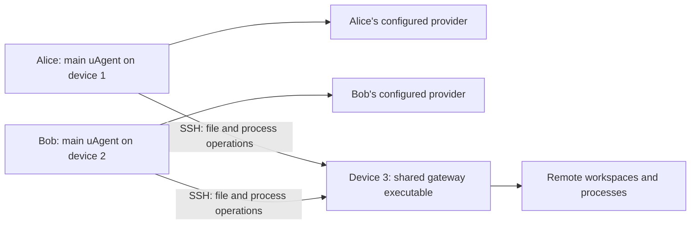

# Remote workspaces: shared stateless gateway

Revised 2026-11-10. This replaces the stateful remote backend design in
[PR #336](https://github.com/timongentzsch/uAgent/pull/336). Implementation follows the Opus 5.5 source review. Preserve the completed sidebar/mobile work, SSH bootstrap, verified
four-platform packaging and CI improvements.

## Contract

Each main uAgent owns its configuration, provider credentials, model selection,
agent loop, conversations, history, memory, usage, approvals and schedules.
**Provider calls go directly from that main instance to its configured provider.**
Selecting a remote workspace changes where files and commands are accessed;
it does not change providers, route provider traffic through the remote machine,
or create remote settings. Provider localhost URLs continue to mean the main
host. Main instances belonging to different users have independent settings.

The remote executable is a shared execution gateway. It handles filesystem/Git
operations, commands and terminals. Project MCP, browser file transfers and
remote worktrees are explicitly unavailable in the first version. Remote project skill discovery, sudo password prompts and automatic memory extraction are also deferred; global skills and explicit memory tools remain on the main. It does not
start an agent, read provider settings, persist conversations, maintain a model
catalogue or run a scheduler. Never copy provider credentials or the settings
file to it, including through environment variables or tool launch arguments.

Stateless means no durable application state. Open connections, process/terminal
handles and bounded execution buffers are temporary state. Installed versioned
binaries are installation artifacts; workspace files are the user's real work.

## Multiple users and main instances

- Install/reuse one remote executable, not a copy per main client, conversation
  or folder. Multiple mains can attach concurrently, including from different
  machines and with different settings, models and credentials.
- Share the executable and installation, with an isolated execution process per
  conversation/runtime and terminal. Existing handlers rely on process-local
  cwd, sandbox and cancellation. Different OS accounts use distinct processes
  and normal OS permissions; shared SSH accounts do not isolate user files.
- Each main stores a random client secret per host privately. Process sockets
  and handles are scoped to that client/runtime. A reconnect replaces the old
  connection, checks the outcome of an uncertain call by its id, and never
  blindly repeats a mutation. One client cannot cancel another client's work.
- Execution processes outlive transport drops while children remain active.
  They exit after the conversation ends, or an idle grace period without a
  connection or live children. Detached jobs die when their execution process
  exits; remote restart reports interruption rather than recreating state.
- Install into build-keyed directories so different main versions coexist.
  Never replace a running worker or use a shared mutable current-build symlink.
  Check an admin-owned shared installation first, then the per-account cache;
  never write an admin-owned installation or create world-writable code.

## Main-side execution context

Add one explicit workspace identity: execution host plus canonical folder.
Persist it with the conversation, workspace and schedule on the main host.
Use the existing hosts.json id (empty for Local) in history, drafts, session
headers, schedules, trust, folder settings and memory. Hash the host into
WorkspaceId only for remote folders, preserving Local IDs. Disable borrowed
Claude memories for remote folders. Session identity and caches include the host; equal paths/IDs on
separate machines must not collide. Host switching in the UI does not retarget
outstanding work.

Expose one Workspace value (host, path). Run the main remote-conversation
worker in an empty private local runtime folder and register no local execution
tools for it. Separate the logical remote folder from the runtime's actual local cwd/state
folder. Remote paths are resolved by the gateway, never validated or opened on
the main filesystem. All required file access follows the execution context:
agent file tools, project instructions, Git, editor/file APIs, previews,
attachments and workspace lifecycle. No local-execution fallback when offline.
Global prompts/configuration are read on the main host; remote project content
is read remotely, with host-qualified trust decisions stored on the main host.

Keep stateful coordination on the main: to-do, memory, delegation, approvals,
activity records, schedules, command receipts and agent/provider streaming.
Only execution-bearing operations cross SSH. Preserve the existing sandbox and
approval semantics: the remote process supplies tool descriptions and performs
filesystem-dependent validation, approval classification, previews and subject
calculation; the main decides and records approval, then sends the approved
scope. Send explicit sandbox preset, approval mode and timeouts, never main
extra writable roots or the main environment.
Provider calls, including discovery, titles, review and image requests, keep
using the existing main-side provider implementation without a new proxy path.

## Gateway and transport

Reuse the SSH connection manager, native bundle checks and existing streaming/
request framing primitives. The gateway exposes only the execution operations
needed by existing file/process handlers, not a remote application web API.
Use a private per-user runtime endpoint reached through authenticated SSH;
there is no public listener, browser pairing/device store or remote settings API.
Bound request/output sizes and keep cancellation/control usable during streams.

Main-host stores remain authoritative. Remote execution events enter their
existing event/replay log; clients read one application history. Preserve the
current HTTP/SSE/WebSocket browser interface where useful, but answer host-scoped
catalogues/settings on the main rather than proxying another SessionHost.
Use one main event stream, with host on sessions, workspaces, pins and
terminals. Remove remote_start.cc, remote_proxy.cc, the relay in
master_remote.cc, --remote-host, per-host controllers, hostApi prefixes,
pairing and cookies. Reuse SSH and newline-JSON framing, with bounded byte
chunks rather than a new HTTP execution API.

Remote tools see only the specific arguments, approved scope and explicitly
needed execution environment. Provider keys/configuration must not enter gateway
RPC, remote files, process environments, command arguments or logs. Direct model
calls keep that data out of the gateway; remote files/commands remain visible to
the remote account/admin. If a configured provider itself runs on device 3, it
is a separate trusted endpoint and necessarily receives its own requests.

Reuse current tool/file/process handlers instead of reimplementing their policy,
conflict detection or formats. Do not add a generic RPC/plugin framework, a
filesystem mount, configuration replication, custom crypto or a remote database.

Remote mode never uses the real ~/.uagent: GlobalBase points at a private
per-process RuntimeDir folder, removed on exit. Sandbox protections still hide
the actual account configuration. Installed binaries and real workspace edits
are the only durable remote artifacts.

Attachment stores stay on the main. Resolve write_file from= there and send
bytes; refuse main attachment paths in remote read/run. Fetch shared files and
ask images remotely. Refuse browser upload/download, project MCP (including
main-environment expansion), remote worktree delegation/schedules and named
remote spaces in this version, with actionable notices. Global MCP remains an
explicit main-side service without remote roots. Remote schedule checks run
remotely and fail visibly when offline. Remote folders remain supported.

## UI and recovery

Keep host-grouped folders/workspaces/conversations, pins, initially collapsed
Recent, bottom Hosts status, square selection controls and compact mobile rows.
Settings/providers/models are main-owned global surfaces. Switching host changes
execution context only. Main history/settings stay available while a host is
unavailable; remote execution controls explain the missing connection.

Retain automatic platform detection/bootstrap, strict SSH identity checks,
actionable key guidance, bounded automatic retry and manual Reconnect. Connects
join an existing attempt; explicit Disconnect stays down.

A provider stream can continue during a remote transport outage because it is
main-side. Pending remote operations follow existing failure/approval semantics;
never silently replay a shell command or file mutation after an uncertain drop.
Cancellation affects only the owning operation/client. Preserve terminal handles
across SSH transport loss while the gateway lives. A gateway restart loses
volatile handles and reports interruption; no remote history or durable job
store is introduced to conceal that boundary.

## Implementation order

1. Introduce host-qualified workspace/state identity and main-side remote
   conversation launch. Preserve ordinary Local behavior.
2. Add isolated execution-process mode and the client handshake. Wire remote file,
   process and project-context operations through the execution boundary;
   keep the agent, approvals, activity coordination and providers on the main.
3. Route host-scoped browser operations to main-owned state plus gateway
   execution. Make settings global, preserve the sidebar, remove obsolete
   remote application/pairing/catalogue paths and update packaging/docs.
4. Validate the integrated behavior, assemble the four verified native payloads,
   install on dev and exercise GPU. Preserve all existing Local/user data and
   old remote CLI data; do not silently migrate/delete it.

Source seams include `session_server.cc`, `session_supervisor.cc`, SessionHost
storage/router/snapshot code, project prompt loading, tool/file/process dispatch,
`remote_hosts.cc`, `master_remote.cc`, `web/src/state/api.ts` and `app/hosts.tsx`.
Provider transport should require no remote-specific request execution.

## Required proof

- Clean remote HOME works without provider/settings setup. No durable uAgent
  configuration, credentials, conversations, pins or schedules are created there.
- Main-configured discovery and streamed model calls work for remote workspaces.
  A provider mock observes a main-host source; canary provider keys/model
  configuration never appear in gateway requests, remote state, logs or children.
- Shared setting changes and conversation model choices work on Local/GPU with
  existing reload/restart semantics and no remote configuration copies.
- Main history, pins, workspaces and schedules survive restart. Remote gateway
  restart needs no application-state reconstruction and reports lost handles.
- Remote file reads/writes, conflict checks, Git, project instructions, commands,
  approvals, cancellation, attachments, previews and terminals work, with no
  accidental main-host file/process execution.
- Two independent mains share the executable with isolated execution processes and use different settings and
  folders concurrently without mixing outputs/handles. Disconnect/cancel client
  A while B keeps working; reconnect A. Simultaneous bootstrap reuses the same build; different builds coexist and
  leave attached clients and work untouched.
- For separate remote SSH accounts, the same installed executable runs under
  distinct worker identities with normal file permissions. State clearly which
  multi-user scenario was actually tested.
- Existing Local sessions and unrelated remote CLI state remain intact. Keep
  local tests, four-platform CI, installation and live GPU proof distinct.

- A canary at the same path on the main remains untouched. Remote tool schemas
  reflect the remote sandbox. A remote MCP ${SECRET} never expands on the main.
  Attachment copying works while main attachment paths are refused. Main
  restart reattaches surviving terminals by the stored client/runtime identity.

## Review incorporated

Claude Code reviewed this plan and the source with `claude-opus-5-5`, high
reasoning, on 2026-11-10. Its initial verdict was not ready: cwd/process-global
policy, remote approval preflight, identity coverage, temporary filesystem
state, attachment/MCP boundaries, reconnect and versioned installs needed
concrete rules. The changes above incorporate those findings. The old dev/GPU
remote web processes must be stopped deliberately during rollout without
removing their existing data. A leaner payload and old-build cleanup can wait.

The implementation review also requires authenticated RPC with an in-memory
remote credential supplied over stdin, explicit SSH forward cancellation before
rebinding, sandbox-preset-qualified execution identities, remote containment
checks in approval decisions, deadline-bounded receipt recovery and folder
resolution outside the main catalogue lock. Reuse one bounded preflight result
per tool dispatch and avoid idle SSH ping traffic. Terminal close failures must
remain actionable without silently claiming a disconnected process was stopped.
